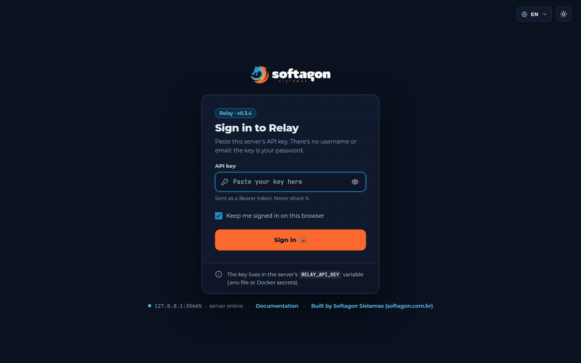

# Softagon Relay

**Connect your apps and local AI agents to WhatsApp without spinning up Chromium, Node.js, PostgreSQL, Redis, or external transcription APIs.**

Self-hosted WhatsApp Web gateway, embedded Web Console, and native local MCP Server in a single Rust container (~55 MB).

[](LICENSE)
[](https://github.com/SoftagonSistemas/whatsapp-gateway-relay-softagon/releases)
[](https://hub.docker.com/r/softagon/relay)

> **Docs:** [Português (BR)](docs/pt-BR/README.md) · [English](docs/en/README.md) · [Español](docs/es/README.md) · [Français](docs/fr/README.md) · [Changelog & Roadmap](CHANGELOG.md) · [Contributing](CONTRIBUTING.md) · [Security](SECURITY.md)

## Quick Start (One-Line Docker Run)

```bash
KEY="$(openssl rand -hex 32)" && echo "RELAY_API_KEY=$KEY" && docker run -d --name softagon-relay --restart unless-stopped -p 127.0.0.1:8080:8080 -v relay-data:/data -e RELAY_API_KEY="$KEY" softagon/relay:latest
```

> Binds to `127.0.0.1:8080` by default and generates a random 256-bit key. Known placeholder keys and keys shorter than 16 characters are rejected at startup.

Open **`http://localhost:8080/console`** (or `/manager`), paste the printed `RELAY_API_KEY`, type a phone number, and scan the live SVG QR code.



---

## What It Includes

- **Single container, zero external databases:** native Rust binary (Tokio + Axum) with embedded **SQLite (WAL)** — no PostgreSQL, Redis, RabbitMQ, or Chromium required.
- **Embedded Raycast-style Web Console (`/console`):** keyboard-first Vue 3 UI (`⌘K`/`Ctrl+K`), Light/Dark theme, 4 languages (`pt-BR`, `en`, `es`, `fr`), live SVG QR pairing, test messaging, webhook management, and live OpenAPI runner.
- **Native Local MCP Server (`v0.3.0`, `rmcp`):** connects local AI agents (Claude Desktop, Cursor, Antigravity, VS Code) directly to the internal `RelayService` without going through HTTP REST:
  - **STDIO** (default local mode): `softagon-relay mcp --stdio` (logs routed to `stderr`).
  - **Streamable HTTP**: `softagon-relay mcp --http` or `MCP_HTTP_ENABLED=true` — binds to `127.0.0.1` by default (Docker opt-in: `MCP_HTTP_HOST=0.0.0.0` + `MCP_ALLOW_CONTAINER_BIND=true` behind `-p 127.0.0.1:8091:8091`), `Origin` validation (anti-DNS rebinding), Bearer auth, destructive tools blocked by default, and SQLite audit log (`mcp_audit_log`).
- **Versioned HTTP API (`/v1`) + OpenAPI 3.2.1:** available at `/openapi.json`, `/openapi.yaml`, and `/docs` (Scalar).
- **Signed Webhooks (HMAC-SHA256):** persistent SQLite outbox with exponential backoff + jitter and stable UUIDv7 event IDs.
- **Offline Multilingual Voice-Note Transcription:** pure-Rust OGG/Opus decoding (`symphonia` + `symphonia-opus` + `rubato`, no FFmpeg) + `whisper.cpp` (lazy-loaded on demand and unloaded after idle timeout).
- **Pluggable Media Storage:** Local filesystem (`/data/media`) or S3-compatible object storage (AWS S3, Cloudflare R2, MinIO).

---

## Measured Resource Footprint (Real Scenarios)

Measured on **2026-11-25** against `softagon/relay:0.3.0` (`linux/amd64`, compiled with `--features whisper`) using `docker stats --no-stream` via [`scripts/monitor.sh`](scripts/monitor.sh) on Docker 29.1.3 / Linux (x86_64):

| Scenario | RAM | CPU | Notes |
|---|---:|---:|---|
| **Boot / Idle (0 paired sessions)** | ~4–5 MiB | ~0.05% | Measured right after container start, before pairing |
| **1 paired WhatsApp session (steady state)** | **~38 MiB** | **~0.1–0.2%** | Measured with 1 real WhatsApp account connected via WebSocket |
| **Active voice-note transcription (`whisper` base)** | **~212–338 MiB** | Burst | Model loads lazily on incoming voice note and unloads after `180s` idle (~100 MiB RSS after unload) |
| **Docker image size (`linux/amd64`)** | **~55 MB compressed (Docker Hub)** | — | Rust binary, Console SPA, SQLite, Opus decoder, `rmcp`, `whisper.cpp` |

> *Architecture note:* Prebuilt Docker images currently publish **`linux/amd64`**. Multi-arch **`linux/arm64`** support is tracked on our roadmap (you can also build locally on ARM64 with `docker build`).

---

## Local MCP Server (AI Agents)

- **Recommended when `softagon-relay` is already running in Docker:** enable **Streamable HTTP** inside the same container so a single process owns the WhatsApp WebSocket and SQLite database. Publish the port only on host loopback (`-p 127.0.0.1:8091:8091`) and opt in to container bind (`-e MCP_HTTP_ENABLED=true -e MCP_HTTP_HOST=0.0.0.0 -e MCP_ALLOW_CONTAINER_BIND=true`) — the MCP server still enforces loopback `Host` & `Origin` checks plus `Authorization: Bearer <RELAY_API_KEY>` at `http://127.0.0.1:8091/mcp`.
- **STDIO via Docker (safe default alongside a running server — reads SQLite without touching active WhatsApp sessions):**

```json
{
  "mcpServers": {
    "softagon-relay": {
      "command": "docker",
      "args": [
        "run", "-i", "--rm",
        "-v", "relay-data:/data",
        "-e", "RELAY_API_KEY",
        "softagon/relay:latest",
        "mcp", "--stdio"
      ],
      "env": {
        "RELAY_API_KEY": "<paste-your-generated-key>"
      }
    }
  }
}
```

> **Standalone STDIO (no `serve` container running):** add `"-e", "MCP_RESTORE_SESSIONS=true"` to `args` so STDIO reconnects your persisted WhatsApp sessions directly. Never set `MCP_RESTORE_SESSIONS=true` while another `softagon-relay` server is already connected to the same `/data` volume.

If you prefer running natively without Docker, prebuilt `linux-x86_64` binaries are attached to [GitHub Releases](https://github.com/SoftagonSistemas/whatsapp-gateway-relay-softagon/releases).

Tools exposed: `list_sessions`, `get_session_status`, `list_chats`, `search_messages`, `get_chat_messages`, `get_message_transcription`, `send_text_message`, and (disabled unless `MCP_ALLOW_DESTRUCTIVE=true` + `confirm: true`) `logout_session` / `delete_session`.

---

## Hardened Docker Compose

Use the repository's [compose.yaml](compose.yaml) (`read_only: true`, `cap_drop: ALL`, `no-new-privileges:true`, non-root UID `10001`).

```bash
cp .env.example .env
# Edit RELAY_API_KEY in .env
docker compose up -d
```

---

## Transparency on AI-Assisted Development

Softagon Relay was built using **AI-assisted software engineering** alongside human architecture decisions, code review, security design, and live testing against real WhatsApp accounts. All automated checks (`vue-tsc`, `vite build`, `cargo fmt`, `cargo clippy --all-targets -- -D warnings`, and integration tests covering REST, SQLite, webhooks, audio decoding, and MCP security) run locally before every push.

---

## Roadmap

- **Native Desktop App (Tauri — Windows, Linux & macOS):** bundle the Rust core, embedded Console, and local MCP Server with a system tray icon so desktop users do not need Docker.
- **Multi-arch `linux/arm64` Docker images** for Raspberry Pi, Apple Silicon, and ARM VPS servers.

If you need the Tauri Desktop edition, ARM64 images, or specific MCP tools, **[open a GitHub Issue](https://github.com/SoftagonSistemas/whatsapp-gateway-relay-softagon/issues/new)** and share your OS and use case!

---

## Disclaimer & License

Softagon Relay is an independent, unofficial open-source project built on [`whatsapp-rust`](https://github.com/oxidezap/whatsapp-rust) and is **not affiliated with, authorized by, or endorsed by Meta or WhatsApp**. Review Meta's Terms of Service, deploy behind TLS, and protect backups of `/data`.

Licensed under the **[Apache License, Version 2.0](LICENSE)** · Maintained by **[Softagon Sistemas](https://softagon.com.br)**.
