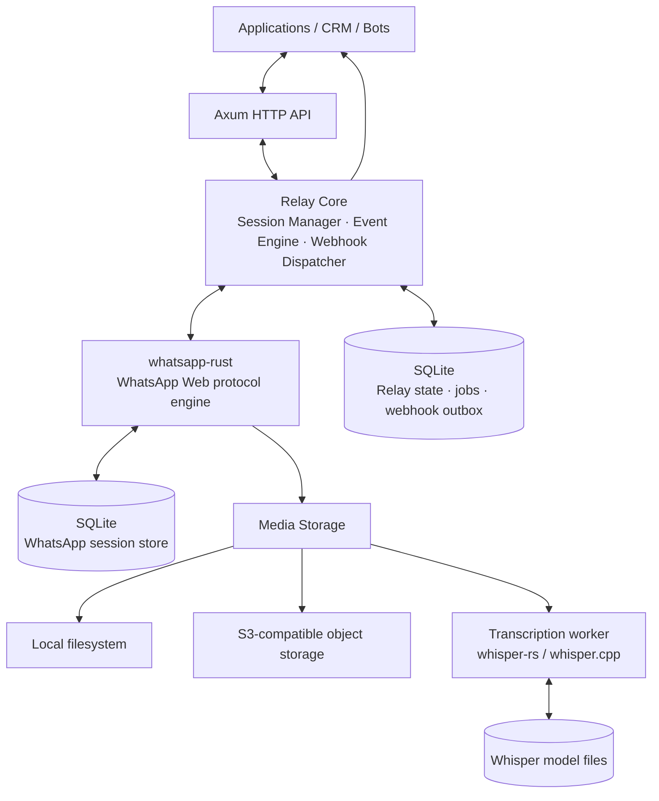

# Softagon Relay

**Open-source, self-hosted messaging gateway built with Rust.**

[](https://hub.docker.com/r/softagon/relay)
[](LICENSE)

- **Website:** <https://softagon.com.br> (by **Softagon Sistemas**)
- **Documentation:** [Português (BR)](docs/pt-BR/README.md) · [English](docs/en/README.md) · [Español](docs/es/README.md) · [Français](docs/fr/README.md)
- **Docker Hub:** <https://hub.docker.com/r/softagon/relay> (`docker pull softagon/relay:latest`)
- **Repository:** <https://github.com/SoftagonSistemas/whatsapp-gateway-relay-softagon>

Softagon Relay is a lightweight gateway designed to connect applications to WhatsApp Web through a versioned HTTP API, webhooks and persistent events. It is intended to run as a single Docker container, with SQLite as its embedded database, optional S3-compatible media storage and local speech-to-text processing.

> **Project status:** **v0.2.0** published on [Docker Hub](https://hub.docker.com/r/softagon/relay) with embedded Raycast-style Web Console (`/console`), SQLite WAL, Local/S3 media, signed webhooks, OpenAPI 3.2.1, and local Whisper transcription.

---

## Product principles

- **Slim by default:** no mandatory PostgreSQL, Redis, message broker or Python runtime.
- **Single-container deployment:** one application process, one persistent data volume and optional external object storage.
- **Local-first:** WhatsApp sessions, application state and the default transcription engine run on the host.
- **Multilingual transcription:** incoming voice messages can be transcribed locally using Whisper.
- **API-first:** the HTTP contract is described in OpenAPI before implementation details are exposed to consumers.
- **Replaceable components:** keep the WhatsApp engine, storage backend and transcription engine behind internal interfaces.
- **Build once, deploy many:** compile release images in CI or on a build machine; small production VPS instances should pull a prebuilt image.

## Architecture



### Runtime components

| Layer | Technology | Responsibility |
|---|---|---|
| Language | Rust (MSRV target: 1.94) | Main application and native integrations |
| Async runtime | Tokio 1.x | I/O, WebSockets, background tasks and timers |
| HTTP | Axum 0.8.x | REST API and health endpoints |
| WhatsApp engine | `whatsapp-rust` 0.7.x | Pairing, sessions, messages, media and protocol events |
| Application database | SQLite + SQLx 0.9.x | Sessions metadata, jobs, webhook outbox and application state |
| Protocol session storage | `whatsapp-rust` SQLite storage | Persistent WhatsApp protocol/session state |
| Speech-to-text | `whisper-rs` 0.16.x + `whisper.cpp` | Offline multilingual transcription |
| Audio decoding | Symphonia 0.6.x + `symphonia-opus` 0.1.x | OGG/Opus decoding without requiring FFmpeg in the default image |
| Resampling | Rubato 5.x | Convert decoded audio to the sample rate required by Whisper |
| Object storage | `object_store` 0.14.x | Local filesystem by default; S3 backend when configured |
| API contract | OpenAPI 3.2.1 | Machine-readable HTTP API specification |
| API documentation | Scalar | Interactive reference generated from the OpenAPI document |
| Deployment | Docker / Docker Compose | Single-container runtime and persistent volumes |

Version numbers above are the versions verified while preparing this blueprint on **2026-11-24**. Pin exact dependency versions in `Cargo.lock` and update them through tested dependency upgrades rather than relying on floating production builds.

## Why this stack?

### Rust + Tokio + Axum

Rust provides native binaries and explicit control over memory and CPU. Tokio supplies asynchronous I/O and task scheduling; Axum provides HTTP routing and integrates with the Tower middleware ecosystem.

- Rust: <https://www.rust-lang.org/>
- Tokio: <https://tokio.rs/> · <https://docs.rs/tokio/latest/tokio/>
- Axum: <https://github.com/tokio-rs/axum> · <https://docs.rs/axum/latest/axum/>

### WhatsApp engine: whatsapp-rust

Use `whatsapp-rust` as the initial protocol engine. Its published 0.7.0 documentation describes QR and pairing-code authentication, persistent sessions, encrypted one-to-one and group messaging, media, receipts, history sync and a replaceable storage/transport/runtime architecture. SQLite storage and Tokio transport are available in its default stack.

- Repository: <https://github.com/oxidezap/whatsapp-rust>
- Documentation: <https://whatsapp-rust.jlucaso.com/>
- Crate: <https://crates.io/crates/whatsapp-rust>
- API docs: <https://docs.rs/whatsapp-rust/latest/whatsapp_rust/>
- Release history: <https://github.com/oxidezap/whatsapp-rust/releases>

**Implementation rule:** isolate this dependency behind a Relay-owned `WhatsAppEngine` interface. Do not let `whatsapp-rust` types leak into the public REST contract or database schema. Keep the engine's protocol/session database separate from Relay's application database so that each component owns its schema and migrations.

The engine is an unofficial WhatsApp Web implementation, not the official WhatsApp Business Platform API. Using unofficial clients may violate Meta's terms and may result in account restrictions or suspension. Softagon Relay is not affiliated with, endorsed by or sponsored by Meta or WhatsApp. See the upstream disclaimer and Meta terms before deploying: <https://github.com/oxidezap/whatsapp-rust> · <https://www.whatsapp.com/legal/terms-of-service>.

### SQLite only — no PostgreSQL or Redis in V1

SQLite is the only required database. Use it for Relay application state, persistent jobs and webhook delivery state. Use the `whatsapp-rust` SQLite backend for protocol/session state.

Recommended files inside the persistent data directory:

```text
/data/
├── relay.db                 # Relay-owned application state
├── whatsapp-sessions.db     # WhatsApp engine-owned state (path to be wired)
├── models/                  # Downloaded speech models
├── media/                   # Local media when MEDIA_STORAGE=local
└── tmp/                     # Temporary decrypted/decoded media; clean up after use
```

Enable SQLite Write-Ahead Logging (WAL), configure a busy timeout and keep write transactions short. WAL allows readers and a writer to proceed concurrently, but SQLite still serializes writers. **Do not place a WAL database on NFS or another network filesystem**; the database must live on a local persistent volume on one host.

- SQLite: <https://www.sqlite.org/> 
- WAL behavior and limitations: <https://www.sqlite.org/wal.html>
- SQLx: <https://github.com/launchbadge/sqlx> · <https://docs.rs/sqlx/latest/sqlx/>

No Redis, PostgreSQL, RabbitMQ or NATS is required for the first release. Use SQLite-backed queues/outbox tables and bounded in-process workers. A future multi-node edition would require a different persistence and coordination design; it is explicitly out of scope for the slim V1.

### Optional S3-compatible media storage

Media storage must be abstracted from the WhatsApp engine and from the API. Use `object_store` as the storage interface:

- Default: local filesystem under `/data/media`.
- Optional: AWS S3 or an S3-compatible endpoint such as Cloudflare R2 or MinIO (validate each provider's endpoint and signing configuration in integration tests).
- Keep media bytes out of SQLite. Store object keys, MIME type, size, checksum, retention state and related message IDs in SQLite.
- Use private buckets by default. Generate short-lived presigned URLs only when an integration needs direct downloads.

`object_store` supports local filesystems and cloud object stores, including AWS S3. The S3 feature can be included in the build while the runtime continues to use local storage unless configured otherwise.

- Project: <https://github.com/apache/arrow-rs/tree/main/object_store>
- Crate and API: <https://crates.io/crates/object_store> · <https://docs.rs/object_store/latest/object_store/>
- S3 backend: <https://docs.rs/object_store/latest/object_store/aws/>

Proposed configuration:

```dotenv
MEDIA_STORAGE=local
MEDIA_LOCAL_PATH=/data/media

# Set MEDIA_STORAGE=s3 to activate the S3 backend.
S3_ENDPOINT_URL=
S3_REGION=auto
S3_BUCKET=
S3_ACCESS_KEY_ID=
S3_SECRET_ACCESS_KEY=
S3_PREFIX=softagon-relay/
```

Never commit credentials. Prefer an environment/secret manager in production. Do not make S3 mandatory for the gateway to start.

### Local multilingual transcription

V1 uses `whisper.cpp` through the Rust bindings `whisper-rs`. The default model is the multilingual **Whisper Base** model, not `base.en`, so the engine can detect and transcribe supported languages. Model loading is lazy: the model is downloaded to `/data/models` and loaded only when transcription is first needed. On an idle timeout, the worker may unload it to return memory to the system.

- `whisper.cpp`: <https://github.com/ggml-org/whisper.cpp>
- `whisper-rs` crate: <https://crates.io/crates/whisper-rs>
- `whisper-rs` documentation: <https://docs.rs/whisper-rs/latest/whisper_rs/>
- Maintained source repository: <https://codeberg.org/tazz4843/whisper-rs>
- `whisper-rs` repository migration notice: <https://github.com/tazz4843/whisper-rs>

The `whisper-rs` project was moved from GitHub to Codeberg; the published crate remains available on crates.io. The package metadata currently identifies version 0.16.0 and the Unlicense. Review the current crate and all transitive licenses when preparing a distribution.

#### Audio pipeline

WhatsApp voice notes commonly arrive as encrypted media that must first be downloaded and decrypted by the WhatsApp engine. The intended pipeline is:

1. Receive and persist the message event.
2. Download and decrypt the media through the WhatsApp engine.
3. Decode OGG/Opus to PCM using Symphonia and its Opus decoder.
4. Downmix to mono and resample to 16 kHz with Rubato.
5. Run Whisper in a dedicated blocking worker, outside Tokio's async executor.
6. Persist the result and publish `message.transcription.completed` or `message.transcription.failed`.
7. Delete temporary plaintext audio according to the configured retention policy.

Audio decoding references:

- Symphonia: <https://github.com/pdeljanov/Symphonia> · <https://docs.rs/symphonia/latest/symphonia/>
- Pure-Rust Opus decoder: <https://docs.rs/symphonia-opus/latest/symphonia_opus/>
- Rubato resampler: <https://docs.rs/rubato/latest/rubato/>

`symphonia-opus` 0.1.x is a newly published component as of this blueprint. Validate it against real WhatsApp voice-note samples (including mono/stereo, pre-skip, gain, truncated files and different Opus packet sizes) before calling the audio pipeline production-ready. Keep FFmpeg out of the default image unless compatibility tests show it is necessary.

#### Transcription contract

Transcription is asynchronous. Receiving a WhatsApp message must never wait for model inference. The public result should remain the same regardless of the selected model:

```json
{
  "status": "completed",
  "text": "Hello, how are you?",
  "language": "en",
  "engine": "whisper",
  "model": "base",
  "duration_ms": 5400,
  "processing_ms": 3200,
  "segments": [],
  "error": null
}
```

The numbers above are illustrative, not measured. Standard statuses: `queued`, `processing`, `completed`, `failed`, `unsupported`. The language value should use a stable language identifier; use automatic detection by default and allow a per-session language override.

#### Why Whisper Base for the small-server profile?

The upstream `whisper.cpp` README publishes the following approximate model-file sizes and memory use:

| Model | Model file on disk | Upstream memory reference |
|---|---:|---:|
| Tiny | 75 MiB | ~273 MB |
| Base | 142 MiB | ~388 MB |
| Small | 466 MiB | ~852 MB |
| Medium | 1.5 GiB | ~2.1 GB |
| Large | 2.9 GiB | ~3.9 GB |

Source: <https://github.com/ggml-org/whisper.cpp#memory-usage>.

These are upstream reference figures, not measurements of Softagon Relay. Actual process memory also includes the gateway, protocol session, buffers, decoder, runtime libraries and concurrent jobs. Quantized models may change memory and accuracy. Do not infer total VPS RAM usage from model-file size.

### OpenAPI 3.2.1 + Scalar

The API contract lives in `openapi/openapi.yaml` and is version-controlled with the source code. Use **OpenAPI 3.2.1** as the target specification. The specification defines a language-agnostic HTTP API contract that humans and tools can inspect without reverse-engineering the application.

- OpenAPI 3.2.1 specification: <https://spec.openapis.org/oas/v3.2.1.html>
- OpenAPI initiative: <https://www.openapis.org/>
- Scalar API Reference: <https://scalar.com/products/api-references/openapi>
- Scalar compatibility documentation: <https://scalar.com/products/api-references/openapi>

Scalar documents support for OpenAPI 3.2. The OpenAPI file should be the source of truth; do not assume that a Rust OpenAPI generator emits 3.2.1 correctly without validating the produced document. Add specification validation and a compatibility check to CI.

## V1 API shape

The following routes are the intended initial contract. They are a design proposal until implemented and described in `openapi/openapi.yaml`.

| Method | Endpoint | Purpose |
|---|---|---|
| `GET` | `/v1/health` | Liveness/readiness information |
| `GET` | `/v1/sessions` | List sessions |
| `POST` | `/v1/sessions` | Create a session |
| `GET` | `/v1/sessions/{session_id}` | Get session details |
| `GET` | `/v1/sessions/{session_id}/qr` | Obtain pairing QR data |
| `GET` | `/v1/sessions/{session_id}/status` | Connection state |
| `POST` | `/v1/sessions/{session_id}/logout` | Disconnect/logout |
| `POST` | `/v1/sessions/{session_id}/messages/text` | Send a text message |
| `POST` | `/v1/sessions/{session_id}/messages/media` | Send image, document, video or audio |
| `GET` | `/v1/messages/{message_id}` | Retrieve message state/details |
| `GET` | `/v1/messages/{message_id}/transcription` | Retrieve transcription result |
| `POST` | `/v1/messages/{message_id}/transcription` | Retry/request transcription |

### Webhook events

Initial event names:

- `session.status`
- `message.received`
- `message.sent`
- `message.ack`
- `message.transcription.completed`
- `message.transcription.failed`
- `group.updated`

Webhook delivery requirements:

- Persist delivery attempts in SQLite before dispatch.
- Sign payloads with HMAC-SHA256 and include a timestamp to help recipients reject replays.
- Retry transient failures with exponential backoff and jitter.
- Apply delivery timeouts and a bounded retry policy.
- Include a stable event ID so consumers can deduplicate deliveries.
- Document that delivery is **at least once**, not exactly once.

## Environment configuration

The following is the proposed `.env.example` contract. Keep defaults conservative; unknown or invalid values should fail fast with a clear configuration error.

```dotenv
# Application
APP_HOST=0.0.0.0
APP_PORT=8080
RUST_LOG=info
RELAY_API_KEY=change-this-before-starting
DATA_DIR=/data

# SQLite
RELAY_DATABASE_PATH=/data/relay.db
WHATSAPP_DATABASE_PATH=/data/whatsapp-sessions.db
SQLITE_BUSY_TIMEOUT_MS=5000
SQLITE_JOURNAL_MODE=wal

# Media storage: local | s3
MEDIA_STORAGE=local
MEDIA_LOCAL_PATH=/data/media

# S3-compatible storage (used only when MEDIA_STORAGE=s3)
S3_ENDPOINT_URL=
S3_REGION=auto
S3_BUCKET=
S3_ACCESS_KEY_ID=
S3_SECRET_ACCESS_KEY=
S3_PREFIX=softagon-relay/

# Transcription
TRANSCRIPTION_ENABLED=true
TRANSCRIPTION_ENGINE=whisper
TRANSCRIPTION_MODEL=base
TRANSCRIPTION_LANGUAGE=auto
TRANSCRIPTION_MODEL_DIR=/data/models
TRANSCRIPTION_PRELOAD=false
TRANSCRIPTION_IDLE_UNLOAD_SECONDS=180
TRANSCRIPTION_THREADS=1
TRANSCRIPTION_WORKERS=1
TRANSCRIPTION_MAX_QUEUE=20
TRANSCRIPTION_TIMEOUT_SECONDS=180

# Webhooks
WEBHOOK_DELIVERY_TIMEOUT_SECONDS=10
WEBHOOK_MAX_ATTEMPTS=8
WEBHOOK_BACKOFF_BASE_SECONDS=2
```

This environment block is the desired V1 contract, not a claim that every variable is already wired in code. Keep secrets in `.env` only for local development; use Docker secrets or the hosting platform's secret manager in production.

## Docker deployment

### Minimum deployment target

The first low-cost deployment profile targets:

- 1 vCPU
- 2 GB RAM
- 5 GB SSD
- Linux x86-64
- One Relay container and one persistent local volume
- Whisper Base, one transcription worker and one inference thread
- Lazy model loading; S3 recommended for media retention

This is a **sizing target to validate**, not a measured production guarantee. Under one vCPU, audio transcription can be slower than the duration of the original audio. Queueing is expected during bursts. Start with one transcription worker and measure memory, CPU and processing-time ratio before increasing concurrency.

### Build and run

The repository should contain a multi-stage Dockerfile and Compose definition. During development, after those files are implemented:

```bash
cp .env.example .env
# Edit .env and set a strong RELAY_API_KEY.
docker compose up -d --build

docker compose logs -f relay
```

For production, build and publish the image from CI or a machine with sufficient memory, then deploy the prebuilt image. Do **not** compile the full Rust/C++ dependency graph on a 1 vCPU / 2 GB VPS. The published docs.rs build for `whatsapp-rust` 0.7.0 used approximately 3.26 GB in its documentation-build environment; this is not runtime RAM, but it illustrates why the build host should be separate from the minimum runtime host.

Docker multi-stage build guidance: <https://docs.docker.com/build/building/multi-stage/>.

### Compose shape

A minimal Compose file should follow this pattern (image/build details can change during implementation):

```yaml
services:
  relay:
    build:
      context: .
      dockerfile: Dockerfile
    image: softagon/relay:dev
    container_name: softagon-relay
    restart: unless-stopped
    env_file:
      - .env
    ports:
      - "8080:8080"
    volumes:
      - relay-data:/data
    read_only: true
    tmpfs:
      - /tmp:size=128m,noexec,nosuid
    security_opt:
      - no-new-privileges:true
    cap_drop:
      - ALL

volumes:
  relay-data:
```

The final Dockerfile must explicitly provide writable `/data` and temporary directories, a non-root runtime user, CA certificates and any runtime libraries required by the compiled Whisper bindings. Verify compatibility of `read_only` and `tmpfs` with the final implementation before enforcing this Compose profile.

## Benchmark references and what they do (and do not) prove

Published upstream measurements are useful for planning, but they are not a substitute for benchmarking the complete Relay container.

| Component | Published result/reference | Interpretation |
|---|---|---|
| `whatsapp-rust` 0.7.0 | Release notes report about one-third fewer allocations per message round trip than 0.6.0. | Upstream internal improvement; not a throughput comparison against Baileys, whatsmeow or Softagon Relay. |
| `whatsapp-rust` 0.7.0 build | docs.rs reports a 3m 25s average successful build and an example documentation-build peak of about 3.26 GB. | Build/documentation environment only; not runtime memory. Build in CI, not on the minimum VPS. |
| `whisper.cpp` Tiny | ~75 MiB model file / ~273 MB memory. | Upstream approximate model reference. |
| `whisper.cpp` Base | ~142 MiB model file / ~388 MB memory. | Recommended starting point for the 2 GB low-cost profile; total Relay memory remains to be measured. |
| `whisper.cpp` Small | ~466 MiB model file / ~852 MB memory. | Higher resource profile; test before recommending on 2 GB hosts. |
| `whisper.cpp` Medium / Large | ~2.1 GB / ~3.9 GB memory reference. | Not suitable for the 2 GB baseline. |
| SQLite WAL | Readers do not block writers and writers do not block readers in normal WAL operation; there is still only one writer at a time. | Appropriate for a single-node embedded database, not a multi-host shared database. |

Sources:

- `whatsapp-rust` release notes: <https://github.com/oxidezap/whatsapp-rust/releases>
- `whatsapp-rust` docs.rs build information: <https://docs.rs/crate/whatsapp-rust/latest/builds>
- `whisper.cpp` model memory table: <https://github.com/ggml-org/whisper.cpp#memory-usage>
- SQLite WAL behavior: <https://www.sqlite.org/wal.html>

### Softagon Relay benchmark plan

Do not publish performance claims until these tests have been run against a tagged build and their hardware/software environment has been recorded.

| Test | Measurements to record |
|---|---|
| Idle container | RSS, CPU, disk footprint, open file descriptors |
| 1 / 10 / 50 sessions | RSS per session, CPU, reconnect behavior, stability |
| Message burst | messages/second, queue depth, p50/p95 latency, failures |
| Webhook delivery | throughput, retry behavior, duplicate delivery handling |
| Whisper Base | peak RSS, CPU time, audio duration, processing-time/audio-time ratio |
| Media upload/download | throughput, temporary disk use, S3 latency and retries |
| 24-hour soak | memory growth, dropped events, reconnects, SQLite errors |
| Restart recovery | pending jobs, webhook outbox, sessions and media consistency |

Always record CPU model, virtualization type, RAM limit, disk type, kernel, Docker version, image digest, Rust version, dependency lockfile and Whisper model checksum.

## Security and operational requirements

- Require an API key at startup; never run with a known example key in production.
- Support TLS through a reverse proxy or a trusted ingress. Do not expose the API directly to the public internet without TLS and rate limiting.
- Store WhatsApp session databases as secrets: restrict volume permissions and encrypt backups.
- Keep S3 buckets private and use least-privilege credentials.
- Sign webhooks and make consumers deduplicate by event ID.
- Apply upload size limits, timeouts, queue limits and per-session rate limits.
- Avoid logging message contents, phone numbers, access tokens or decrypted media by default.
- Remove temporary decrypted audio after transcription unless an explicit retention policy says otherwise.
- Back up SQLite using a SQLite-aware backup mechanism; do not copy a live database file without accounting for WAL state.
- Pin dependencies with `Cargo.lock`, scan dependencies and review upstream release notes before upgrades.

## Proposed repository layout

```text
softagon-relay/
├── Cargo.toml
├── Cargo.lock
├── rust-toolchain.toml
├── Dockerfile
├── compose.yaml
├── .dockerignore
├── .env.example
├── openapi/
│   └── openapi.yaml
├── migrations/
├── src/
│   ├── main.rs
│   ├── config/
│   ├── api/
│   ├── core/
│   │   ├── sessions/
│   │   ├── events/
│   │   ├── webhooks/
│   │   └── queue/
│   ├── engines/
│   │   └── whatsapp/
│   ├── storage/
│   │   ├── database/
│   │   └── media/
│   └── transcription/
│       ├── audio/
│       ├── whisper/
│       └── worker/
├── tests/
│   ├── api/
│   ├── whatsapp/
│   ├── transcription/
│   └── storage/
└── benches/
```

## Initial implementation milestones

1. **Foundation:** Rust workspace, configuration validation, structured logs, Axum health endpoint, Docker multi-stage build and CI image build.
2. **WhatsApp engine:** pair one device, persist session, reconnect after restart, receive and send text, upload/download media.
3. **API contract:** write and validate `openapi/openapi.yaml` as OpenAPI 3.2.1; expose the first session and message routes; publish Scalar documentation.
4. **Reliability:** SQLite migrations, event IDs, persistent webhook outbox, retry/backoff, HMAC signatures and idempotent send requests.
5. **Transcription:** decode actual WhatsApp OGG/Opus voice notes, resample to mono 16 kHz, load Whisper Base lazily, persist the transcription and emit webhook events.
6. **Storage:** local media backend first; optional S3-compatible backend and integration tests second.
7. **Validation:** run the benchmark plan on the 1 vCPU / 2 GB / 5 GB target before publishing minimum hardware claims.

## License

Recommended project license: **Apache-2.0**. Add the repository's `LICENSE` file before the first public release and preserve all third-party license notices. Dependencies and model files retain their own licenses; review them independently. In particular, `whisper-rs` 0.16.0 identifies the Unlicense, `whatsapp-rust` identifies MIT, and Whisper model weights must be reviewed according to their upstream distribution terms.

## Disclaimer

Softagon Relay is an independent, unofficial project. WhatsApp and Meta are trademarks of their respective owners. Softagon Relay is not affiliated with, authorized by, or endorsed by Meta or WhatsApp. The protocol engine may be subject to changes, limitations or enforcement by the platform. Review applicable terms, laws and privacy requirements before using it with real accounts or personal data.
