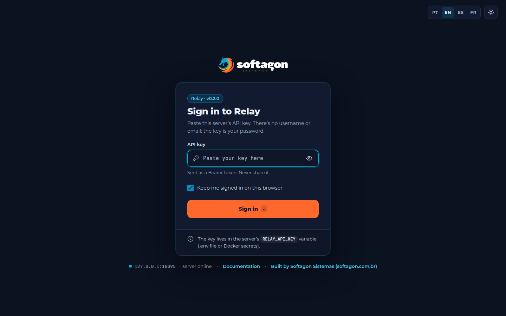
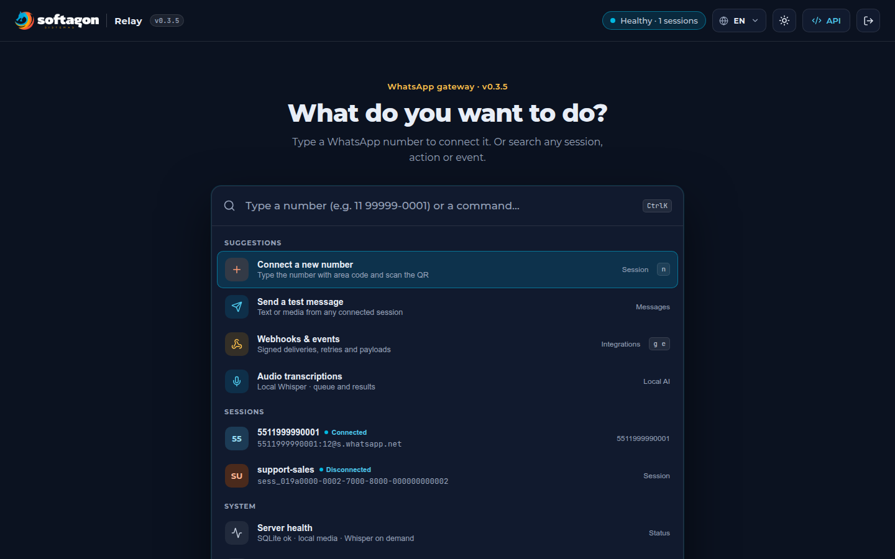
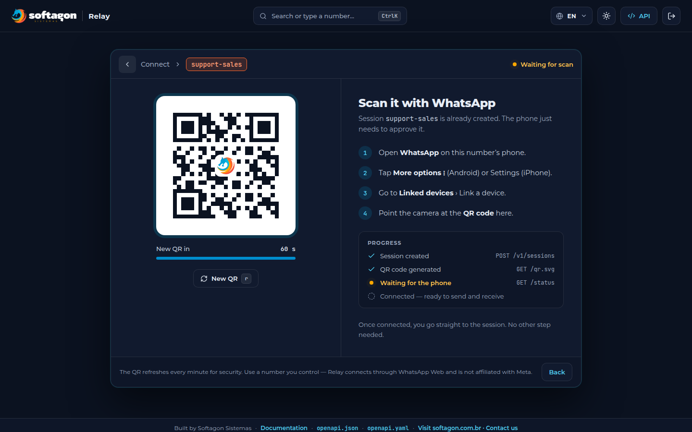
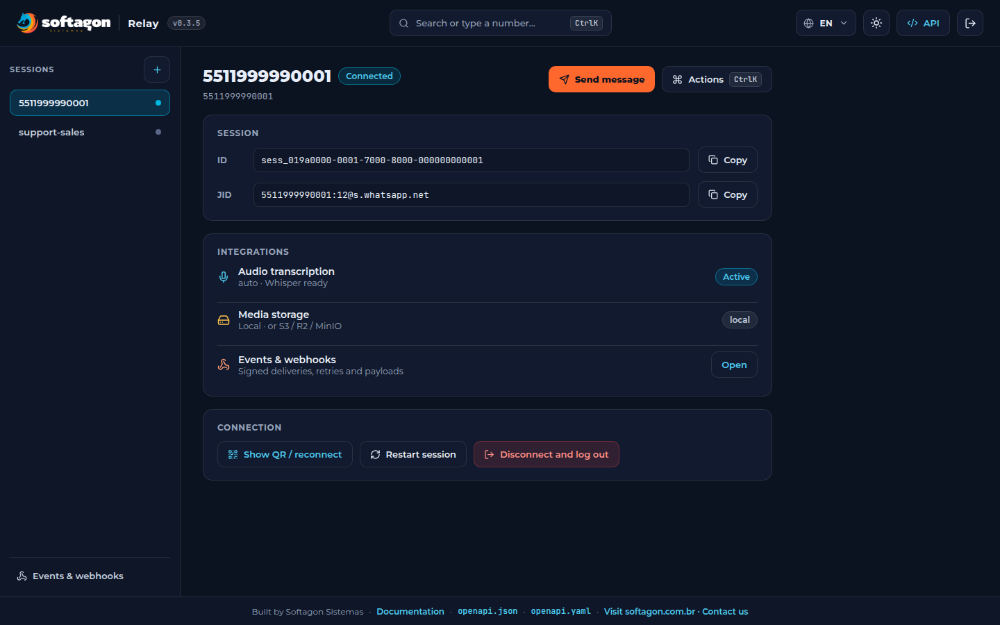
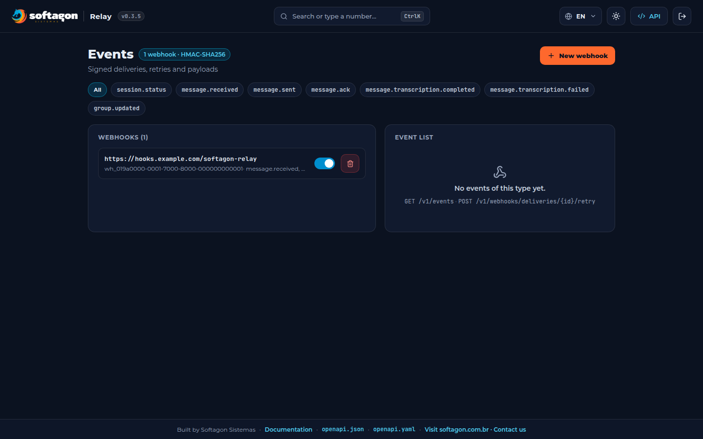
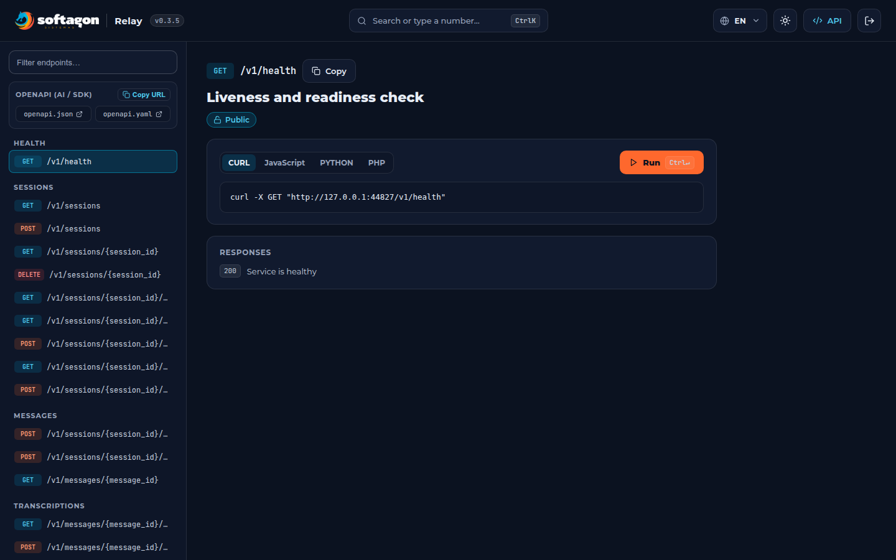

# Dokumentasi Resmi — Softagon Relay (Hata Batak Toba)

> Hata: [Português (BR)](../pt-BR/README.md) · [English](../en/README.md) · [Español](../es/README.md) · [Français](../fr/README.md) · [Bahasa Indonesia](../id/README.md) · [Basa Betawi](../bew/README.md) · [Basa Sunda](../su/README.md) · [Basa Jawa](../jv/README.md) · **Hata Batak Toba** · [Bahasa Melayu](../ms/README.md)

**Aha do Softagon Relay?**  
**Softagon Relay** i ma **gateway HTTP API WhatsApp Web** open-source jala self-hosted na dibahen marhite **Rust** sian **[Softagon Sistemas](https://softagon.com.br)**. Mardalan di **sada container Docker (~55 MB)** rap dohot **SQLite (WAL)** di bagasanna, **Konsol Web gaya Raycast** di `/console`, panyimpanan media **Lokal manang S3/R2/MinIO**, **webhook martanda tangan HMAC-SHA256**, **OpenAPI 3.2.1**, dohot **transkripsi tona soara multibahasa offline** marhite `whisper.cpp`.

- **Situs Resmi & Kontak:** <https://softagon.com.br>
- **Docker Hub:** <https://hub.docker.com/r/softagon/relay> (`softagon/relay:latest`)
- **Kode Sumber (GitHub):** <https://github.com/SoftagonSistemas/whatsapp-gateway-relay-softagon>
- **Changelog & Roadmap:** [CHANGELOG.md](../../CHANGELOG.md) *(dohot rencana **aplikasi Desktop Tauri** tu Windows, Linux & macOS — [buka Issue](https://github.com/SoftagonSistemas/whatsapp-gateway-relay-softagon/issues/new) molo porlu!)*
- **Lisensi:** Apache-2.0

---

## 1. Mulai Hatop (Docker)

```bash
KEY="$(openssl rand -hex 32)" && echo "RELAY_API_KEY=$KEY" && docker run -d \
  --name softagon-relay \
  --restart unless-stopped \
  -p 127.0.0.1:8080:8080 \
  -v relay-data:/data \
  -e RELAY_API_KEY="$KEY" \
  softagon/relay:latest
```

Buka **Konsol Web** di `http://localhost:8080/console` (manang `/manager`, na dialihon otomatis) dung i pamasuk `RELAY_API_KEY`-mu.

### Docker Compose na Aman
Pakke [compose.yaml](../../compose.yaml) sian repositori (`read_only: true`, `cap_drop: ALL`, `no-new-privileges:true`, UID non-root `10001`).

---

## 2. Panduan Visual Konsol Web (`/console`)

Konsol Web dibahen marhite tata letak keyboard-first **gaya Raycast**, boi mangganti hata pintor (**10 hata:** `PT / EN / ES / FR / ID / BEW / SU / JV / BTK / MS`) dohot tema **Tiur / Holom**.

### 2.1 Masuk (`/console/login`)
Pamasuk holan kunci na diatur di `RELAY_API_KEY` (ndang porlu goar pangke manang email). Kunci ditongos songon token `Bearer` jala boi disimpan di browsermu.



### 2.2 Beranda & Bilah Parenta (`/console`)
Pariksa hahipason server langsung (`Hipas · N sesi`), buka daftar sesi marhite sada klik, manang ketik nomor WhatsApp dung i tekan `↵` laho mamulai pahubungkon.



### 2.3 Pahubung Nomor na Imbaru marhite Kode QR (`/console/connect`)
Dung sesi dibahen, kode QR SVG pintor tarida rap dohot hitungan mundur otomatis (tekan `r` laho mambahen muse). Di HP-mu, buka **WhatsApp → Perangkat tertaut → Tautkan perangkat** dung i scan. Perangkat tarida gabe **Softagon Relay**.



### 2.4 Manajemen Sesi & Tona Uji (`/console/sessions`)
Atur sasude akun WhatsApp na terhubung di sada inganan:
- Salin **ID** dohot **JID** sesi marhite sada klik.
- Klik **Tongos tona** laho manongos tona uji langsung dohot validasi nomor internasional.
- Buka **Aksi (`⌘K` / `Ctrl+K`)** laho mamulai muse, pahubungkon muse, kaluar, manang **manesa sesi na putus**.



### 2.5 Event & Webhook (`/console/events`)
Daftarkon URL webhook laho manjalo event sacara real-time (`message.received`, `message.sent`, `message.ack`, `session.status`, `message.transcription.completed`, `group.updated`). Relay otomatis mambahen secret HMAC-SHA256.



### 2.6 Referensi API Interaktif (`/console/api`)
Dibahen langsung sian `/openapi.yaml` (adong do muse di **`/openapi.json`** tu agen AI, n8n, Postman, dohot SDK). Saring endpoint, salin umpama **cURL, JavaScript, Python, dohot PHP**, dung i dalanhon langsung (`⌘↵` / `Ctrl+↵`).



### Pintasan Keyboard
| Pintasan | Aksi |
|---|---|
| `⌘K` / `Ctrl+K` | Buka bilah parenta manang panel aksi sesi |
| `/` | Fokus panluluion |
| `n` | Pahubung nomor na imbaru |
| `g` dung i `s` / `e` / `a` | Buka Sesi / Event / API |
| `r` | Bahen muse Kode QR di layar Pahubung |
| `?` | Patuduhon daftar pintasan |

---

## 3. API HTTP (`/v1`) & Autentikasi

Sasude rute `/v1/*` (ndang dohot `GET /v1/health` na publik) porlu:

```http
Authorization: Bearer <RELAY_API_KEY>
```

| Metode | Endpoint | Guna |
|---|---|---|
| `GET` | `/v1/health` | Pariksa hahipason server (publik) |
| `GET` / `POST` | `/v1/sessions` | Daftar manang bahen sesi |
| `GET` / `DELETE` | `/v1/sessions/{id}` | Detail manang sesa sesi putus (`409` molo terhubung) |
| `GET` | `/v1/sessions/{id}/qr` · `/qr.svg` | Payload QR tautan (JSON manang SVG) |
| `GET` | `/v1/sessions/{id}/status` | Status sambungan langsung |
| `POST` | `/v1/sessions/{id}/reconnect` | Mulai muse dohot siklus QR na imbaru |
| `POST` | `/v1/sessions/{id}/logout` | Putushon tautan perangkat WhatsApp |
| `POST` | `/v1/sessions/{id}/messages/text` | Tongos teks (mandukung `Idempotency-Key`) |
| `POST` | `/v1/sessions/{id}/messages/media` | Tongos gambar, video, audio, manang dokumen |
| `GET` | `/v1/messages/{id}` | Buat status & metadata tona |
| `GET` / `POST` | `/v1/messages/{id}/transcription` | Buat manang uji muse transkripsi Whisper |
| `GET` / `POST` | `/v1/webhooks` | Daftar manang bahen langganan webhook |
| `GET` / `PATCH` / `DELETE` | `/v1/webhooks/{id}` | Pariksa, pauba, manang sesa webhook |

---

## 4. Webhook Martanda Tangan (HMAC-SHA256)

Event: `session.status`, `message.received`, `message.sent`, `message.ack`, `message.transcription.completed`, `message.transcription.failed`, `group.updated`.

Header di ganup panongosan (**at-least-once** dohot exponential backoff + jitter):
- `X-Relay-Event-Id`: ID event UUIDv7 stabil laho deduplikasi
- `X-Relay-Event-Type`: goar ni event
- `X-Relay-Timestamp`: timestamp Unix di detik
- `X-Relay-Signature`: `sha256=<hex(HMAC-SHA256(secret, "{timestamp}.{raw_body}"))>`

---

## 5. Transkripsi Lokal (Whisper) & Panyimpanan S3

- **Tona Soara:** didekode murni di Rust (Symphonia + `symphonia-opus` + Rubato 16 kHz mono, ndang porlu FFmpeg) jala ditranskripsi lokal marhite `whisper.cpp` (model `base` multibahasa).
- **S3 / R2 / MinIO:** atur `MEDIA_STORAGE=s3`, `S3_BUCKET`, `S3_ACCESS_KEY_ID`, `S3_SECRET_ACCESS_KEY`, dohot `S3_ENDPOINT_URL`.

---

## 6. Server MCP Lokal tu Agen AI (`v0.3.0`)

Softagon Relay adong **MCP Server (Model Context Protocol)** Rust native marhite `rmcp`:

- **STDIO (mode lokal default):** dalanhon `softagon-relay mcp --stdio`. Sasude log dituju tu `stderr` asa `stdout` ias tu JSON-RPC.
- **Streamable HTTP:** dalanhon `softagon-relay mcp --http` manang aktifhon `MCP_HTTP_ENABLED=true` (bind tu `127.0.0.1:8091/mcp`; di Docker atur `MCP_HTTP_HOST=0.0.0.0` + `MCP_ALLOW_CONTAINER_BIND=true`).
- **Tools:** `list_sessions`, `get_session_status`, `list_chats`, `search_messages`, `get_chat_messages`, `get_message_transcription`, `send_text_message`, dohot `logout_session` / `delete_session` (**nonaktif sacara default** molo so `MCP_ALLOW_DESTRUCTIVE=true` + `confirm: true`).
- **Catatan audit:** ganup pamanggilan tool MCP dicatat tu `mcp_audit_log` di SQLite.

```json
{
  "mcpServers": {
    "softagon-relay": {
      "command": "docker",
      "args": [
        "run", "-i", "--rm",
        "-v", "relay-data:/data",
        "-e", "RELAY_API_KEY",
        "softagon/relay:latest",
        "mcp", "--stdio"
      ],
      "env": {
        "RELAY_API_KEY": "<tempel-kuncimu>"
      }
    }
  }
}
```

---

## 7. Pangurupion & Kontak

Porlu pangurupion khusus, integrasi kustom, manang rekayasa AI & WhatsApp?  
Buka **[softagon.com.br](https://softagon.com.br)** jala hubungi tim **Softagon Sistemas**.
