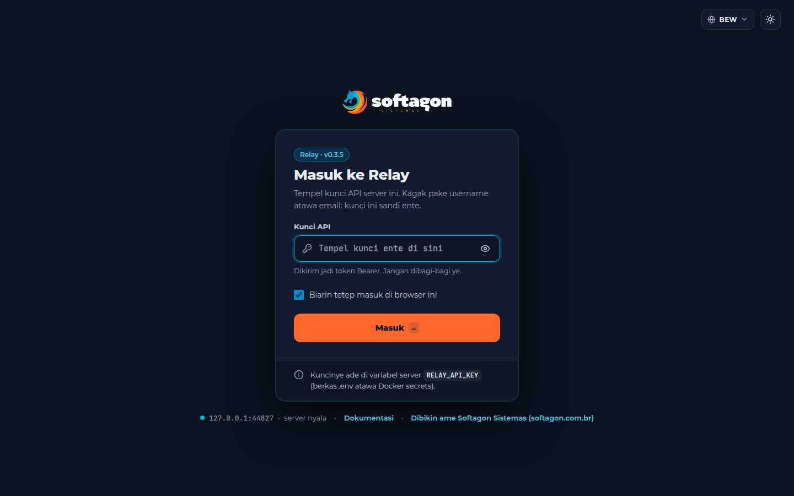
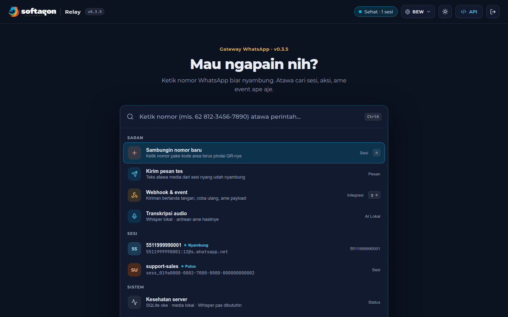
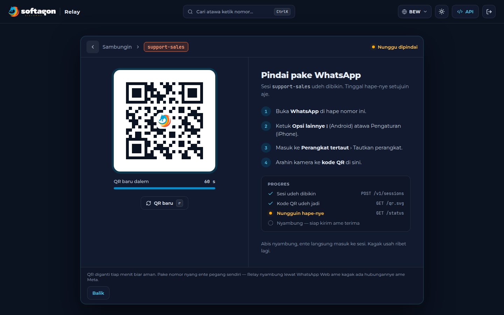
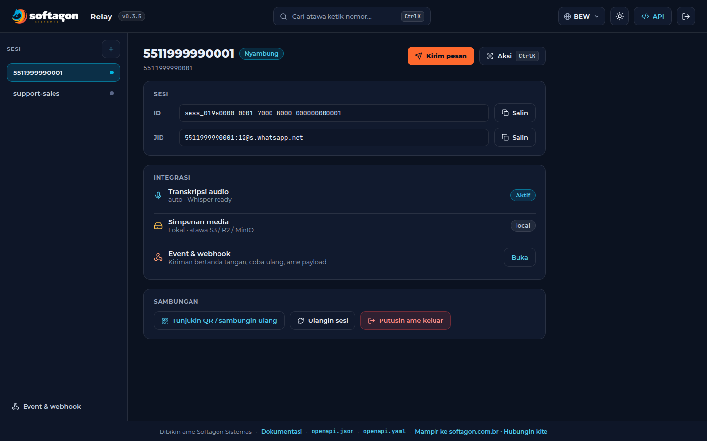
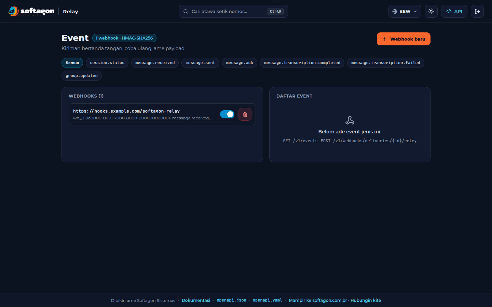
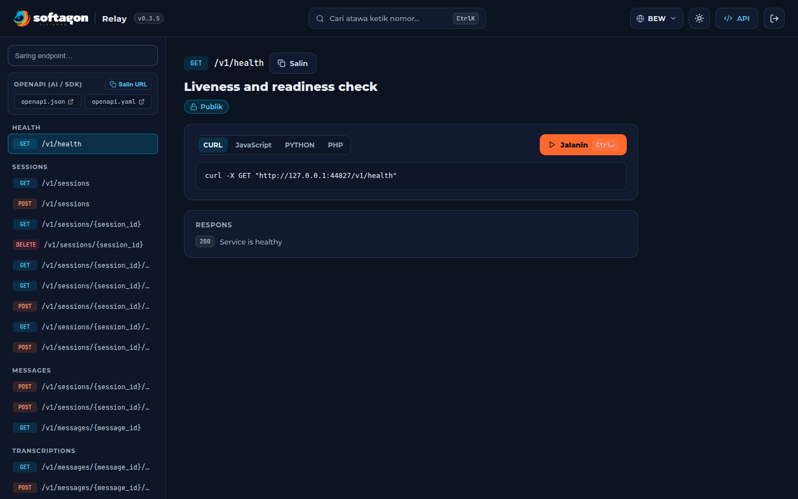

# Dokumentasi Resmi — Softagon Relay (Basa Betawi)

> Basa: [Português (BR)](../pt-BR/README.md) · [English](../en/README.md) · [Español](../es/README.md) · [Français](../fr/README.md) · [Bahasa Indonesia](../id/README.md) · **Basa Betawi** · [Basa Sunda](../su/README.md) · [Basa Jawa](../jv/README.md) · [Hata Batak Toba](../bbc/README.md) · [Bahasa Melayu](../ms/README.md)

**Ape tuh Softagon Relay?**  
**Softagon Relay** entu **gateway HTTP API WhatsApp Web** open-source nyang bisa dijalanin sendiri (self-hosted), dibikin pake **Rust** ame **[Softagon Sistemas](https://softagon.com.br)**. Jalan cukup pake **satu container Docker (~55 MB)** udeh ame **SQLite (WAL)** di dalemnye, **Konsol Web gaya Raycast** di `/console`, simpenan media **Lokal atawa S3/R2/MinIO**, **webhook bertanda tangan HMAC-SHA256**, **OpenAPI 3.2.1**, ame **transkripsi pesan suara multibasa offline** pake `whisper.cpp`.

- **Situs Resmi & Kontak:** <https://softagon.com.br>
- **Docker Hub:** <https://hub.docker.com/r/softagon/relay> (`softagon/relay:latest`)
- **Kode Sumber (GitHub):** <https://github.com/SoftagonSistemas/whatsapp-gateway-relay-softagon>
- **Changelog & Roadmap:** [CHANGELOG.md](../../CHANGELOG.md) *(termasuk rencana **aplikasi Desktop Tauri** buat Windows, Linux & macOS — [buka Issue](https://github.com/SoftagonSistemas/whatsapp-gateway-relay-softagon/issues/new) kalo ente butuh!)*
- **Lisensi:** Apache-2.0

---

## 1. Mulai Cepet (Docker)

```bash
KEY="$(openssl rand -hex 32)" && echo "RELAY_API_KEY=$KEY" && docker run -d \
  --name softagon-relay \
  --restart unless-stopped \
  -p 127.0.0.1:8080:8080 \
  -v relay-data:/data \
  -e RELAY_API_KEY="$KEY" \
  softagon/relay:latest
```

Buka **Konsol Web** di `http://localhost:8080/console` (atawa `/manager`, langsung dialihin otomatis) terus masukin `RELAY_API_KEY` ente.

### Docker Compose nyang Aman
Pake [compose.yaml](../../compose.yaml) dari repositori (`read_only: true`, `cap_drop: ALL`, `no-new-privileges:true`, UID non-root `10001`).

---

## 2. Panduan Visual Konsol Web (`/console`)

Konsol Web bawaannye dibikin pake tampilan keyboard-first **gaya Raycast**, bisa ganti basa langsung (**10 basa:** `PT / EN / ES / FR / ID / BEW / SU / JV / BTK / MS`) ame tema **Terang / Gelap**.

### 2.1 Masuk (`/console/login`)
Masukin kunci nyang udeh diatur di `RELAY_API_KEY` aje (kagak perlu username atawa email). Kuncinye dikirim jadi token `Bearer` ame bisa disimpen di browser ente.



### 2.2 Beranda & Bilah Perintah (`/console`)
Cek kesehatan server langsung (`Sehat · N sesi`), buka daftar sesi sekali klik, atawa ketik nomor WhatsApp terus pencet `↵` biar langsung mulai nyambungin.



### 2.3 Sambungin Nomor Baru lewat Kode QR (`/console/connect`)
Begitu sesi dibikin, kode QR SVG langsung nongol pake itungan mundur pembaruan otomatis (pencet `r` buat bikin baru langsung). Di hape ente, buka **WhatsApp → Perangkat tertaut → Tautkan perangkat** terus pindai. Perangkatnye bakal nongol pake nama **Softagon Relay**.



### 2.4 Kelola Sesi & Kirim Pesan Tes (`/console/sessions`)
Urus semua akun WhatsApp nyang nyambung di satu tempat:
- Salin **ID** ame **JID** sesi sekali klik.
- Klik **Kirim pesan** buat kirim pesan tes langsung pake validasi nomor internasional ame resolusi otomatis digit hape buat Brasil, Meksiko, ame Argentina (BR/MX/AR).
- Buka **Aksi (`⌘K` / `Ctrl+K`)** buat ngulang sesi, sambungin ulang, keluar, atawa **hapus sesi nyang udeh putus** (sesi nyang masih nyambung dilindungin biar kagak kehapus kagak sengaja).



### 2.5 Event & Webhook (`/console/events`)
Daftarin URL webhook biar dapet event secara langsung (`message.received`, `message.sent`, `message.ack`, `session.status`, `message.transcription.completed`, `group.updated`). Relay otomatis bikin secret HMAC-SHA256 ame gampang buat matiin atawa hapus langganan.



### 2.6 Referensi API Interaktif (`/console/api`)
Dibikin langsung dari `/openapi.yaml` (ade juga di **`/openapi.json`** buat nyambung ke agen AI, n8n, Postman, ame SDK). Saring endpoint, salin contoh **cURL, JavaScript, Python, ame PHP**, terus jalanin langsung (`⌘↵` / `Ctrl+↵`).



### Pintasan Keyboard
| Pintasan | Aksi |
|---|---|
| `⌘K` / `Ctrl+K` | Buka bilah perintah atawa panel aksi sesi |
| `/` | Fokus pencarian |
| `n` | Sambungin nomor baru |
| `g` lalu `s` / `e` / `a` | Buka Sesi / Event / API |
| `r` | Bikin ulang Kode QR di layar Sambungin |
| `?` | Tunjukin daftar pintasan |

---

## 3. API HTTP (`/v1`) & Autentikasi

Semua rute `/v1/*` (kecuali `GET /v1/health` nyang publik) perlu header:

```http
Authorization: Bearer <RELAY_API_KEY>
```

| Metode | Endpoint | Guna |
|---|---|---|
| `GET` | `/v1/health` | Cek server hidup/siap (publik) |
| `GET` / `POST` | `/v1/sessions` | Lihat daftar atawa bikin sesi |
| `GET` / `DELETE` | `/v1/sessions/{id}` | Detail atawa hapus sesi putus (`409` kalo masih nyambung) |
| `GET` | `/v1/sessions/{id}/qr` · `/qr.svg` | Payload QR tautan (JSON atawa SVG) |
| `GET` | `/v1/sessions/{id}/status` | Status sambungan langsung |
| `POST` | `/v1/sessions/{id}/reconnect` | Ulangin sesi ame mulai siklus QR baru |
| `POST` | `/v1/sessions/{id}/logout` | Putusin tautan perangkat WhatsApp |
| `POST` | `/v1/sessions/{id}/messages/text` | Kirim teks (dukung `Idempotency-Key`) |
| `POST` | `/v1/sessions/{id}/messages/media` | Kirim gambar, video, audio, atawa dokumen |
| `GET` | `/v1/messages/{id}` | Ambil status & metadata pesan |
| `GET` / `POST` | `/v1/messages/{id}/transcription` | Ambil atawa ulangin transkripsi Whisper |
| `GET` / `POST` | `/v1/webhooks` | Daftar atawa bikin langganan webhook |
| `GET` / `PATCH` / `DELETE` | `/v1/webhooks/{id}` | Cek, ubah, atawa hapus webhook |

---

## 4. Webhook Bertanda Tangan (HMAC-SHA256)

Event: `session.status`, `message.received`, `message.sent`, `message.ack`, `message.transcription.completed`, `message.transcription.failed`, `group.updated`.

Header di tiap kiriman (**at-least-once** pake exponential backoff + jitter):
- `X-Relay-Event-Id`: ID event UUIDv7 stabil biar kagak dobel
- `X-Relay-Event-Type`: nama event
- `X-Relay-Timestamp`: timestamp Unix dalem detik
- `X-Relay-Signature`: `sha256=<hex(HMAC-SHA256(secret, "{timestamp}.{raw_body}"))>`

---

## 5. Transkripsi Lokal (Whisper) & Simpenan S3

- **Pesan Suara:** didekode murni pake Rust (Symphonia + `symphonia-opus` + Rubato 16 kHz mono, kagak butuh FFmpeg) terus ditranskripsi lokal pake `whisper.cpp` (model `base` multibasa).
- **S3 / R2 / MinIO:** atur `MEDIA_STORAGE=s3`, `S3_BUCKET`, `S3_ACCESS_KEY_ID`, `S3_SECRET_ACCESS_KEY`, ame `S3_ENDPOINT_URL`.

---

## 6. Server MCP Lokal buat Agen AI (`v0.3.0`)

Softagon Relay udeh bawa **MCP Server (Model Context Protocol)** Rust native pake `rmcp`, manggil `RelayService` langsung:

- **STDIO (mode lokal bawaan):** jalanin `softagon-relay mcp --stdio`. Semua log masuk ke `stderr` biar `stdout` bersih buat JSON-RPC.
- **Streamable HTTP:** jalanin `softagon-relay mcp --http` atawa nyalain `MCP_HTTP_ENABLED=true` (bind ke `127.0.0.1:8091/mcp`; di Docker tambahin `MCP_HTTP_HOST=0.0.0.0` + `MCP_ALLOW_CONTAINER_BIND=true`).
- **Tools:** `list_sessions`, `get_session_status`, `list_chats`, `search_messages`, `get_chat_messages`, `get_message_transcription`, `send_text_message`, ame `logout_session` / `delete_session` (**mati secara bawaan** kecuali `MCP_ALLOW_DESTRUCTIVE=true` + `confirm: true`).
- **Audit:** semua panggilan tool MCP dicatet ke `mcp_audit_log` di SQLite.

```json
{
  "mcpServers": {
    "softagon-relay": {
      "command": "docker",
      "args": [
        "run", "-i", "--rm",
        "-v", "relay-data:/data",
        "-e", "RELAY_API_KEY",
        "softagon/relay:latest",
        "mcp", "--stdio"
      ],
      "env": {
        "RELAY_API_KEY": "<tempel-kunci-ente>"
      }
    }
  }
}
```

### 6.2 Grok Bot, Sambungin Tanpa Login & Fitur Agen (`v0.3.8`)

- **Paket Siap Pake Grok Bot:** langsung tambahin 1 klik lewat **[Masukin ke Grok Bot](https://x.ai/bot/Xe4LpCGaepuE-J2BYH363)** atawa liat [`docs/grok-bot.md`](../grok-bot.md) ame [`integrations/grok-bot/TEMPLATE.md`](../../integrations/grok-bot/TEMPLATE.md) buat pasang biner lokal di `/workspace/softagon-relay`.
- **Link Pairing Sementara (`/pair/{token}`):** `POST /v1/sessions/{id}/pair-link` (atawa MCP `create_pairing_link`) buka **QR Code** langsung tanpa login `RELAY_API_KEY`, otomatis bikin QR baru ampe 10 menit, plus ada `qr.png` ame **kode 8 digit** (`POST /v1/sessions/{id}/pair-code`).
- **Webhook Bearer & Header Bebas:** tambahin `bearer_token` atawa `auth_header_name`/`auth_header_value` pas bikin/ubah webhook. Kalo kena `401`/`403`, langsung berenti nyoba ulang.
- **Konteks Obrolan Komplit:** ada `sender_name`, `sender_phone` (termasuk kontak `@lid`), balesan tim dari HP (`from_me: true`, `source: "device_sync"`), waktu asli tanpa spam webhook pas `is_history_sync`, plus `sticker`, `reaction`, `location`, ame `contact`.
- **Alat MCP & REST Lengkap (`v0.4.0`–`v0.4.4`):** `reply_to_message_id`, `send_reaction`, `send_chat_presence`, `subscribe_presence`, `as_voice_note` (PTT), `sticker`, `send_location`, `send_contact`, `edit_message`, `revoke_message`, buku kontak persisten (`list_contacts`, `save_contact`, `sync_contacts` ame sinkronisasi otomatis buku kontak HP), `check_whatsapp`, `get_profile_picture`, `list_groups`, `get_group_info`, `GET /v1/media/{media_id}`, `MEDIA_RETENTION_DAYS`, `softagon-relay backup`, metrik Prometheus `GET /v1/metrics`, peringatan `session.disconnected`, migrasi otomatis riwayat `@lid`, fallback SQLite `quoted.text`, ame gabungin pesan beruntun `WEBHOOK_COALESCE_SECONDS` (default global `0`; `4s` di kit Grok Bot).

---

## 7. Benchmark Produksi Asli (Uji 8 Jam Nonstop)

Diukur di produksi beneran (**2026-11-27/28**, 16 kali cek tiap 30 menit, `linux/amd64`, `--features whisper`, 1 akun WhatsApp aktif):

| Indikator | Hasil Uji (8 Jam Nonstop) |
|---|---|
| **RAM pas stabil** | **31,7–32,1 MiB** (kaga ada memori bocor abis 8 jam) |
| **RAM puncak (Whisper `base` jalan)** | **286,4 MiB**, otomatis turun lagi ke **~32 MiB** pas nganggur |
| **Rata-rata CPU** | **0,04%–0,19%** |
| **Webhook kekirim (Bearer + HMAC)** | **1.083** (`0` gagal auth, `0` bocor `status@broadcast`) |
| **Resolusi `@lid` → nomor HP** | **100% (`127/127`)** di chat pribadi ame grup |
| **Transkripsi audio offline (CPU)** | **100% (`5/5`)**, sampe **4,5× lebih cepet dari waktu asli** |
| **Error kritis (`ERROR`) dalem 8 jam** | **`0`** (nyambung terus paling lama: **6 jam 20 menit**) |

---

## 8. Dukungan & Kontak

Butuh bantuan khusus, integrasi kustom, atawa pengembangan AI & WhatsApp?  
Mampir ke **[softagon.com.br](https://softagon.com.br)** ame ngobrol bareng tim **Softagon Sistemas**.
