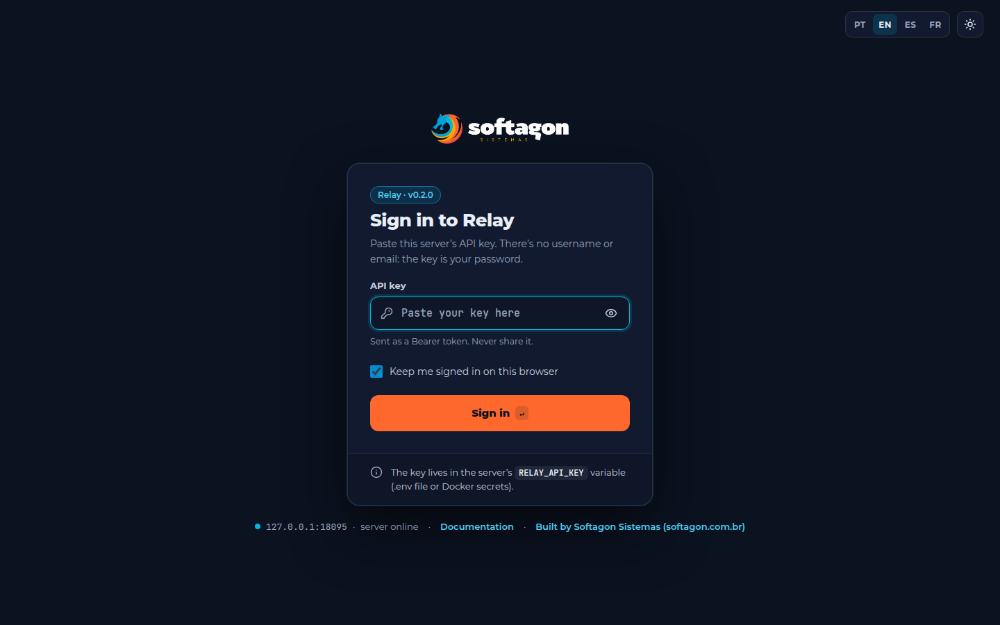
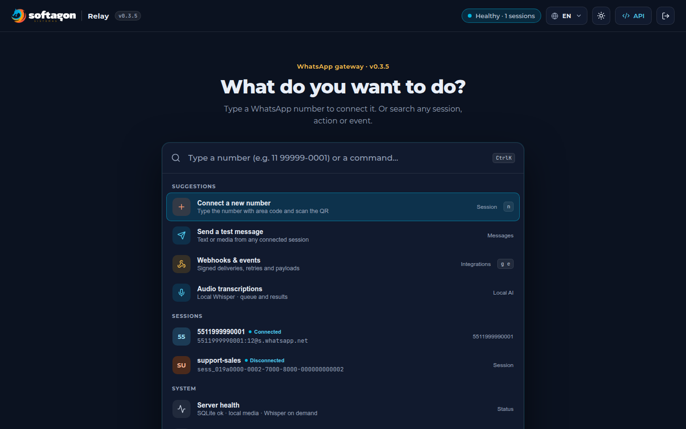
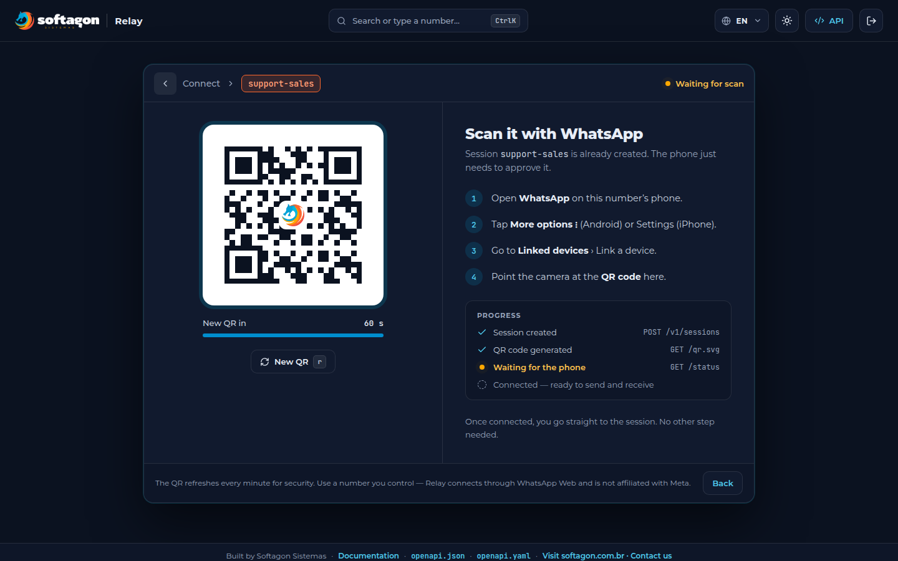
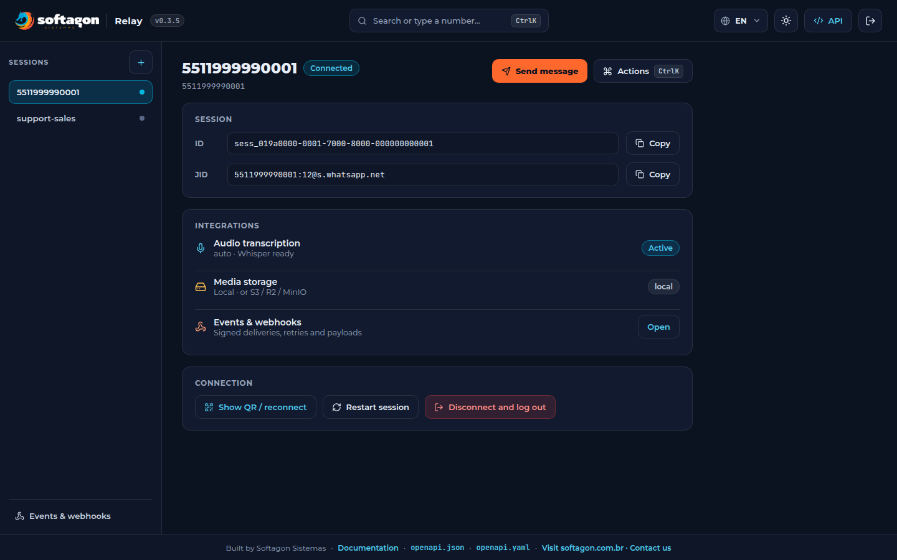
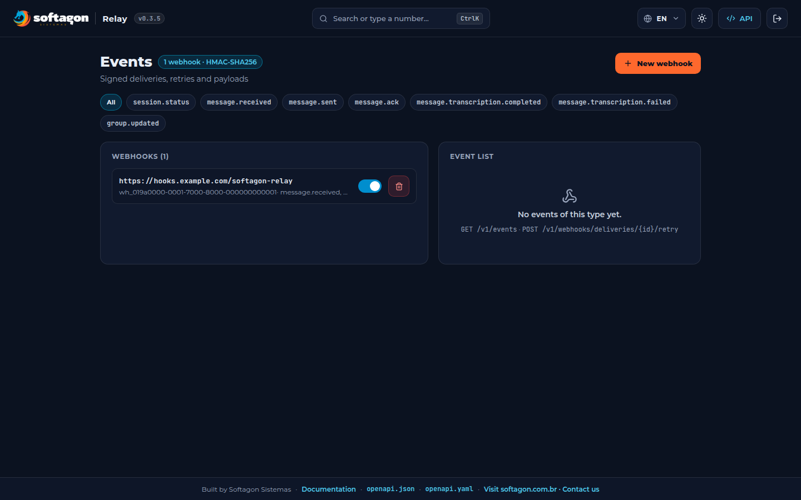
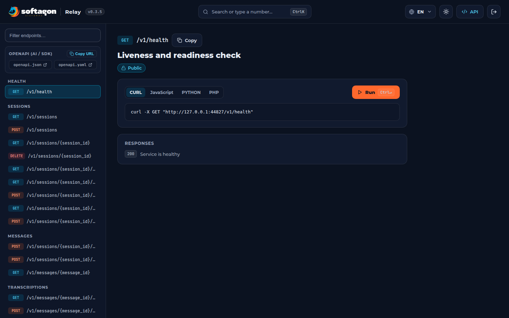

# Official Documentation — Softagon Relay (English)

> Languages: [Português (BR)](../pt-BR/README.md) · **English** · [Español](../es/README.md) · [Français](../fr/README.md)

**What is Softagon Relay?**  
**Softagon Relay** is an open-source, self-hosted **WhatsApp Web HTTP API gateway** built in **Rust** by **[Softagon Sistemas](https://softagon.com.br)**. It runs as a **single Docker container (~52 MB)** with embedded **SQLite (WAL)**, a **Raycast-style Web Console** at `/console`, **Local or S3/R2/MinIO** media storage, **HMAC-SHA256 signed webhooks**, **OpenAPI 3.2.1**, and **offline multilingual voice-note transcription** powered by `whisper.cpp`.

- **Official Website & Contact:** <https://softagon.com.br>
- **Docker Hub:** <https://hub.docker.com/r/softagon/relay> (`softagon/relay:latest`)
- **Source Code (GitHub):** <https://github.com/SoftagonSistemas/whatsapp-gateway-relay-softagon>
- **Changelog & Roadmap:** [CHANGELOG.md](../../CHANGELOG.md) *(including upcoming **Tauri Desktop app** for Windows, Linux & macOS — [open an Issue](https://github.com/SoftagonSistemas/whatsapp-gateway-relay-softagon/issues/new) if you need it!)*
- **License:** Apache-2.0

---

## 1. Quick Start (Docker)

```bash
docker run -d \
  --name softagon-relay \
  --restart unless-stopped \
  -p 8080:8080 \
  -v relay-data:/data \
  -e RELAY_API_KEY="replace-with-a-strong-secret" \
  softagon/relay:latest
```

Open the **Web Console** at `http://localhost:8080/console` (or `/manager`, which redirects automatically) and enter your `RELAY_API_KEY`.

### Hardened Docker Compose
Use the repository's [compose.yaml](../../compose.yaml) (`read_only: true`, `cap_drop: ALL`, `no-new-privileges:true`, non-root UID `10001`).

---

## 2. Web Console Visual Guide (`/console`)

The embedded Web Console is designed in a **Raycast-inspired** keyboard-first layout, supporting instant language switching (**PT / EN / ES / FR**) and **Light / Dark** themes.

### 2.1 Sign In (`/console/login`)
Enter only the key configured in `RELAY_API_KEY` (no username or email required). It is sent as a `Bearer` token and can optionally be remembered in your browser.



### 2.2 Home & Command Bar (`/console`)
Check live server health (`Healthy · N sessions`), jump to your sessions list with one click, or type any WhatsApp phone number (with automatic international formatting & validation) and press `↵` to start pairing.



### 2.3 Connect a New Number via QR Code (`/console/connect`)
Once the session is created, a live SVG QR code appears with an automatic refresh countdown (press `r` to regenerate immediately). On your phone, open **WhatsApp → Linked devices → Link a device** and scan. The linked device appears as **Softagon Relay**.



### 2.4 Session Management & Test Messaging (`/console/sessions`)
Manage all connected WhatsApp accounts from one place:
- Copy session **ID** and **JID** in one click.
- Click **Send message** to send a live test message with international phone validation and automatic mobile digit resolution (BR/MX/AR).
- Open **Actions (`⌘K` / `Ctrl+K`)** to restart, reconnect, log out, or **delete disconnected sessions** (connected sessions are protected against accidental deletion).



### 2.5 Events & Webhooks (`/console/events`)
Register webhook URLs to receive real-time events (`message.received`, `message.sent`, `message.ack`, `session.status`, `message.transcription.completed`, `group.updated`). Relay automatically generates an HMAC-SHA256 signing secret and lets you toggle or delete subscriptions.



### 2.6 Interactive API Reference (`/console/api`)
Generated live from `/openapi.yaml` (also available as **`/openapi.json`** for direct AI agent, n8n, Postman, and SDK integration). Filter endpoints, copy ready-to-use **cURL, JavaScript, Python, and PHP** snippets, and execute real requests against your instance (`⌘↵` / `Ctrl+↵`).



### Keyboard Shortcuts
| Shortcut | Action |
|---|---|
| `⌘K` / `Ctrl+K` | Open command bar or session action panel |
| `/` | Focus search |
| `n` | Connect a new number |
| `g` then `s` / `e` / `a` | Go to Sessions / Events / API |
| `r` | Regenerate QR Code on Connect screen |
| `?` | Show shortcuts sheet |

---

## 3. HTTP API (`/v1`) & Authentication

All `/v1/*` routes (except public `GET /v1/health`) require:

```http
Authorization: Bearer <RELAY_API_KEY>
```

| Method | Endpoint | Purpose |
|---|---|---|
| `GET` | `/v1/health` | Server liveness/readiness (public) |
| `GET` / `POST` | `/v1/sessions` | List or create a session |
| `GET` / `DELETE` | `/v1/sessions/{id}` | Get details or delete a disconnected session (`409` if connected) |
| `GET` | `/v1/sessions/{id}/qr` · `/qr.svg` | Pairing QR payload (JSON or SVG) |
| `GET` | `/v1/sessions/{id}/status` | Live connection state |
| `POST` | `/v1/sessions/{id}/reconnect` | Restart and start a fresh QR cycle |
| `POST` | `/v1/sessions/{id}/logout` | Unlink WhatsApp device |
| `POST` | `/v1/sessions/{id}/messages/text` | Send text (supports `Idempotency-Key` & BR/MX/AR mobile JID resolution) |
| `POST` | `/v1/sessions/{id}/messages/media` | Send image, video, audio, or document |
| `GET` | `/v1/messages/{id}` | Retrieve message status & metadata |
| `GET` / `POST` | `/v1/messages/{id}/transcription` | Retrieve or retry Whisper transcription |
| `GET` / `POST` | `/v1/webhooks` | List or create webhook subscriptions |
| `GET` / `PATCH` / `DELETE` | `/v1/webhooks/{id}` | Inspect, update, or delete a webhook |

---

## 4. Signed Webhooks (HMAC-SHA256)

Events: `session.status`, `message.received`, `message.sent`, `message.ack`, `message.transcription.completed`, `message.transcription.failed`, `group.updated`.

Headers on every delivery (**at-least-once** with exponential backoff + jitter):
- `X-Relay-Event-Id`: stable UUIDv7 event ID for deduplication
- `X-Relay-Event-Type`: event name
- `X-Relay-Timestamp`: Unix timestamp in seconds
- `X-Relay-Signature`: `sha256=<hex(HMAC-SHA256(secret, "{timestamp}.{raw_body}"))>`

---

## 5. Local Transcription (Whisper) & S3 Storage

- **Voice Notes:** decoded in pure Rust (Symphonia + `symphonia-opus` + Rubato 16 kHz mono, no FFmpeg required) and transcribed locally with `whisper.cpp` (multilingual `base` model, lazy-loaded and unloaded after idle timeout).
- **S3 / R2 / MinIO:** set `MEDIA_STORAGE=s3`, `S3_BUCKET`, `S3_ACCESS_KEY_ID`, `S3_SECRET_ACCESS_KEY`, and `S3_ENDPOINT_URL`.

---

## 6. Local MCP Server for AI Agents (`v0.3.0`)

Softagon Relay ships with a native Rust **MCP Server (Model Context Protocol)** powered by `rmcp`, calling the shared `RelayService` directly (no HTTP REST dependency):

- **STDIO (default local mode):** run `softagon-relay mcp` (or `softagon-relay mcp --stdio`). All logs are routed to `stderr` so `stdout` stays clean JSON-RPC.
- **Streamable HTTP:** run `softagon-relay mcp --http` or enable `MCP_HTTP_ENABLED=true` alongside `softagon-relay serve` — binds **exclusively to `127.0.0.1:8091/mcp`** with strict `Origin` validation (anti-DNS rebinding) and `Authorization: Bearer <RELAY_API_KEY>`.
- **Tools:** `list_sessions`, `get_session_status`, `list_chats`, `search_messages`, `get_chat_messages`, `get_message_transcription`, `send_text_message`, plus destructive tools `logout_session` / `delete_session` (**disabled by default** unless `MCP_ALLOW_DESTRUCTIVE=true` and `confirm: true`).
- **Audit trail:** every MCP tool invocation is persisted to `mcp_audit_log` in SQLite.

```json
{
  "mcpServers": {
    "softagon-relay": {
      "command": "softagon-relay",
      "args": ["mcp", "--stdio"],
      "env": {
        "RELAY_API_KEY": "your-secret-key",
        "DATA_DIR": "/path/to/data"
      }
    }
  }
}
```

---

## 7. Support & Contact

Need dedicated support, custom integrations, or AI & messaging engineering?  
Visit **[softagon.com.br](https://softagon.com.br)** and talk to the **Softagon Sistemas** team.
