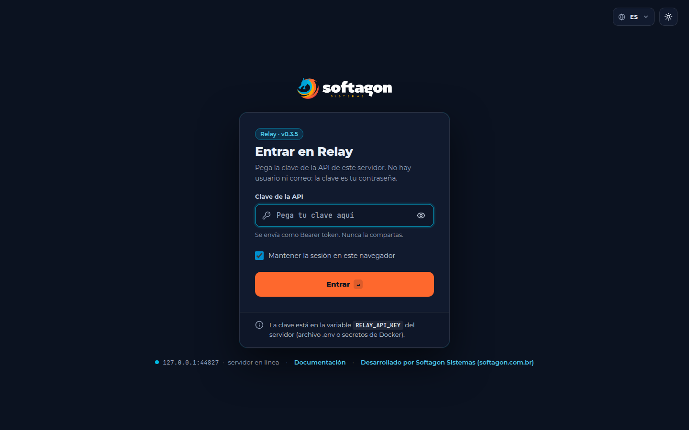
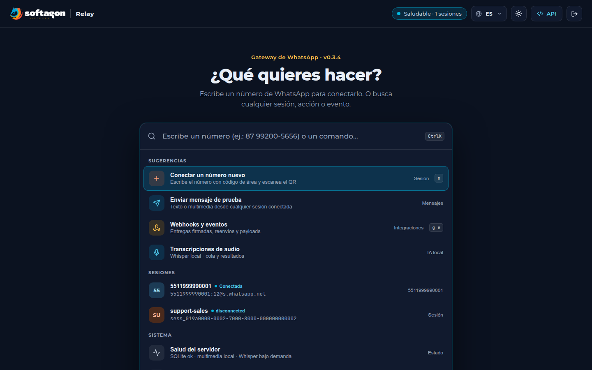
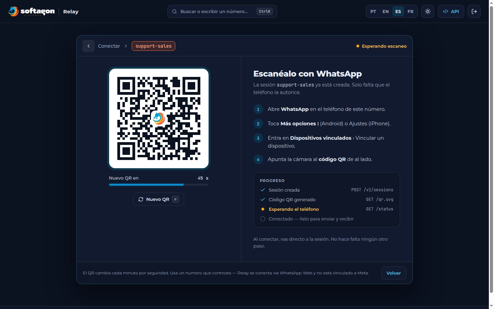
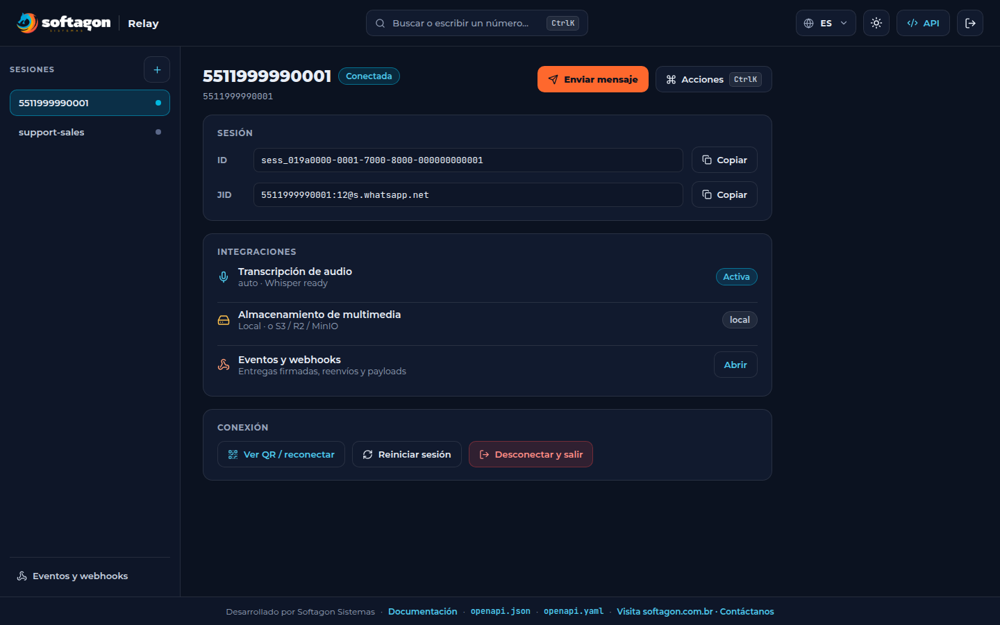
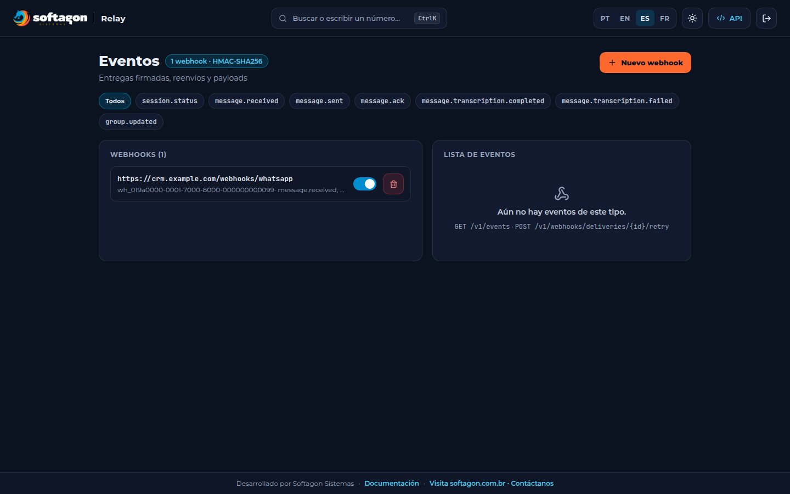
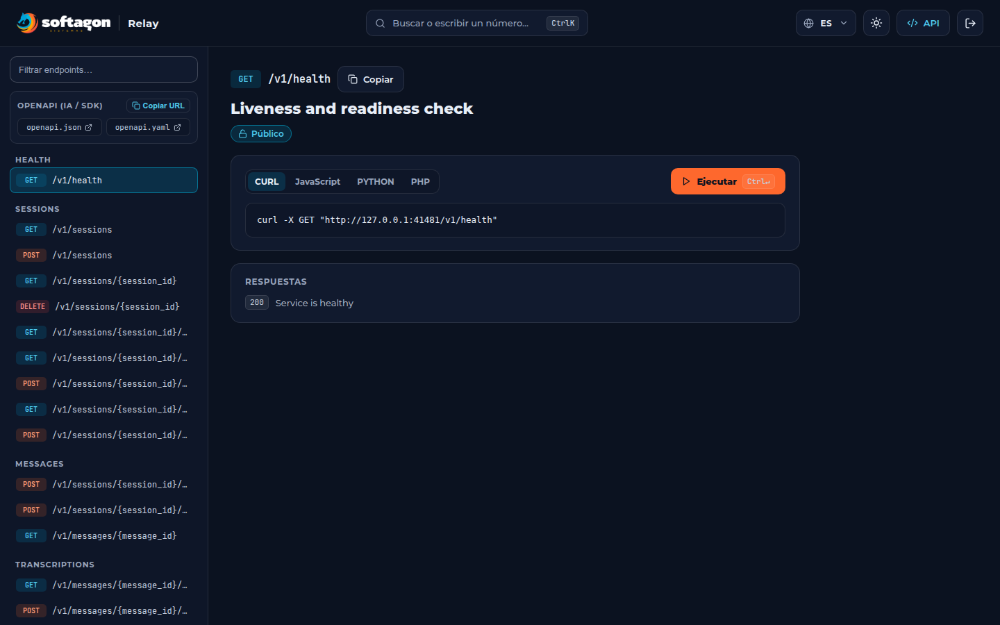

# Documentación Oficial — Softagon Relay (Español)

> Idiomas: [Português (BR)](../pt-BR/README.md) · [English](../en/README.md) · **Español** · [Français](../fr/README.md) · [Bahasa Indonesia](../id/README.md) · [Basa Betawi](../bew/README.md) · [Basa Sunda](../su/README.md) · [Basa Jawa](../jv/README.md) · [Hata Batak Toba](../bbc/README.md) · [Bahasa Melayu](../ms/README.md)

**¿Qué es Softagon Relay?**  
**Softagon Relay** es un **gateway WhatsApp Web open-source y self-hosted** desarrollado en **Rust** por **[Softagon Sistemas](https://softagon.com.br)**. Funciona en un **único contenedor Docker (~55 MB)** con **SQLite (WAL)** integrado, **Consola Web estilo Raycast** en `/console`, almacenamiento de medios **Local o S3/R2/MinIO**, **webhooks firmados con HMAC-SHA256**, **OpenAPI 3.2.1** y **transcripción offline multilingüe de notas de voz** con `whisper.cpp`.

- **Sitio Web Oficial y Contacto:** <https://softagon.com.br>
- **Docker Hub:** <https://hub.docker.com/r/softagon/relay> (`softagon/relay:latest`)
- **Código fuente (GitHub):** <https://github.com/SoftagonSistemas/whatsapp-gateway-relay-softagon>
- **Changelog y Roadmap:** [CHANGELOG.md](../../CHANGELOG.md) *(incluyendo próxima versión **Desktop en Tauri** para Windows, Linux y macOS — ¡[abre un Issue](https://github.com/SoftagonSistemas/whatsapp-gateway-relay-softagon/issues/new) si la necesitas!)*
- **Licencia:** Apache-2.0

---

## 1. Inicio Rápido (Docker)

```bash
KEY="$(openssl rand -hex 32)" && echo "RELAY_API_KEY=$KEY" && docker run -d \
  --name softagon-relay \
  --restart unless-stopped \
  -p 127.0.0.1:8080:8080 \
  -v relay-data:/data \
  -e RELAY_API_KEY="$KEY" \
  softagon/relay:latest
```

Abre la **Consola Web** en `http://localhost:8080/console` (o `/manager`, que redirige automáticamente) e ingresa tu `RELAY_API_KEY`.

### Docker Compose Endurecido
Usa el [compose.yaml](../../compose.yaml) del repositorio (`read_only: true`, `cap_drop: ALL`, `no-new-privileges:true`, usuario no-root UID `10001`).

---

## 2. Guía Visual de la Consola Web (`/console`)

La Consola Web integrada sigue un diseño estilo **Raycast** orientado al teclado, con cambio instantáneo de idioma (**10 idiomas:** `PT / EN / ES / FR / ID / BEW / SU / JV / BTK / MS`) y tema (**Claro / Oscuro**).

### 2.1 Inicio de Sesión (`/console/login`)
Ingresa únicamente la clave configurada en `RELAY_API_KEY` (sin usuario ni correo). Se envía como token `Bearer` y puede recordarse opcionalmente en el navegador.



### 2.2 Inicio y Barra de Comandos (`/console`)
Consulta el estado del servidor en vivo (`Saludable · N sesiones`), abre la lista de sesiones con un clic o escribe cualquier número de WhatsApp (con formato y validación internacional automática) y pulsa `↵` para iniciar la vinculación.



### 2.3 Conectar Nuevo Número con Código QR (`/console/connect`)
Al crear la sesión, se muestra el código QR SVG en vivo con contador de renovación automática (pulsa `r` para regenerarlo al instante). En el teléfono, abre **WhatsApp → Dispositivos vinculados → Vincular un dispositivo** y escanea. El dispositivo aparece como **Softagon Relay**.



### 2.4 Gestión de Sesiones y Mensaje de Prueba (`/console/sessions`)
Administra todas tus sesiones desde un solo lugar:
- Copia el **ID** y el **JID** de la sesión con un clic.
- Pulsa **Enviar mensaje** para probar el envío con validación internacional y resolución automática del dígito móvil (BR/MX/AR).
- Abre **Acciones (`⌘K` / `Ctrl+K`)** para reiniciar, reconectar, cerrar sesión o **eliminar sesiones desconectadas** (las sesiones activas están protegidas contra eliminación accidental).



### 2.5 Eventos y Webhooks (`/console/events`)
Registra URLs para recibir eventos en tiempo real (`message.received`, `message.sent`, `message.ack`, `session.status`, `message.transcription.completed`, `group.updated`). Relay genera automáticamente el secreto HMAC-SHA256 y permite activar, pausar o eliminar suscripciones.



### 2.6 Referencia Interactiva de la API (`/console/api`)
Generada en vivo desde `/openapi.yaml` (también disponible en **`/openapi.json`** para integración directa con agentes de IA, n8n, Postman y SDKs). Filtra endpoints, copia ejemplos listos en **cURL, JavaScript, Python y PHP** y ejecuta peticiones reales contra tu servidor (`⌘↵` / `Ctrl+↵`).



### Atajos de teclado
| Atajo | Acción |
|---|---|
| `⌘K` / `Ctrl+K` | Abrir barra de comandos o panel de acciones |
| `/` | Enfocar búsqueda |
| `n` | Conectar nuevo número |
| `g` luego `s` / `e` / `a` | Ir a Sesiones / Eventos / API |
| `r` | Generar nuevo QR en la pantalla de conexión |
| `?` | Ver hoja de atajos |

---

## 3. API HTTP (`/v1`) y Autenticación

Todas las rutas `/v1/*` (excepto `GET /v1/health`, que es pública) requieren:

```http
Authorization: Bearer <RELAY_API_KEY>
```

| Método | Endpoint | Función |
|---|---|---|
| `GET` | `/v1/health` | Estado del servidor (público) |
| `GET` / `POST` | `/v1/sessions` | Listar o crear sesión |
| `GET` / `DELETE` | `/v1/sessions/{id}` | Detalles o eliminar sesión desconectada (`409` si está conectada) |
| `GET` | `/v1/sessions/{id}/qr` · `/qr.svg` | Código QR en JSON o SVG |
| `GET` | `/v1/sessions/{id}/status` | Estado de conexión en vivo |
| `POST` | `/v1/sessions/{id}/reconnect` | Reiniciar y generar nuevo ciclo de QR |
| `POST` | `/v1/sessions/{id}/logout` | Desvincular dispositivo de WhatsApp |
| `POST` | `/v1/sessions/{id}/messages/text` | Enviar texto (soporta `Idempotency-Key` y resolución móvil BR/MX/AR) |
| `POST` | `/v1/sessions/{id}/messages/media` | Enviar imagen, video, audio o documento |
| `GET` | `/v1/messages/{id}` | Consultar estado/detalles del mensaje |
| `GET` / `POST` | `/v1/messages/{id}/transcription` | Consultar o reintentar transcripción Whisper |
| `GET` / `POST` | `/v1/webhooks` | Listar o crear webhooks |
| `GET` / `PATCH` / `DELETE` | `/v1/webhooks/{id}` | Inspeccionar, actualizar o eliminar webhook |

---

## 4. Webhooks Firmados (HMAC-SHA256)

Eventos: `session.status`, `message.received`, `message.sent`, `message.ack`, `message.transcription.completed`, `message.transcription.failed`, `group.updated`.

Cabeceras en cada entrega (**at-least-once** con backoff exponencial + jitter):
- `X-Relay-Event-Id`: ID único UUIDv7 para deduplicación
- `X-Relay-Event-Type`: tipo de evento
- `X-Relay-Timestamp`: marca de tiempo Unix en segundos
- `X-Relay-Signature`: `sha256=<hex(HMAC-SHA256(secret, "{timestamp}.{raw_body}"))>`

---

## 5. Transcripción Local (Whisper) y Almacenamiento S3

- **Notas de voz:** decodificadas en Rust puro (Symphonia + `symphonia-opus` + Rubato 16 kHz mono, sin FFmpeg) y transcritas localmente con `whisper.cpp` (modelo `base` multilingüe con carga diferida y descarga automática por inactividad).
- **S3 / R2 / MinIO:** configura `MEDIA_STORAGE=s3`, `S3_BUCKET`, `S3_ACCESS_KEY_ID`, `S3_SECRET_ACCESS_KEY` y `S3_ENDPOINT_URL`.

---

## 6. Servidor MCP Local para Agentes de IA (`v0.3.0`)

Softagon Relay incluye un **MCP Server (Model Context Protocol)** nativo en Rust (`rmcp`) conectado directamente a `RelayService` (sin depender del HTTP REST):

- **STDIO (modo local predeterminado):** ejecuta `softagon-relay mcp` (o `softagon-relay mcp --stdio`). Los logs se envían a `stderr` para mantener `stdout` limpio para JSON-RPC.
- **Streamable HTTP:** ejecuta `softagon-relay mcp --http` o activa `MCP_HTTP_ENABLED=true` junto con `softagon-relay serve` — escucha en `127.0.0.1:8091/mcp` por defecto (en Docker detrás de `-p 127.0.0.1:8091:8091`, usa `MCP_HTTP_HOST=0.0.0.0` + `MCP_ALLOW_CONTAINER_BIND=true`), siempre con validación de `Host`/`Origin` (anti-DNS rebinding) y `Authorization: Bearer <RELAY_API_KEY>`.
- **Herramientas:** `list_sessions`, `get_session_status`, `list_chats`, `search_messages`, `get_chat_messages`, `get_message_transcription`, `send_text_message` y (deshabilitadas por defecto) `logout_session` / `delete_session` (`MCP_ALLOW_DESTRUCTIVE=true` y `confirm: true`).
- **Auditoría:** cada invocación MCP se registra en `mcp_audit_log` en SQLite.

```json
{
  "mcpServers": {
    "softagon-relay": {
      "command": "docker",
      "args": [
        "run", "-i", "--rm",
        "-v", "relay-data:/data",
        "-e", "RELAY_API_KEY",
        "softagon/relay:latest",
        "mcp", "--stdio"
      ],
      "env": {
        "RELAY_API_KEY": "<pega-tu-clave-generada>"
      }
    }
  }
}
```

> Para uso **standalone** sin otro contenedor `softagon-relay` en ejecución, añade `"-e", "MCP_RESTORE_SESSIONS=true"` en `args`. Con el servidor principal activo, prefiere **Streamable HTTP** dentro del mismo contenedor (`-p 127.0.0.1:8091:8091 -e MCP_HTTP_ENABLED=true -e MCP_HTTP_HOST=0.0.0.0 -e MCP_ALLOW_CONTAINER_BIND=true`).

---

## 7. Soporte y Contacto

¿Necesitas soporte dedicado, integraciones a medida o consultoría en IA y mensajería?  
Visita **[softagon.com.br](https://softagon.com.br)** y habla con el equipo de **Softagon Sistemas**.
