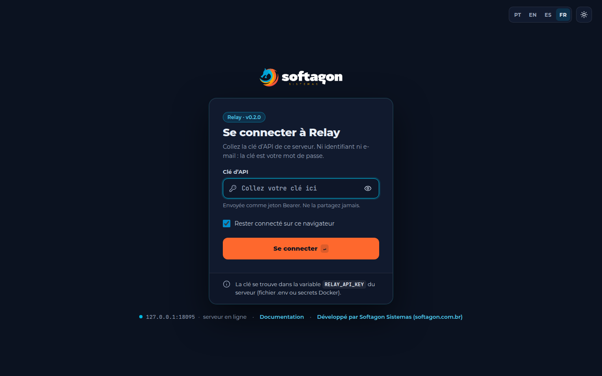
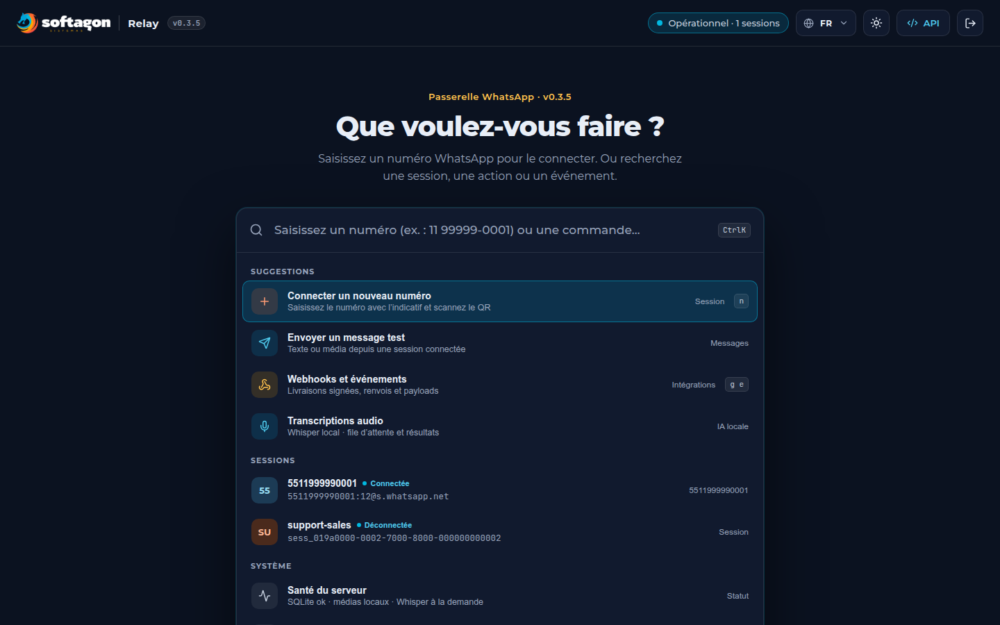
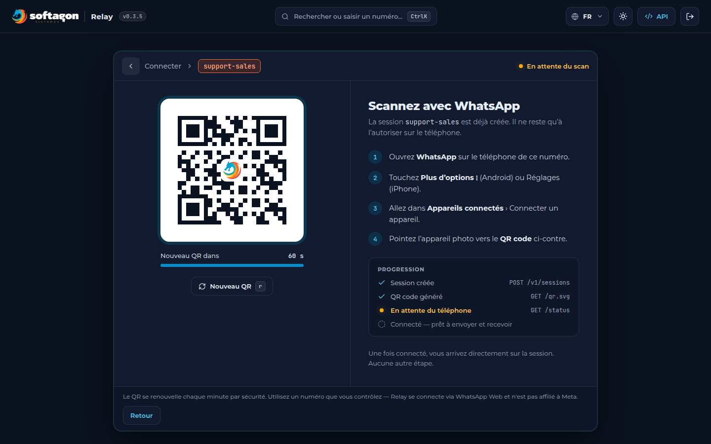
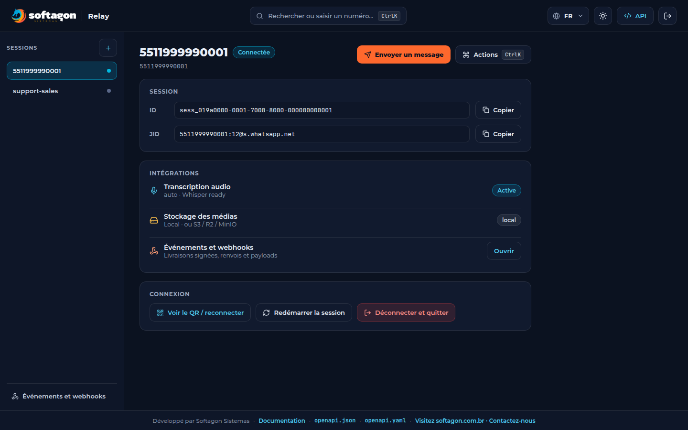
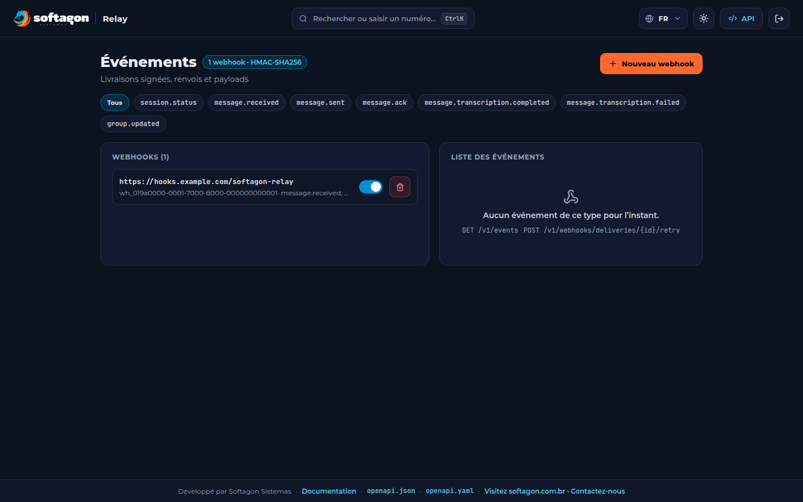
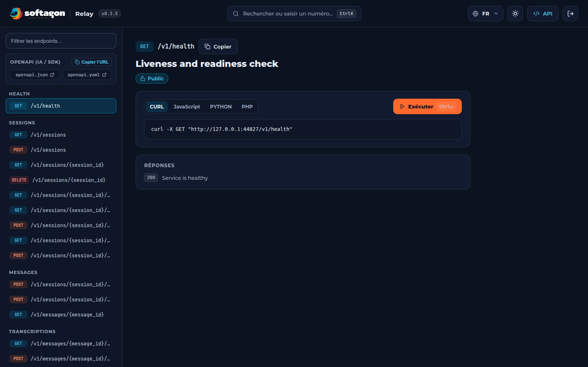

# Documentation Officielle — Softagon Relay (Français)

> Langues : [Português (BR)](../pt-BR/README.md) · [English](../en/README.md) · [Español](../es/README.md) · **Français** · [Bahasa Indonesia](../id/README.md) · [Basa Betawi](../bew/README.md) · [Basa Sunda](../su/README.md) · [Basa Jawa](../jv/README.md) · [Hata Batak Toba](../bbc/README.md) · [Bahasa Melayu](../ms/README.md)

**Qu'est-ce que Softagon Relay ?**  
**Softagon Relay** est une **passerelle API HTTP WhatsApp Web open-source et auto-hébergée**, développée en **Rust** par **[Softagon Sistemas](https://softagon.com.br)**. Elle fonctionne dans un **seul conteneur Docker (~55 Mo)** avec **SQLite (WAL)** intégré, une **Console Web de style Raycast** sur `/console`, un stockage de médias **Local ou S3/R2/MinIO**, des **webhooks signés HMAC-SHA256**, **OpenAPI 3.2.1** et la **transcription locale multilingue de messages vocaux** via `whisper.cpp`.

- **Site Officiel & Contact :** <https://softagon.com.br>
- **Docker Hub :** <https://hub.docker.com/r/softagon/relay> (`softagon/relay:latest`)
- **Code source (GitHub) :** <https://github.com/SoftagonSistemas/whatsapp-gateway-relay-softagon>
- **Changelog & Roadmap :** [CHANGELOG.md](../../CHANGELOG.md) *(incluant la prochaine version **Desktop Tauri** pour Windows, Linux et macOS — [ouvrez une Issue](https://github.com/SoftagonSistemas/whatsapp-gateway-relay-softagon/issues/new) si vous en avez besoin !)*
- **Licence :** Apache-2.0

---

## 1. Démarrage Rapide (Docker)

```bash
KEY="$(openssl rand -hex 32)" && echo "RELAY_API_KEY=$KEY" && docker run -d \
  --name softagon-relay \
  --restart unless-stopped \
  -p 127.0.0.1:8080:8080 \
  -v relay-data:/data \
  -e RELAY_API_KEY="$KEY" \
  softagon/relay:latest
```

Ouvrez la **Console Web** sur `http://localhost:8080/console` (ou `/manager`, redirigé automatiquement) et saisissez votre `RELAY_API_KEY`.

### Docker Compose sécurisé
Utilisez le fichier [compose.yaml](../../compose.yaml) du dépôt (`read_only: true`, `cap_drop: ALL`, `no-new-privileges:true`, utilisateur non-root UID `10001`).

---

## 2. Guide Visuel de la Console Web (`/console`)

La Console Web embarquée s'inspire de **Raycast** pour une utilisation fluide au clavier, avec changement instantané de langue (**10 langues :** `PT / EN / ES / FR / ID / BEW / SU / JV / BTK / MS`) et de thème (**Clair / Sombre**).

### 2.1 Connexion (`/console/login`)
Saisissez uniquement la clé configurée dans `RELAY_API_KEY` (sans identifiant ni e-mail). Elle est envoyée en jeton `Bearer` et peut être mémorisée dans le navigateur.



### 2.2 Accueil et Barre de Commandes (`/console`)
Consultez l'état du serveur en direct (`Opérationnel · N sessions`), accédez à vos sessions en un clic ou saisissez directement un numéro WhatsApp (avec formatage et validation internationale automatiques) puis appuyez sur `↵` pour lancer l'appairage.



### 2.3 Connecter un Nouveau Numéro par QR Code (`/console/connect`)
Dès la création de la session, le QR Code SVG s'affiche en direct avec compte à rebours de renouvellement (appuyez sur `r` pour le régénérer immédiatement). Sur le téléphone, ouvrez **WhatsApp → Appareils connectés → Connecter un appareil** et scannez. L'appareil s'affiche sous le nom **Softagon Relay**.



### 2.4 Gestion des Sessions et Message de Test (`/console/sessions`)
Pilotez toutes vos sessions au même endroit :
- Copiez l'**ID** et le **JID** de la session en un clic.
- Cliquez sur **Envoyer un message** pour tester l'envoi avec validation internationale et résolution automatique des chiffres mobiles (BR/MX/AR).
- Ouvrez **Actions (`⌘K` / `Ctrl+K`)** pour redémarrer, reconnecter, déconnecter ou **supprimer une session déconnectée** (les sessions actives sont protégées contre toute suppression accidentelle).



### 2.5 Événements et Webhooks (`/console/events`)
Enregistrez vos URLs pour recevoir les événements en temps réel (`message.received`, `message.sent`, `message.ack`, `session.status`, `message.transcription.completed`, `group.updated`). Relay génère automatiquement le secret HMAC-SHA256 et permet d'activer, suspendre ou supprimer vos abonnements.



### 2.6 Référence Interactive de l'API (`/console/api`)
Générée en direct depuis `/openapi.yaml` (également disponible en **`/openapi.json`** pour une intégration directe avec les agents IA, n8n, Postman et SDK). Filtrez les routes, copiez les exemples prêts à l'emploi en **cURL, JavaScript, Python et PHP** et exécutez des appels réels (`⌘↵` / `Ctrl+↵`).



### Raccourcis clavier
| Raccourci | Action |
|---|---|
| `⌘K` / `Ctrl+K` | Ouvrir la barre de commandes ou le panneau d'actions |
| `/` | Focus sur la recherche |
| `n` | Connecter un nouveau numéro |
| `g` puis `s` / `e` / `a` | Aller vers Sessions / Événements / API |
| `r` | Régénérer le QR Code sur l'écran de connexion |
| `?` | Afficher la liste des raccourcis |

---

## 3. API HTTP (`/v1`) et Authentification

Toutes les routes `/v1/*` (sauf `GET /v1/health`, publique) nécessitent :

```http
Authorization: Bearer <RELAY_API_KEY>
```

| Méthode | Endpoint | Rôle |
|---|---|---|
| `GET` | `/v1/health` | État de santé du serveur (public) |
| `GET` / `POST` | `/v1/sessions` | Lister ou créer une session |
| `GET` / `DELETE` | `/v1/sessions/{id}` | Détails ou suppression d'une session déconnectée (`409` si connectée) |
| `GET` | `/v1/sessions/{id}/qr` · `/qr.svg` | QR Code d'appairage (JSON ou SVG) |
| `GET` | `/v1/sessions/{id}/status` | État de connexion en direct |
| `POST` | `/v1/sessions/{id}/reconnect` | Redémarrer et lancer un nouveau cycle QR |
| `POST` | `/v1/sessions/{id}/logout` | Déconnecter l'appareil WhatsApp |
| `POST` | `/v1/sessions/{id}/messages/text` | Envoyer un texte (supporte `Idempotency-Key` et résolution mobile BR/MX/AR) |
| `POST` | `/v1/sessions/{id}/messages/media` | Envoyer image, vidéo, audio ou document |
| `GET` | `/v1/messages/{id}` | Consulter l'état et les détails du message |
| `GET` / `POST` | `/v1/messages/{id}/transcription` | Consulter ou relancer la transcription Whisper |
| `GET` / `POST` | `/v1/webhooks` | Lister ou créer des webhooks |
| `GET` / `PATCH` / `DELETE` | `/v1/webhooks/{id}` | Consulter, modifier ou supprimer un webhook |

---

## 4. Webhooks Signés (HMAC-SHA256)

Événements : `session.status`, `message.received`, `message.sent`, `message.ack`, `message.transcription.completed`, `message.transcription.failed`, `group.updated`.

En-têtes envoyés à chaque livraison (**at-least-once** avec backoff exponentiel + jitter) :
- `X-Relay-Event-Id` : identifiant unique UUIDv7 pour la déduplication
- `X-Relay-Event-Type` : type d'événement
- `X-Relay-Timestamp` : horodatage Unix en secondes
- `X-Relay-Signature` : `sha256=<hex(HMAC-SHA256(secret, "{timestamp}.{raw_body}"))>`

---

## 5. Transcription Locale (Whisper) et Stockage S3

- **Messages vocaux :** décodés en Rust pur (Symphonia + `symphonia-opus` + Rubato 16 kHz mono, sans FFmpeg) et transcrits localement avec `whisper.cpp` (modèle `base` multilingue chargé à la demande et déchargé après inactivité).
- **S3 / R2 / MinIO :** définissez `MEDIA_STORAGE=s3`, `S3_BUCKET`, `S3_ACCESS_KEY_ID`, `S3_SECRET_ACCESS_KEY` et `S3_ENDPOINT_URL`.

---

## 6. Serveur MCP Local pour Agents IA (`v0.3.0`)

Softagon Relay intègre un **serveur MCP (Model Context Protocol)** natif en Rust (`rmcp`) connecté directement à `RelayService` (sans dépendre de l'API HTTP REST) :

- **STDIO (mode local par défaut) :** lancez `softagon-relay mcp` (ou `softagon-relay mcp --stdio`). Les logs sont dirigés vers `stderr` afin de préserver `stdout` pour JSON-RPC.
- **Streamable HTTP :** lancez `softagon-relay mcp --http` ou activez `MCP_HTTP_ENABLED=true` avec `softagon-relay serve` — écoute sur `127.0.0.1:8091/mcp` par défaut (dans Docker derrière `-p 127.0.0.1:8091:8091`, utilisez `MCP_HTTP_HOST=0.0.0.0` + `MCP_ALLOW_CONTAINER_BIND=true`), toujours avec validation `Host`/`Origin` (anti-DNS rebinding) et `Authorization: Bearer <RELAY_API_KEY>`.
- **Outils :** `list_sessions`, `get_session_status`, `list_chats`, `search_messages`, `get_chat_messages`, `get_message_transcription`, `send_text_message`, ainsi que `logout_session` / `delete_session` (**désactivés par défaut**, nécessitant `MCP_ALLOW_DESTRUCTIVE=true` et `confirm: true`).
- **Audit :** chaque appel MCP est enregistré dans `mcp_audit_log` dans SQLite.

```json
{
  "mcpServers": {
    "softagon-relay": {
      "command": "docker",
      "args": [
        "run", "-i", "--rm",
        "-v", "relay-data:/data",
        "-e", "RELAY_API_KEY",
        "softagon/relay:latest",
        "mcp", "--stdio"
      ],
      "env": {
        "RELAY_API_KEY": "<collez-votre-cle-generee>"
      }
    }
  }
}
```

> Pour un usage **autonome** sans autre conteneur `softagon-relay` actif, ajoutez `"-e", "MCP_RESTORE_SESSIONS=true"` dans `args`. Avec le serveur principal en cours d'exécution, préférez **Streamable HTTP** dans le même conteneur (`-p 127.0.0.1:8091:8091 -e MCP_HTTP_ENABLED=true -e MCP_HTTP_HOST=0.0.0.0 -e MCP_ALLOW_CONTAINER_BIND=true`).

### 6.2 Grok Bot, Appairage sans Connexion et Outils Agents (`v0.3.8`)

- **Kit clé en main Grok Bot :** importez en 1 clic avec **[Ajouter à Grok Bot](https://x.ai/bot/Xe4LpCGaepuE-J2BYH363)** ou consultez [`docs/grok-bot.md`](../grok-bot.md) et [`integrations/grok-bot/TEMPLATE.md`](../../integrations/grok-bot/TEMPLATE.md) pour installer le binaire natif dans `/workspace/softagon-relay`.
- **Lien d'appairage temporaire (`/pair/{token}`) :** `POST /v1/sessions/{id}/pair-link` (ou MCP `create_pairing_link`) affiche le **QR Code** sans demander `RELAY_API_KEY`, renouvelle automatiquement les cycles expirés jusqu'à 10 minutes et propose `qr.png` natif ainsi qu'un **code à 8 chiffres** (`POST /v1/sessions/{id}/pair-code` / MCP `request_pair_code`).
- **Webhooks avec Bearer ou en-tête personnalisé :** transmettez `bearer_token` ou `auth_header_name`/`auth_header_value` sur `POST`/`PATCH /v1/webhooks`. Les erreurs `401`/`403` arrêtent immédiatement les nouvelles tentatives.
- **Contexte client enrichi :** inclut `sender_name`, `sender_phone` (résolu même pour `@lid`), les réponses envoyées depuis le téléphone de l'équipe (`from_me: true`, `source: "device_sync"`), l'horodatage réel sans déclencher de webhook sur `is_history_sync`, ainsi que `sticker`, `reaction`, `location` et `contact`.
- **Outils MCP & endpoints REST complets (`v0.4.0`–`v0.4.5`) :** `reply_to_message_id`, `send_reaction`, `send_chat_presence`, `subscribe_presence`, `as_voice_note` (PTT), `sticker`, `send_location`, `send_contact`, `edit_message`, `revoke_message`, annuaire persistant de contacts (`list_contacts`, `save_contact`, `sync_contacts` avec synchronisation automatique du carnet d'adresses), `check_whatsapp`, `get_profile_picture`, `list_groups`, `get_group_info`, `GET /v1/media/{media_id}`, `MEDIA_RETENTION_DAYS`, `softagon-relay backup`, métriques Prometheus `GET /v1/metrics`, alertes `session.disconnected`, migration automatique de l'historique `@lid`, fallback SQLite pour `quoted.text` et regroupement de rafales `WEBHOOK_COALESCE_SECONDS` (défaut global `0` ; `4s` dans le kit Grok Bot).

---

## 7. Benchmark Réel en Production (Test Continu de 8 Heures)

Mesuré en production réelle (**2026-11-27/28**, 16 relevés toutes les 30 min, `linux/amd64`, `--features whisper`, 1 compte WhatsApp réel connecté) :

| Indicateur | Résultat Mesuré (8h Continues) |
|---|---|
| **RAM en régime établi** | **31,7–32,1 MiB** (zéro fuite mémoire après 8h) |
| **Pic RAM (Whisper `base` actif)** | **286,4 MiB** avec déchargement automatique au repos vers **~32 MiB** |
| **CPU moyen** | **0,04 %–0,19 %** |
| **Webhooks livrés (Bearer + HMAC)** | **1 083** (`0` échec d'auth, `0` fuite `status@broadcast`) |
| **Résolution `@lid` → téléphone** | **100 % (`127/127`)** sur les discussions privées et groupes |
| **Transcription audio hors ligne (CPU)** | **100 % (`5/5`)**, jusqu'à **4,5× plus rapide que le temps réel** |
| **Erreurs critiques (`ERROR`) en 8h** | **`0`** (plus longue séquence connectée sans coupure : **6h20**) |

---

## 8. Support et Contact

Besoin d'un support dédié, d'intégrations sur mesure ou de conseil en IA et messagerie ?  
Visitez **[softagon.com.br](https://softagon.com.br)** et contactez l'équipe de **Softagon Sistemas**.
