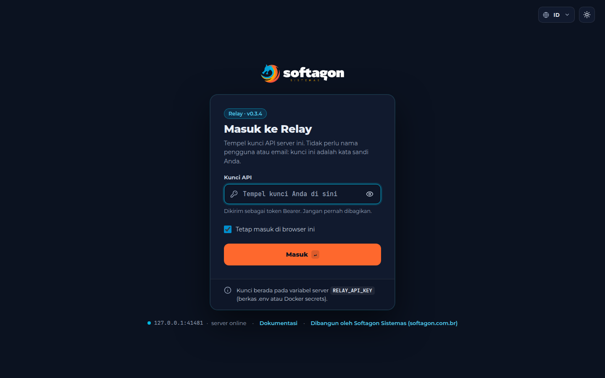
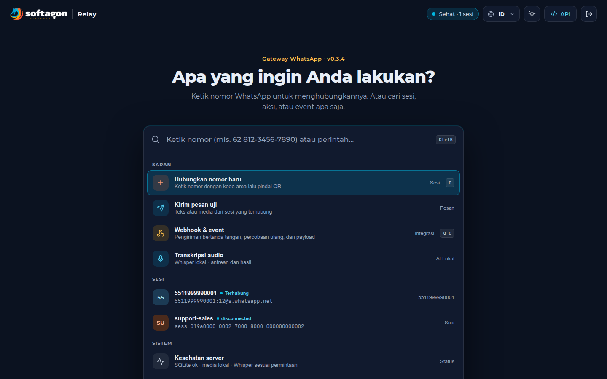
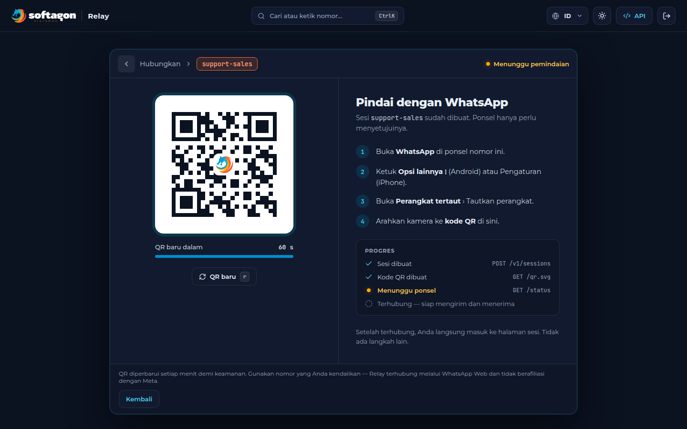
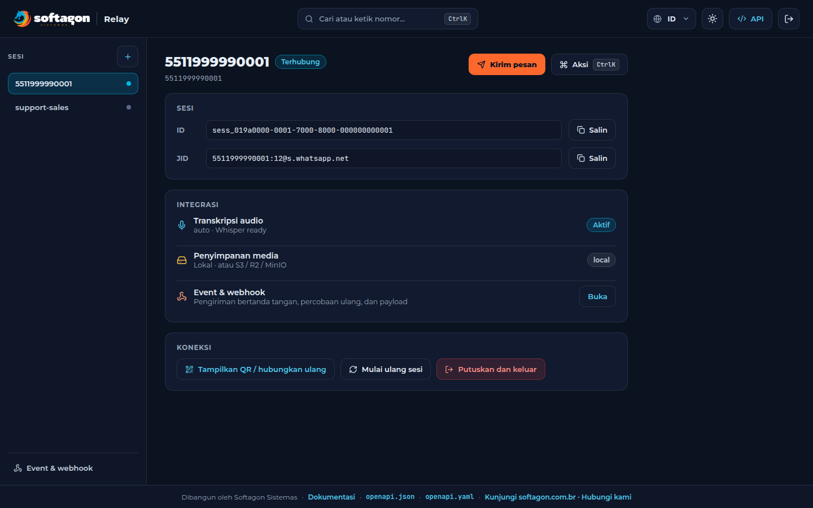
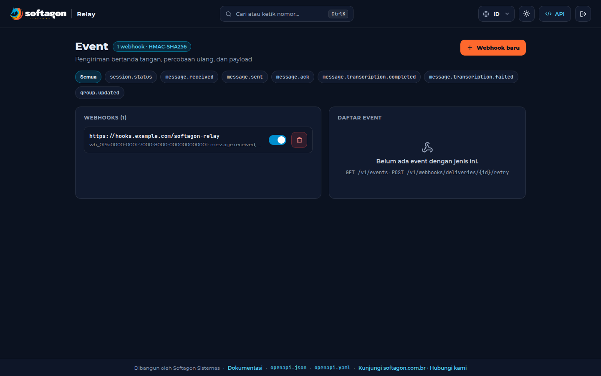
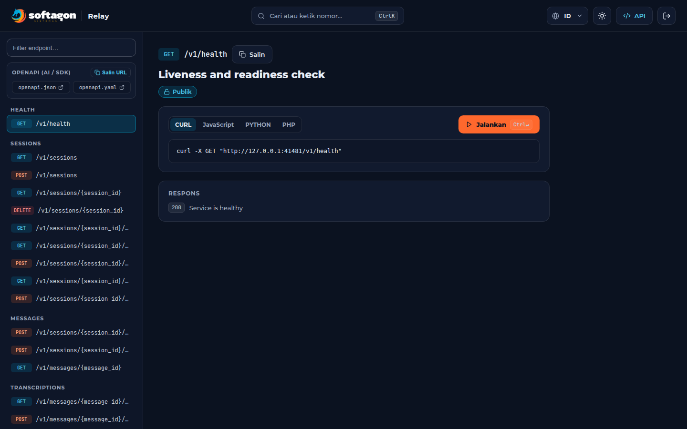

# Dokumentasi Resmi — Softagon Relay (Bahasa Indonesia)

> Bahasa: [Português (BR)](../pt-BR/README.md) · [English](../en/README.md) · [Español](../es/README.md) · [Français](../fr/README.md) · **Bahasa Indonesia** · [Basa Betawi](../bew/README.md) · [Basa Sunda](../su/README.md) · [Basa Jawa](../jv/README.md) · [Hata Batak Toba](../bbc/README.md) · [Bahasa Melayu](../ms/README.md)

**Apa itu Softagon Relay?**  
**Softagon Relay** adalah **gateway HTTP API WhatsApp Web** open-source dan self-hosted yang dibangun dengan **Rust** oleh **[Softagon Sistemas](https://softagon.com.br)**. Berjalan sebagai **satu container Docker (~55 MB)** dengan **SQLite (WAL)** tertanam, **Konsol Web bergaya Raycast** di `/console`, penyimpanan media **Lokal atau S3/R2/MinIO**, **webhook bertanda tangan HMAC-SHA256**, **OpenAPI 3.2.1**, dan **transkripsi pesan suara multibahasa offline** bertenaga `whisper.cpp`.

- **Situs Resmi & Kontak:** <https://softagon.com.br>
- **Docker Hub:** <https://hub.docker.com/r/softagon/relay> (`softagon/relay:latest`)
- **Kode Sumber (GitHub):** <https://github.com/SoftagonSistemas/whatsapp-gateway-relay-softagon>
- **Changelog & Roadmap:** [CHANGELOG.md](../../CHANGELOG.md) *(termasuk rencana **aplikasi Desktop Tauri** untuk Windows, Linux & macOS — [buka Issue](https://github.com/SoftagonSistemas/whatsapp-gateway-relay-softagon/issues/new) jika Anda membutuhkannya!)*
- **Lisensi:** Apache-2.0

---

## 1. Mulai Cepat (Docker)

```bash
KEY="$(openssl rand -hex 32)" && echo "RELAY_API_KEY=$KEY" && docker run -d \
  --name softagon-relay \
  --restart unless-stopped \
  -p 127.0.0.1:8080:8080 \
  -v relay-data:/data \
  -e RELAY_API_KEY="$KEY" \
  softagon/relay:latest
```

Buka **Konsol Web** di `http://localhost:8080/console` (atau `/manager`, yang dialihkan otomatis) dan masukkan `RELAY_API_KEY` Anda.

### Docker Compose Terproteksi
Gunakan [compose.yaml](../../compose.yaml) dari repositori (`read_only: true`, `cap_drop: ALL`, `no-new-privileges:true`, UID non-root `10001`).

---

## 2. Panduan Visual Konsol Web (`/console`)

Konsol Web tertanam dirancang dengan tata letak keyboard-first **bergaya Raycast**, mendukung pergantian bahasa instan (**10 bahasa:** `PT / EN / ES / FR / ID / BEW / SU / JV / BTK / MS`) serta tema **Terang / Gelap**.

### 2.1 Masuk (`/console/login`)
Masukkan hanya kunci yang dikonfigurasi pada `RELAY_API_KEY` (tanpa nama pengguna atau email). Kunci dikirim sebagai token `Bearer` dan dapat disimpan secara opsional di browser Anda.



### 2.2 Beranda & Bilah Perintah (`/console`)
Pantau kesehatan server secara langsung (`Sehat · N sesi`), buka daftar sesi dengan satu klik, atau ketik nomor WhatsApp (dengan pemformatan & validasi internasional otomatis) lalu tekan `↵` untuk mulai menautkan.



### 2.3 Hubungkan Nomor Baru via Kode QR (`/console/connect`)
Setelah sesi dibuat, kode QR SVG langsung tampil dengan hitung mundur pembaruan otomatis (tekan `r` untuk membuat ulang segera). Di ponsel Anda, buka **WhatsApp → Perangkat tertaut → Tautkan perangkat** lalu pindai. Perangkat tertaut akan muncul sebagai **Softagon Relay**.



### 2.4 Manajemen Sesi & Pesan Uji (`/console/sessions`)
Kelola seluruh akun WhatsApp yang terhubung dari satu tempat:
- Salin **ID** dan **JID** sesi dalam satu klik.
- Klik **Kirim pesan** untuk mengirim pesan uji langsung dengan validasi nomor internasional.
- Buka **Aksi (`⌘K` / `Ctrl+K`)** untuk memulai ulang, menghubungkan kembali, keluar, atau **menghapus sesi yang terputus** (sesi aktif terlindungi dari penghapusan tidak sengaja).



### 2.5 Event & Webhook (`/console/events`)
Daftarkan URL webhook untuk menerima event secara real-time (`message.received`, `message.sent`, `message.ack`, `session.status`, `message.transcription.completed`, `group.updated`). Relay otomatis membuat secret penandatanganan HMAC-SHA256 dan memudahkan pengaktifan atau penghapusan langganan.



### 2.6 Referensi API Interaktif (`/console/api`)
Dihasilkan langsung dari `/openapi.yaml` (juga tersedia di **`/openapi.json`** untuk integrasi langsung dengan agen AI, n8n, Postman, dan SDK). Saring endpoint, salin potongan kode **cURL, JavaScript, Python, dan PHP**, lalu jalankan permintaan nyata ke instance Anda (`⌘↵` / `Ctrl+↵`).



### Pintasan Keyboard
| Pintasan | Aksi |
|---|---|
| `⌘K` / `Ctrl+K` | Buka bilah perintah atau panel aksi sesi |
| `/` | Fokus pencarian |
| `n` | Hubungkan nomor baru |
| `g` lalu `s` / `e` / `a` | Buka Sesi / Event / API |
| `r` | Buat ulang Kode QR di layar Hubungkan |
| `?` | Tampilkan daftar pintasan |

---

## 3. API HTTP (`/v1`) & Autentikasi

Semua rute `/v1/*` (kecuali `GET /v1/health` yang bersifat publik) memerlukan:

```http
Authorization: Bearer <RELAY_API_KEY>
```

| Metode | Endpoint | Fungsi |
|---|---|---|
| `GET` | `/v1/health` | Pemeriksaan liveness/readiness server (publik) |
| `GET` / `POST` | `/v1/sessions` | Daftar atau buat sesi |
| `GET` / `DELETE` | `/v1/sessions/{id}` | Ambil detail atau hapus sesi terputus (`409` jika masih terhubung) |
| `GET` | `/v1/sessions/{id}/qr` · `/qr.svg` | Payload QR penautan (JSON atau SVG) |
| `GET` | `/v1/sessions/{id}/status` | Status koneksi langsung |
| `POST` | `/v1/sessions/{id}/reconnect` | Mulai ulang dan buat siklus QR baru |
| `POST` | `/v1/sessions/{id}/logout` | Putuskan tautan perangkat WhatsApp |
| `POST` | `/v1/sessions/{id}/messages/text` | Kirim teks (mendukung `Idempotency-Key`) |
| `POST` | `/v1/sessions/{id}/messages/media` | Kirim gambar, video, audio, atau dokumen |
| `GET` | `/v1/messages/{id}` | Ambil status & metadata pesan |
| `GET` / `POST` | `/v1/messages/{id}/transcription` | Ambil atau ulangi transkripsi Whisper |
| `GET` / `POST` | `/v1/webhooks` | Daftar atau buat langganan webhook |
| `GET` / `PATCH` / `DELETE` | `/v1/webhooks/{id}` | Periksa, ubah, atau hapus webhook |

---

## 4. Webhook Bertanda Tangan (HMAC-SHA256)

Event: `session.status`, `message.received`, `message.sent`, `message.ack`, `message.transcription.completed`, `message.transcription.failed`, `group.updated`.

Header pada setiap pengiriman (**at-least-once** dengan exponential backoff + jitter):
- `X-Relay-Event-Id`: ID event UUIDv7 stabil untuk deduplikasi
- `X-Relay-Event-Type`: nama event
- `X-Relay-Timestamp`: timestamp Unix dalam detik
- `X-Relay-Signature`: `sha256=<hex(HMAC-SHA256(secret, "{timestamp}.{raw_body}"))>`

---

## 5. Transkripsi Lokal (Whisper) & Penyimpanan S3

- **Pesan Suara:** didekode murni dalam Rust (Symphonia + `symphonia-opus` + Rubato 16 kHz mono, tanpa FFmpeg) dan ditranskripsi secara lokal dengan `whisper.cpp` (model `base` multibahasa, dimuat sesuai permintaan dan dibongkar setelah idle).
- **S3 / R2 / MinIO:** atur `MEDIA_STORAGE=s3`, `S3_BUCKET`, `S3_ACCESS_KEY_ID`, `S3_SECRET_ACCESS_KEY`, dan `S3_ENDPOINT_URL`.

---

## 6. Server MCP Lokal untuk Agen AI (`v0.3.0`)

Softagon Relay menyertakan **MCP Server (Model Context Protocol)** Rust native bertenaga `rmcp`, memanggil `RelayService` bersama secara langsung (tanpa ketergantungan HTTP REST):

- **STDIO (mode lokal default):** jalankan `softagon-relay mcp` (atau `softagon-relay mcp --stdio`). Semua log diarahkan ke `stderr` agar `stdout` tetap bersih untuk JSON-RPC.
- **Streamable HTTP:** jalankan `softagon-relay mcp --http` atau aktifkan `MCP_HTTP_ENABLED=true` bersama `softagon-relay serve` — bind ke `127.0.0.1:8091/mcp` secara default (di Docker di balik `-p 127.0.0.1:8091:8091`, atur `MCP_HTTP_HOST=0.0.0.0` + `MCP_ALLOW_CONTAINER_BIND=true`), selalu menegakkan validasi `Host`/`Origin` loopback dan `Authorization: Bearer <RELAY_API_KEY>`.
- **Alat (Tools):** `list_sessions`, `get_session_status`, `list_chats`, `search_messages`, `get_chat_messages`, `get_message_transcription`, `send_text_message`, ditambah alat destruktif `logout_session` / `delete_session` (**nonaktif secara default** kecuali `MCP_ALLOW_DESTRUCTIVE=true` dan `confirm: true`).
- **Jejak audit:** setiap pemanggilan tool MCP dicatat ke `mcp_audit_log` di SQLite.

```json
{
  "mcpServers": {
    "softagon-relay": {
      "command": "docker",
      "args": [
        "run", "-i", "--rm",
        "-v", "relay-data:/data",
        "-e", "RELAY_API_KEY",
        "softagon/relay:latest",
        "mcp", "--stdio"
      ],
      "env": {
        "RELAY_API_KEY": "<tempel-kunci-anda>"
      }
    }
  }
}
```

> Untuk STDIO **mandiri** (saat tidak ada container `serve` yang berjalan), tambahkan `"-e", "MCP_RESTORE_SESSIONS=true"` pada `args`. Jika container server sedang berjalan, gunakan **Streamable HTTP** di dalam container yang sama (`-p 127.0.0.1:8091:8091 -e MCP_HTTP_ENABLED=true -e MCP_HTTP_HOST=0.0.0.0 -e MCP_ALLOW_CONTAINER_BIND=true`).

---

## 7. Dukungan & Kontak

Butuh dukungan khusus, integrasi kustom, atau rekayasa AI & pesan?  
Kunjungi **[softagon.com.br](https://softagon.com.br)** dan hubungi tim **Softagon Sistemas**.
