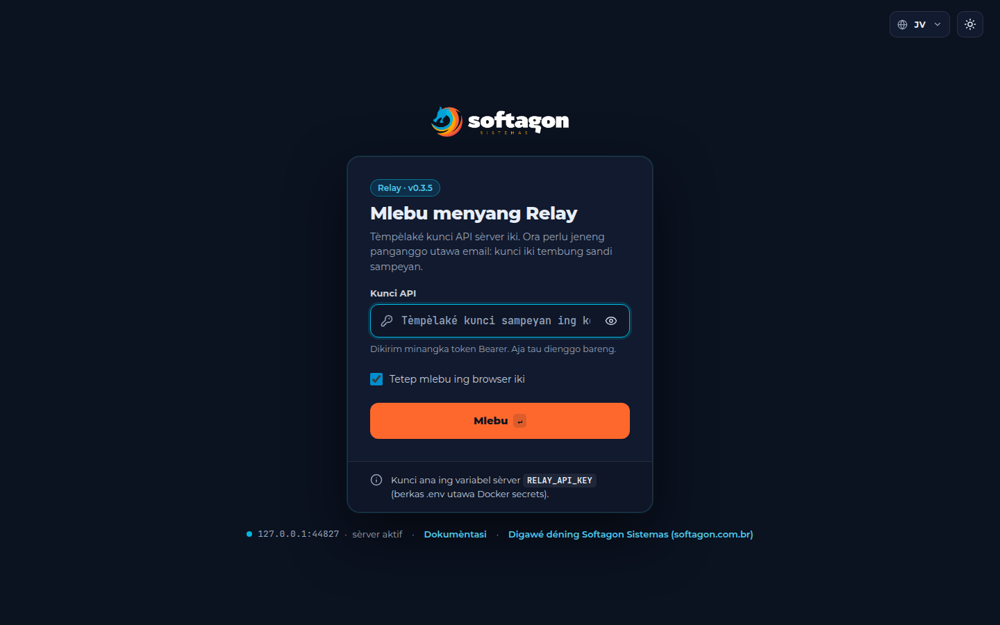
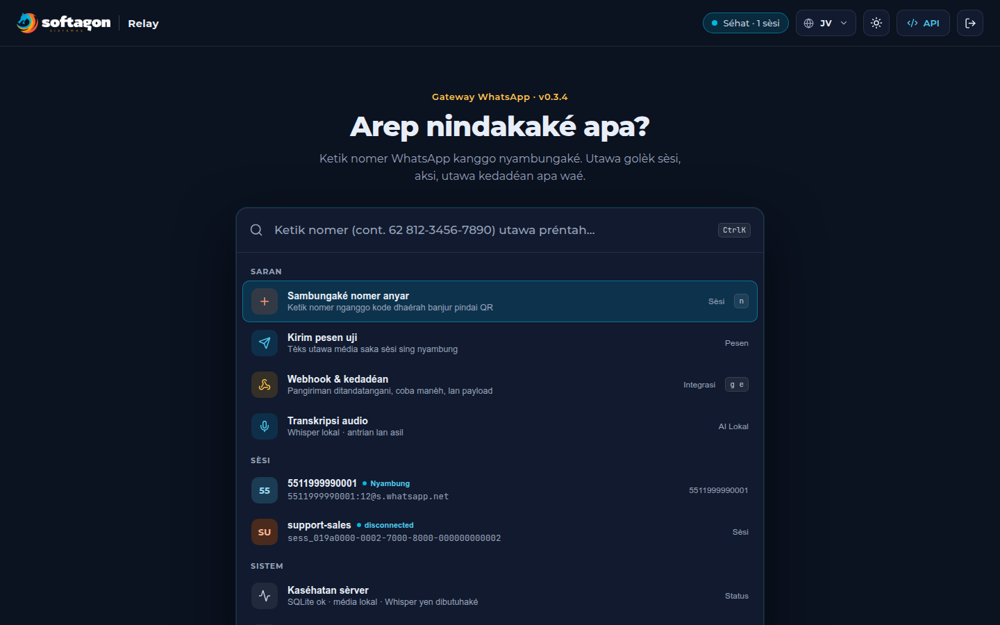
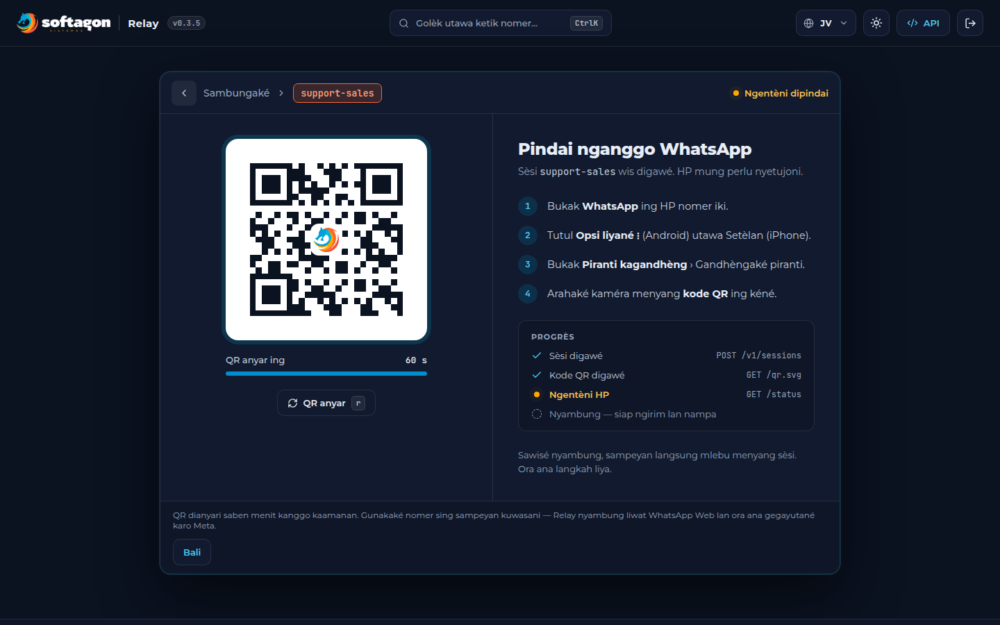
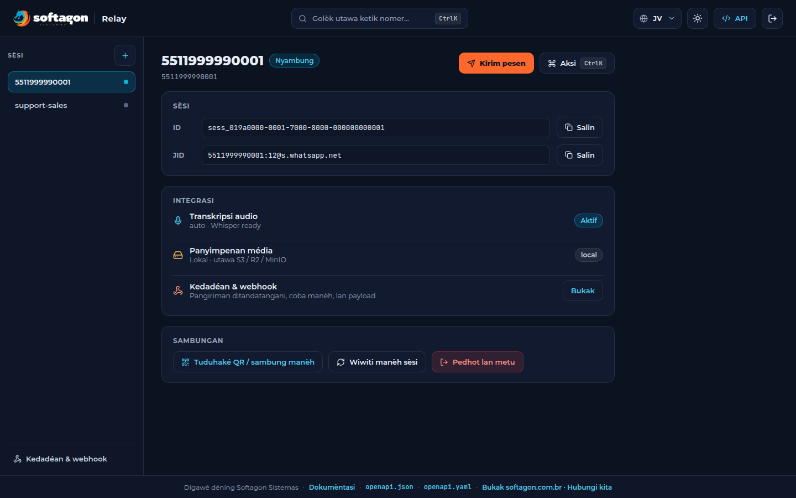
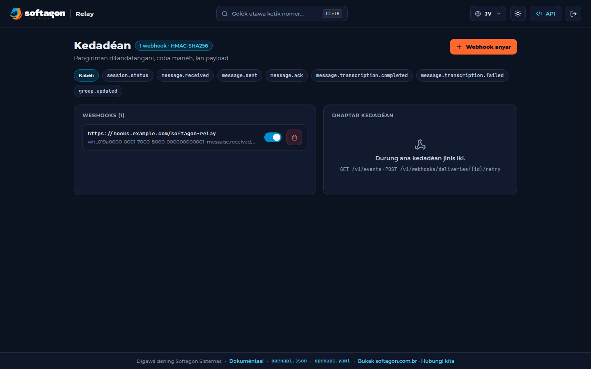
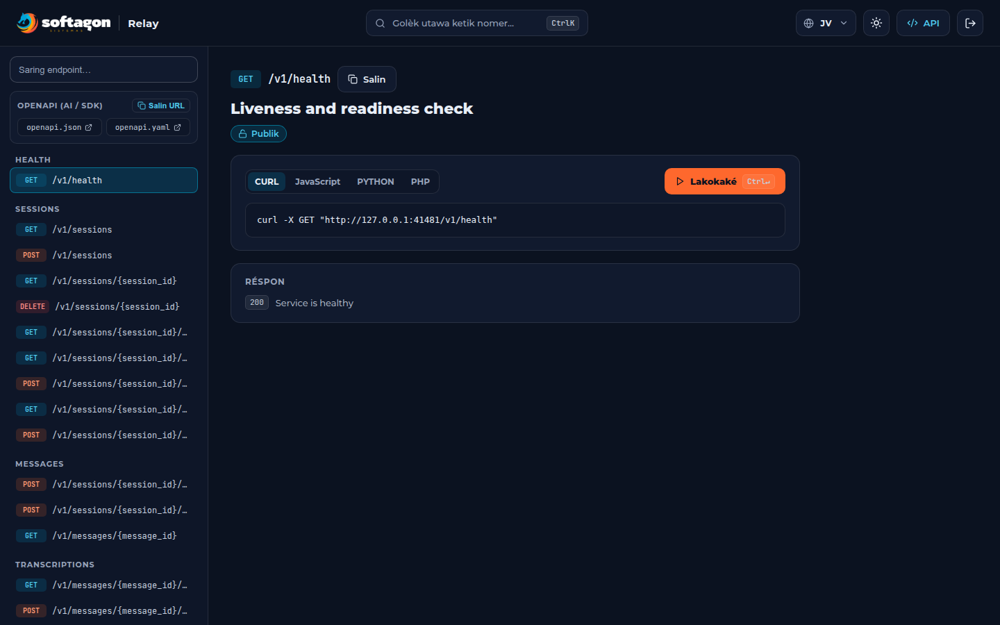

# Dokumèntasi Resmi — Softagon Relay (Basa Jawa)

> Basa: [Português (BR)](../pt-BR/README.md) · [English](../en/README.md) · [Español](../es/README.md) · [Français](../fr/README.md) · [Bahasa Indonesia](../id/README.md) · [Basa Betawi](../bew/README.md) · [Basa Sunda](../su/README.md) · **Basa Jawa** · [Hata Batak Toba](../bbc/README.md) · [Bahasa Melayu](../ms/README.md)

**Apa kuwi Softagon Relay?**  
**Softagon Relay** yaiku **gateway HTTP API WhatsApp Web** open-source lan self-hosted sing digawé nganggo **Rust** déning **[Softagon Sistemas](https://softagon.com.br)**. Mlaku minangka **siji container Docker (~55 MB)** kanthi **SQLite (WAL)** ing njeroné, **Konsol Wèb gaya Raycast** ing `/console`, panyimpenan média **Lokal utawa S3/R2/MinIO**, **webhook ditandatangani HMAC-SHA256**, **OpenAPI 3.2.1**, lan **transkripsi pesen swara multibasa offline** nganggo `whisper.cpp`.

- **Situs Resmi & Kontak:** <https://softagon.com.br>
- **Docker Hub:** <https://hub.docker.com/r/softagon/relay> (`softagon/relay:latest`)
- **Kode Sumber (GitHub):** <https://github.com/SoftagonSistemas/whatsapp-gateway-relay-softagon>
- **Changelog & Roadmap:** [CHANGELOG.md](../../CHANGELOG.md) *(kalebu rencana **aplikasi Desktop Tauri** kanggo Windows, Linux & macOS — [bukak Issue](https://github.com/SoftagonSistemas/whatsapp-gateway-relay-softagon/issues/new) yen sampeyan butuh!)*
- **Lisénsi:** Apache-2.0

---

## 1. Wiwitan Cepet (Docker)

```bash
KEY="$(openssl rand -hex 32)" && echo "RELAY_API_KEY=$KEY" && docker run -d \
  --name softagon-relay \
  --restart unless-stopped \
  -p 127.0.0.1:8080:8080 \
  -v relay-data:/data \
  -e RELAY_API_KEY="$KEY" \
  softagon/relay:latest
```

Bukak **Konsol Wèb** ing `http://localhost:8080/console` (utawa `/manager`, sing dialihaké otomatis) banjur lebokaké `RELAY_API_KEY` sampeyan.

### Docker Compose Aman
Gunakaké [compose.yaml](../../compose.yaml) saka répositori (`read_only: true`, `cap_drop: ALL`, `no-new-privileges:true`, UID non-root `10001`).

---

## 2. Pandhuan Visual Konsol Wèb (`/console`)

Konsol Wèb dirancang nganggo tata letak keyboard-first **gaya Raycast**, ndhukung ganti basa langsung (**10 basa:** `PT / EN / ES / FR / ID / BEW / SU / JV / BTK / MS`) lan téma **Padhang / Peteng**.

### 2.1 Mlebu (`/console/login`)
Lebokaké mung kunci sing diatur ing `RELAY_API_KEY` (ora perlu jeneng panganggo utawa email). Kunci dikirim minangka token `Bearer` lan bisa disimpen ing browser sampeyan.



### 2.2 Ngarep & Bar Préntah (`/console`)
Priksa kaséhatan sèrver langsung (`Séhat · N sèsi`), bukak dhaptar sèsi nganggo sak klik, utawa ketik nomer WhatsApp banjur pencèt `↵` kanggo miwiti nggandhèngaké.



### 2.3 Sambungaké Nomer Anyar liwat Kode QR (`/console/connect`)
Sawisé sèsi digawé, kode QR SVG langsung katon nganggo itungan mundur otomatis (pencèt `r` kanggo nggawé manèh langsung). Ing HP sampeyan, bukak **WhatsApp → Piranti kagandhèng → Gandhèngaké piranti** banjur pindai. Piranti bakal katon minangka **Softagon Relay**.



### 2.4 Manajemèn Sèsi & Pesen Uji (`/console/sessions`)
Atur kabèh akun WhatsApp sing nyambung saka siji panggonan:
- Salin **ID** lan **JID** sèsi nganggo sak klik.
- Klik **Kirim pesen** kanggo ngirim pesen uji langsung kanthi validasi nomer internasional lan résolusi otomatis digit sélulèr kanggo Brasil, Mèksiko, lan Argèntina (BR/MX/AR).
- Bukak **Aksi (`⌘K` / `Ctrl+K`)** kanggo miwiti manèh, nyambung manèh, metu, utawa **mbusak sèsi sing pedhot** (sèsi sing isih nyambung direksa supaya ora kebusak tanpa sengaja).



### 2.5 Kedadéan & Webhook (`/console/events`)
Daftaraké URL webhook kanggo nampa kedadéan sacara real-time (`message.received`, `message.sent`, `message.ack`, `session.status`, `message.transcription.completed`, `group.updated`). Relay otomatis nggawé secret HMAC-SHA256.



### 2.6 Réferènsi API Interaktif (`/console/api`)
Digawé langsung saka `/openapi.yaml` (uga ana ing **`/openapi.json`** kanggo agèn AI, n8n, Postman, lan SDK). Saring endpoint, salin conto **cURL, JavaScript, Python, lan PHP**, banjur lakokaké panjalukan langsung (`⌘↵` / `Ctrl+↵`).



### Pintasan Keyboard
| Pintasan | Aksi |
|---|---|
| `⌘K` / `Ctrl+K` | Bukak bar préntah utawa panel aksi sèsi |
| `/` | Fokus panggolèkan |
| `n` | Sambungaké nomer anyar |
| `g` banjur `s` / `e` / `a` | Bukak Sèsi / Kedadéan / API |
| `r` | Gawé manèh Kode QR ing layar Sambungaké |
| `?` | Tuduhaké dhaptar pintasan |

---

## 3. API HTTP (`/v1`) & Autèntikasi

Kabèh rute `/v1/*` (kajaba `GET /v1/health` sing publik) mbutuhaké:

```http
Authorization: Bearer <RELAY_API_KEY>
```

| Métode | Endpoint | Guna |
|---|---|---|
| `GET` | `/v1/health` | Priksa kaséhatan sèrver (publik) |
| `GET` / `POST` | `/v1/sessions` | Dhaptar utawa gawé sèsi |
| `GET` / `DELETE` | `/v1/sessions/{id}` | Rincian utawa busak sèsi pedhot (`409` yen nyambung) |
| `GET` | `/v1/sessions/{id}/qr` · `/qr.svg` | Payload QR tautan (JSON utawa SVG) |
| `GET` | `/v1/sessions/{id}/status` | Status sambungan langsung |
| `POST` | `/v1/sessions/{id}/reconnect` | Wiwiti manèh lan siklus QR anyar |
| `POST` | `/v1/sessions/{id}/logout` | Pedhot tautan piranti WhatsApp |
| `POST` | `/v1/sessions/{id}/messages/text` | Kirim tèks (ndhukung `Idempotency-Key`) |
| `POST` | `/v1/sessions/{id}/messages/media` | Kirim gambar, vidéo, audio, utawa dokumèn |
| `GET` | `/v1/messages/{id}` | Jupuk status & métadata pesen |
| `GET` / `POST` | `/v1/messages/{id}/transcription` | Jupuk utawa coba manèh transkripsi Whisper |
| `GET` / `POST` | `/v1/webhooks` | Dhaptar utawa gawé langganan webhook |
| `GET` / `PATCH` / `DELETE` | `/v1/webhooks/{id}` | Priksa, ubah, utawa busak webhook |

---

## 4. Webhook Ditandatangani (HMAC-SHA256)

Kedadéan: `session.status`, `message.received`, `message.sent`, `message.ack`, `message.transcription.completed`, `message.transcription.failed`, `group.updated`.

Header ing saben pangiriman (**at-least-once** kanthi exponential backoff + jitter):
- `X-Relay-Event-Id`: ID kedadéan UUIDv7 stabil kanggo déduplikasi
- `X-Relay-Event-Type`: jeneng kedadéan
- `X-Relay-Timestamp`: timestamp Unix ing detik
- `X-Relay-Signature`: `sha256=<hex(HMAC-SHA256(secret, "{timestamp}.{raw_body}"))>`

---

## 5. Transkripsi Lokal (Whisper) & Panyimpenan S3

- **Pesen Swara:** didékode murni ing Rust (Symphonia + `symphonia-opus` + Rubato 16 kHz mono, tanpa FFmpeg) lan ditranskripsi lokal nganggo `whisper.cpp` (modèl `base` multibasa).
- **S3 / R2 / MinIO:** atur `MEDIA_STORAGE=s3`, `S3_BUCKET`, `S3_ACCESS_KEY_ID`, `S3_SECRET_ACCESS_KEY`, lan `S3_ENDPOINT_URL`.

---

## 6. Sèrver MCP Lokal kanggo Agèn AI (`v0.3.0`)

Softagon Relay nduwèni **MCP Server (Model Context Protocol)** Rust native nganggo `rmcp`:

- **STDIO (mode lokal baku):** lakokaké `softagon-relay mcp --stdio`. Kabèh log diarahaké menyang `stderr` supaya `stdout` tetep resik kanggo JSON-RPC.
- **Streamable HTTP:** lakokaké `softagon-relay mcp --http` utawa aktifaké `MCP_HTTP_ENABLED=true` (bind menyang `127.0.0.1:8091/mcp`; ing Docker atur `MCP_HTTP_HOST=0.0.0.0` + `MCP_ALLOW_CONTAINER_BIND=true`).
- **Tools:** `list_sessions`, `get_session_status`, `list_chats`, `search_messages`, `get_chat_messages`, `get_message_transcription`, `send_text_message`, lan `logout_session` / `delete_session` (**nonaktif kanthi baku** kajaba `MCP_ALLOW_DESTRUCTIVE=true` + `confirm: true`).
- **Cathetan audit:** saben pangundang tool MCP dicathet menyang `mcp_audit_log` ing SQLite.

```json
{
  "mcpServers": {
    "softagon-relay": {
      "command": "docker",
      "args": [
        "run", "-i", "--rm",
        "-v", "relay-data:/data",
        "-e", "RELAY_API_KEY",
        "softagon/relay:latest",
        "mcp", "--stdio"
      ],
      "env": {
        "RELAY_API_KEY": "<tempel-kunci-sampeyan>"
      }
    }
  }
}
```

### 6.2 Grok Bot, Pairing Tanpa Login & Fitur Agèn (`v0.3.8`)

- **Kit Siap Anggo Grok Bot:** impor 1 klik nganggo **[Tambahaké menyang Grok Bot](https://x.ai/bot/Xe4LpCGaepuE-J2BYH363)** utawa deleng [`docs/grok-bot.md`](../grok-bot.md) lan [`integrations/grok-bot/TEMPLATE.md`](../../integrations/grok-bot/TEMPLATE.md) kanggo masang binèr lokal ing `/workspace/softagon-relay`.
- **Link Pairing Sauntara (`/pair/{token}`):** `POST /v1/sessions/{id}/pair-link` (utawa MCP `create_pairing_link`) mbukak **QR Code** tanpa login `RELAY_API_KEY`, nganyari QR otomatis nganti 10 menit, sarta ana `qr.png` lan **kode 8 digit** (`POST /v1/sessions/{id}/pair-code`).
- **Webhook Bearer & Header Kustom:** lebokake `bearer_token` utawa `auth_header_name`/`auth_header_value` ing `POST`/`PATCH /v1/webhooks`. Tanggepan `401`/`403` langsung mandheg nyoba manèh.
- **Kontèks Obrolan Jangkep:** kalebu `sender_name`, `sender_phone` (kalebu résolusi `@lid`), wangsulan tim saka HP (`from_me: true`, `source: "device_sync"`), wektu asli tanpa micu webhook nalika `is_history_sync`, uga `sticker`, `reaction`, `location`, lan `contact`.
- **Alat MCP & REST Lengkap (`v0.4.0`–`v0.4.4`):** `reply_to_message_id`, `send_reaction`, `send_chat_presence`, `subscribe_presence`, `as_voice_note` (PTT), `sticker`, `send_location`, `send_contact`, `edit_message`, `revoke_message`, buku kontak persisten (`list_contacts`, `save_contact`, `sync_contacts` kanthi sinkronisasi otomatis buku kontak HP), `check_whatsapp`, `get_profile_picture`, `list_groups`, `get_group_info`, `GET /v1/media/{media_id}`, `MEDIA_RETENTION_DAYS`, `softagon-relay backup`, métrik Prometheus `GET /v1/metrics`, kabar `session.disconnected`, migrasi otomatis riwayat `@lid`, fallback SQLite `quoted.text`, lan nggabungaké pesen runtut `WEBHOOK_COALESCE_SECONDS` (default global `0`; `4s` ing kit Grok Bot).

---

## 7. Benchmark Produksi Nyata (Uji Stabilitas 8 Jam Nonstop)

Diukur ing produksi nyata (**2026-11-27/28**, 16 pamariksaan saben 30 menit, `linux/amd64`, `--features whisper`, 1 akun WhatsApp aktif):

| Indikator | Asil Pengukuran (8 Jam Nonstop) |
|---|---|
| **RAM kahanan stabil** | **31,7–32,1 MiB** (ora ana memori bocor sawise 8 jam) |
| **RAM puncak (Whisper `base` aktif)** | **286,4 MiB**, otomatis mudhun manèh menyang **~32 MiB** nalika nganggur |
| **Rata-rata CPU** | **0,04%–0,19%** |
| **Webhook kakirim (Bearer + HMAC)** | **1.083** (`0` gagal auth, `0` bocor `status@broadcast`) |
| **Résolusi `@lid` → nomer telpon** | **100% (`127/127`)** ing chat pribadi lan grup |
| **Transkripsi audio offline (CPU)** | **100% (`5/5`)**, nganti **4,5× luwih cepet tinimbang wektu nyata** |
| **Éror kritis (`ERROR`) sajrone 8 jam** | **`0`** (nyambung terus paling suwé: **6 jam 20 menit**) |

---

## 8. Dhukungan & Kontak

Butuh dhukungan khusus, integrasi kustom, utawa rékayasa AI & WhatsApp?  
Bukak **[softagon.com.br](https://softagon.com.br)** lan hubungi tim **Softagon Sistemas**.
