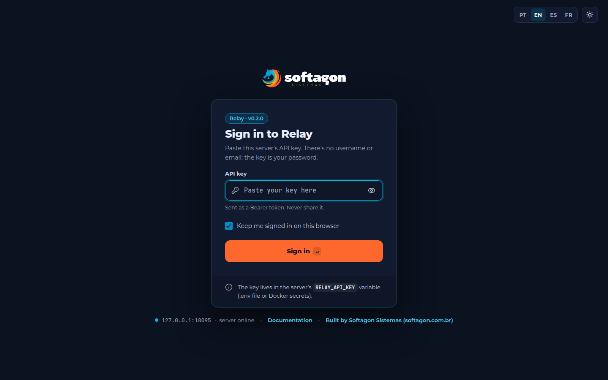
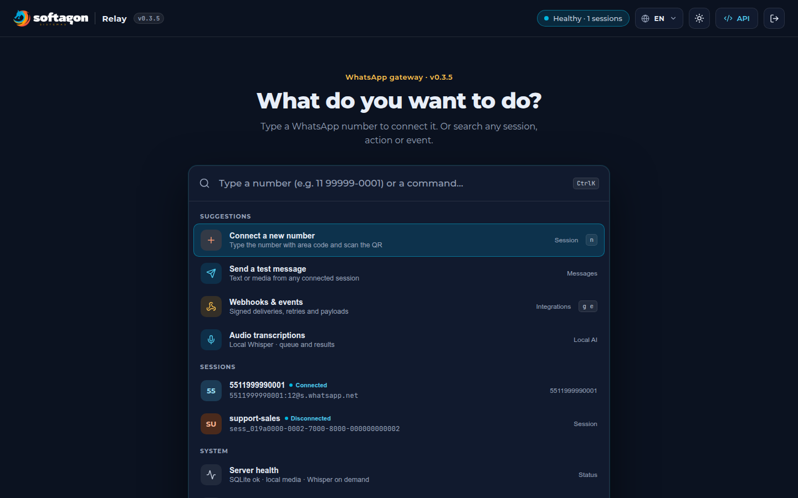
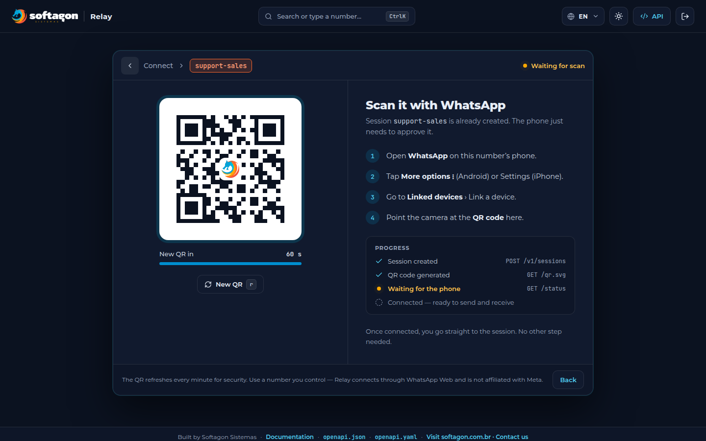
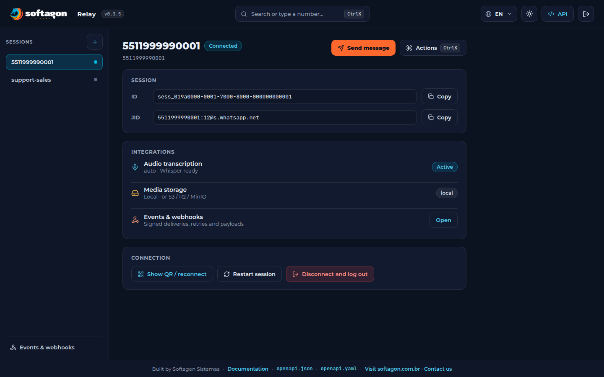
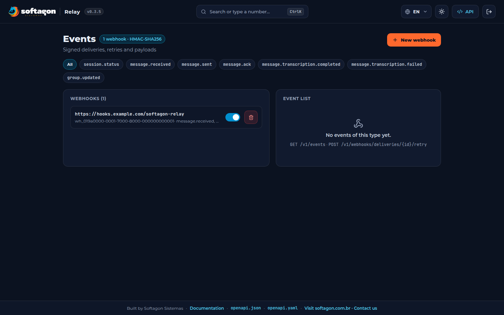
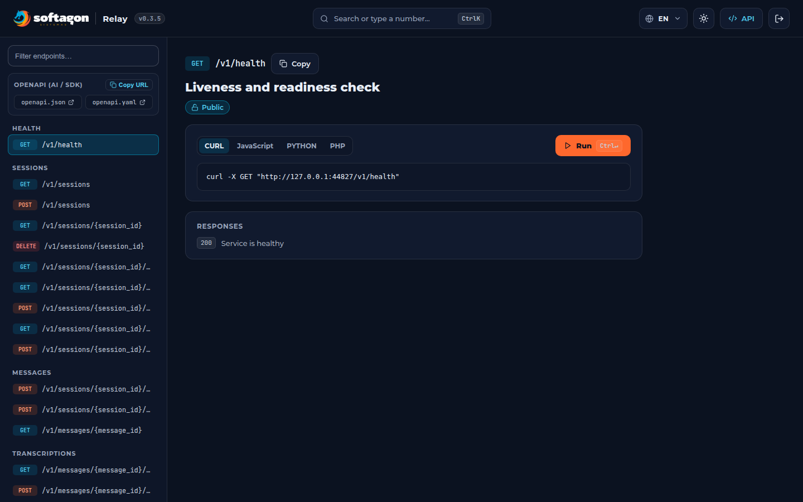

# Dokumentasi Rasmi — Softagon Relay (Bahasa Melayu)

> Bahasa: [Português (BR)](../pt-BR/README.md) · [English](../en/README.md) · [Español](../es/README.md) · [Français](../fr/README.md) · [Bahasa Indonesia](../id/README.md) · [Basa Betawi](../bew/README.md) · [Basa Sunda](../su/README.md) · [Basa Jawa](../jv/README.md) · [Hata Batak Toba](../bbc/README.md) · **Bahasa Melayu**

**Apakah itu Softagon Relay?**  
**Softagon Relay** ialah **gerbang HTTP API WhatsApp Web** sumber terbuka dan hos sendiri (self-hosted) yang dibina dalam **Rust** oleh **[Softagon Sistemas](https://softagon.com.br)**. Ia berjalan sebagai **satu kontena Docker (~55 MB)** dengan **SQLite (WAL)** terbenam, **Konsol Web bergaya Raycast** di `/console`, storan media **Setempat atau S3/R2/MinIO**, **webhook bertandatangan HMAC-SHA256**, **OpenAPI 3.2.1**, dan **transkripsi nota suara berbilang bahasa luar talian** dikuasakan oleh `whisper.cpp`.

- **Laman Web Rasmi & Hubungi:** <https://softagon.com.br>
- **Docker Hub:** <https://hub.docker.com/r/softagon/relay> (`softagon/relay:latest`)
- **Kod Sumber (GitHub):** <https://github.com/SoftagonSistemas/whatsapp-gateway-relay-softagon>
- **Changelog & Pelan Hala Tuju:** [CHANGELOG.md](../../CHANGELOG.md) *(termasuk **aplikasi Desktop Tauri** akan datang untuk Windows, Linux & macOS — [buka Isu](https://github.com/SoftagonSistemas/whatsapp-gateway-relay-softagon/issues/new) jika anda memerlukannya!)*
- **Lesen:** Apache-2.0

---

## 1. Mula Pantas (Docker)

```bash
KEY="$(openssl rand -hex 32)" && echo "RELAY_API_KEY=$KEY" && docker run -d \
  --name softagon-relay \
  --restart unless-stopped \
  -p 127.0.0.1:8080:8080 \
  -v relay-data:/data \
  -e RELAY_API_KEY="$KEY" \
  softagon/relay:latest
```

Buka **Konsol Web** di `http://localhost:8080/console` (atau `/manager`, yang dialihkan secara automatik) dan masukkan `RELAY_API_KEY` anda.

### Docker Compose Diperkukuh
Gunakan [compose.yaml](../../compose.yaml) repositori (`read_only: true`, `cap_drop: ALL`, `no-new-privileges:true`, UID bukan root `10001`).

---

## 2. Panduan Visual Konsol Web (`/console`)

Konsol Web terbenam direka dalam susun atur keutamaan papan kekunci **berinspirasi Raycast**, menyokong penukaran bahasa serta-merta (**10 bahasa:** `PT / EN / ES / FR / ID / BEW / SU / JV / BTK / MS`) dan tema **Cerah / Gelap**.

### 2.1 Log Masuk (`/console/login`)
Masukkan hanya kunci yang dikonfigurasikan dalam `RELAY_API_KEY` (tiada nama pengguna atau e-mel diperlukan). Ia dihantar sebagai token `Bearer` dan boleh diingati secara pilihan dalam pelayar anda.



### 2.2 Utama & Bar Arahan (`/console`)
Semak kesihatan pelayan secara langsung (`Sihat · N sesi`), lompat ke senarai sesi dengan satu klik, atau taip sebarang nombor WhatsApp dan tekan `↵` untuk memulakan pemautan.



### 2.3 Sambung Nombor Baharu melalui Kod QR (`/console/connect`)
Setelah sesi dicipta, kod QR SVG langsung muncul dengan kira detik muat semula automatik (tekan `r` untuk menjana semula serta-merta). Pada telefon anda, buka **WhatsApp → Peranti terpaut → Pautkan peranti** dan imbas. Peranti terpaut akan dipaparkan sebagai **Softagon Relay**.



### 2.4 Pengurusan Sesi & Mesej Ujian (`/console/sessions`)
Urus semua akaun WhatsApp yang disambungkan dari satu tempat:
- Salin **ID** dan **JID** sesi dengan satu klik.
- Klik **Hantar mesej** untuk menghantar mesej ujian langsung dengan pengesahan nombor antarabangsa.
- Buka **Tindakan (`⌘K` / `Ctrl+K`)** untuk memulakan semula, menyambung semula, log keluar, atau **memadam sesi yang terputus**.



### 2.5 Acara & Webhook (`/console/events`)
Daftar URL webhook untuk menerima acara masa nyata (`message.received`, `message.sent`, `message.ack`, `session.status`, `message.transcription.completed`, `group.updated`). Relay menjana rahsia tandatangan HMAC-SHA256 secara automatik.



### 2.6 Rujukan API Interaktif (`/console/api`)
Dijana secara langsung daripada `/openapi.yaml` (juga tersedia di **`/openapi.json`** untuk ejen AI, n8n, Postman, dan SDK). Tapis titik akhir, salin petikan kod **cURL, JavaScript, Python, dan PHP**, dan jalankan permintaan sebenar (`⌘↵` / `Ctrl+↵`).



### Pintasan Papan Kekunci
| Pintasan | Tindakan |
|---|---|
| `⌘K` / `Ctrl+K` | Buka bar arahan atau panel tindakan sesi |
| `/` | Fokus carian |
| `n` | Sambung nombor baharu |
| `g` kemudian `s` / `e` / `a` | Pergi ke Sesi / Acara / API |
| `r` | Jana semula Kod QR di skrin Sambung |
| `?` | Papar helaian pintasan |

---

## 3. API HTTP (`/v1`) & Pengesahan

Semua laluan `/v1/*` (kecuali `GET /v1/health` awam) memerlukan:

```http
Authorization: Bearer <RELAY_API_KEY>
```

| Kaedah | Titik Akhir | Tujuan |
|---|---|---|
| `GET` | `/v1/health` | Semakan kesihatan pelayan (awam) |
| `GET` / `POST` | `/v1/sessions` | Senarai atau cipta sesi |
| `GET` / `DELETE` | `/v1/sessions/{id}` | Butiran atau padam sesi terputus (`409` jika bersambung) |
| `GET` | `/v1/sessions/{id}/qr` · `/qr.svg` | Muatan QR pemautan (JSON atau SVG) |
| `GET` | `/v1/sessions/{id}/status` | Status sambungan langsung |
| `POST` | `/v1/sessions/{id}/reconnect` | Mula semula dan mulakan kitaran QR baharu |
| `POST` | `/v1/sessions/{id}/logout` | Nyahpaut peranti WhatsApp |
| `POST` | `/v1/sessions/{id}/messages/text` | Hantar teks (menyokong `Idempotency-Key`) |
| `POST` | `/v1/sessions/{id}/messages/media` | Hantar imej, video, audio, atau dokumen |
| `GET` | `/v1/messages/{id}` | Dapatkan status & metadata mesej |
| `GET` / `POST` | `/v1/messages/{id}/transcription` | Dapatkan atau cuba semula transkripsi Whisper |
| `GET` / `POST` | `/v1/webhooks` | Senarai atau cipta langganan webhook |
| `GET` / `PATCH` / `DELETE` | `/v1/webhooks/{id}` | Periksa, kemas kini, atau padam webhook |

---

## 4. Webhook Bertandatangan (HMAC-SHA256)

Acara: `session.status`, `message.received`, `message.sent`, `message.ack`, `message.transcription.completed`, `message.transcription.failed`, `group.updated`.

Pengepala pada setiap penghantaran (**at-least-once** dengan exponential backoff + jitter):
- `X-Relay-Event-Id`: ID acara UUIDv7 stabil untuk penyahduplikasian
- `X-Relay-Event-Type`: nama acara
- `X-Relay-Timestamp`: cap masa Unix dalam saat
- `X-Relay-Signature`: `sha256=<hex(HMAC-SHA256(secret, "{timestamp}.{raw_body}"))>`

---

## 5. Transkripsi Setempat (Whisper) & Storan S3

- **Nota Suara:** dinyahkod dalam Rust tulen (Symphonia + `symphonia-opus` + Rubato 16 kHz mono, tanpa FFmpeg) dan ditranskripsi secara setempat dengan `whisper.cpp` (model `base` berbilang bahasa).
- **S3 / R2 / MinIO:** tetapkan `MEDIA_STORAGE=s3`, `S3_BUCKET`, `S3_ACCESS_KEY_ID`, `S3_SECRET_ACCESS_KEY`, dan `S3_ENDPOINT_URL`.

---

## 6. Pelayan MCP Setempat untuk Ejen AI (`v0.3.0`)

Softagon Relay disertakan dengan **MCP Server (Model Context Protocol)** Rust natif dikuasakan oleh `rmcp`:

- **STDIO (mod setempat lalai):** jalankan `softagon-relay mcp --stdio`. Semua log dihalakan ke `stderr` supaya `stdout` kekal bersih untuk JSON-RPC.
- **Streamable HTTP:** jalankan `softagon-relay mcp --http` atau dayakan `MCP_HTTP_ENABLED=true` (ikat ke `127.0.0.1:8091/mcp`; dalam Docker tetapkan `MCP_HTTP_HOST=0.0.0.0` + `MCP_ALLOW_CONTAINER_BIND=true`).
- **Alat (Tools):** `list_sessions`, `get_session_status`, `list_chats`, `search_messages`, `get_chat_messages`, `get_message_transcription`, `send_text_message`, serta `logout_session` / `delete_session` (**dinyahdayakan secara lalai** melainkan `MCP_ALLOW_DESTRUCTIVE=true` + `confirm: true`).
- **Jejak audit:** setiap pemanggilan alat MCP direkodkan ke `mcp_audit_log` dalam SQLite.

```json
{
  "mcpServers": {
    "softagon-relay": {
      "command": "docker",
      "args": [
        "run", "-i", "--rm",
        "-v", "relay-data:/data",
        "-e", "RELAY_API_KEY",
        "softagon/relay:latest",
        "mcp", "--stdio"
      ],
      "env": {
        "RELAY_API_KEY": "<tampal-kunci-anda>"
      }
    }
  }
}
```

---

## 7. Sokongan & Hubungi

Perlukan sokongan khusus, integrasi tersuai, atau kejuruteraan AI & pemesejan?  
Layari **[softagon.com.br](https://softagon.com.br)** dan berhubung dengan pasukan **Softagon Sistemas**.
