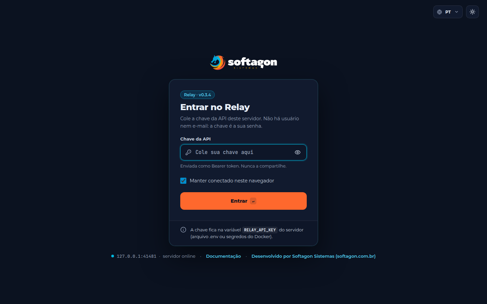
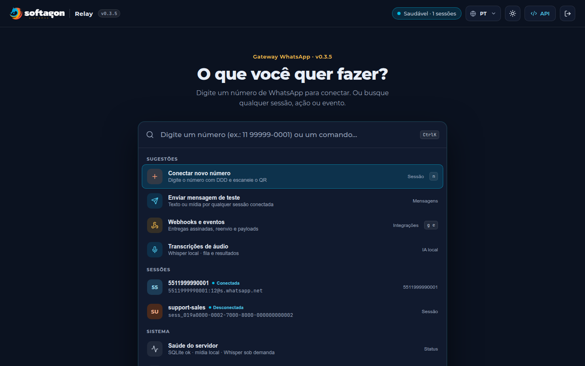
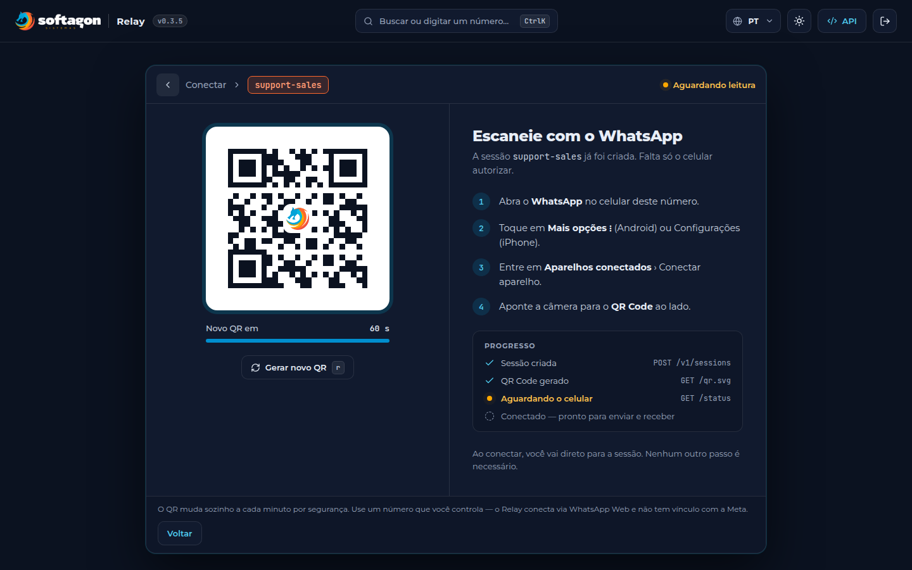
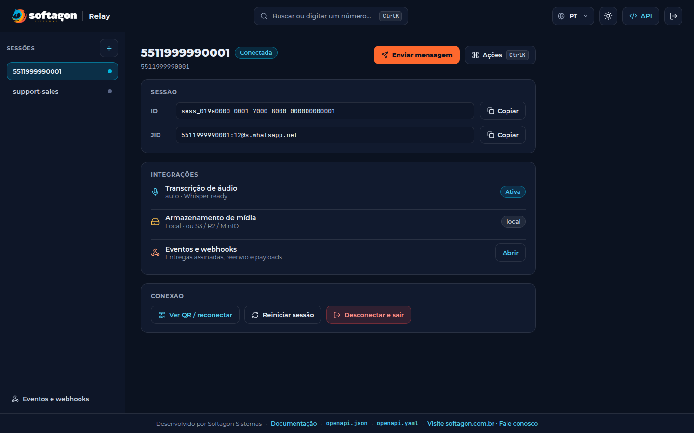
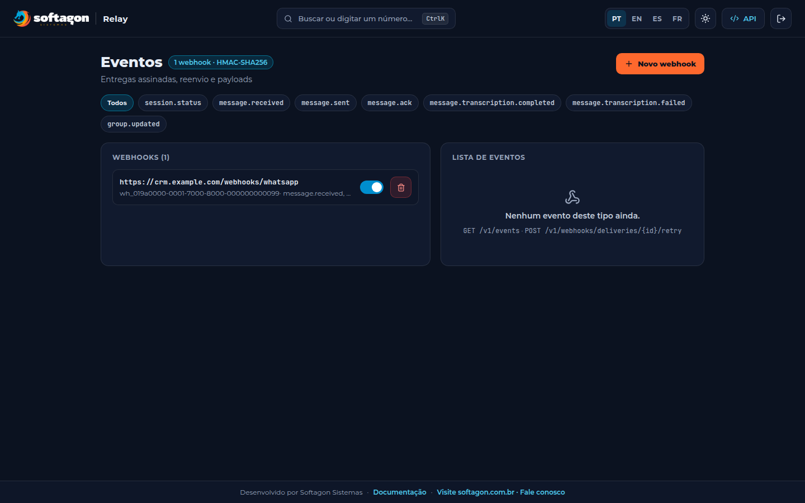
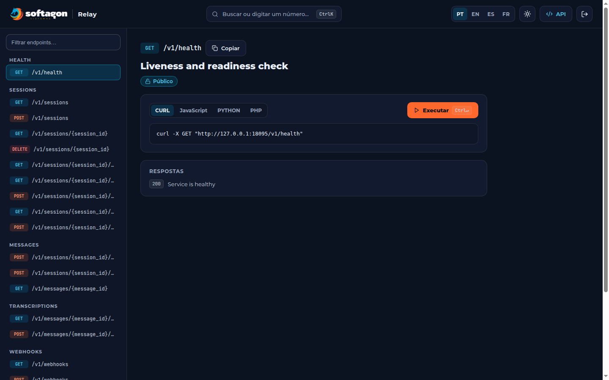

# Documentação Oficial — Softagon Relay (Português)

> Idiomas: **Português (BR)** · [English](../en/README.md) · [Español](../es/README.md) · [Français](../fr/README.md) · [Bahasa Indonesia](../id/README.md) · [Basa Betawi](../bew/README.md) · [Basa Sunda](../su/README.md) · [Basa Jawa](../jv/README.md) · [Hata Batak Toba](../bbc/README.md) · [Bahasa Melayu](../ms/README.md)

**O que é o Softagon Relay?**  
O **Softagon Relay** é um **gateway WhatsApp Web open-source e self-hosted** desenvolvido em **Rust** pela **[Softagon Sistemas](https://softagon.com.br)**. Ele roda em um **único container Docker (~55 MB)** com **SQLite (WAL)** embutido, **Console Web estilo Raycast** em `/console`, armazenamento de mídia **Local ou S3/R2/MinIO**, **webhooks assinados com HMAC-SHA256**, **OpenAPI 3.2.1** e **transcrição offline multilíngue de áudios** com `whisper.cpp`.

- **Site Oficial & Contato:** <https://softagon.com.br>
- **Docker Hub:** <https://hub.docker.com/r/softagon/relay> (`softagon/relay:latest`)
- **Código-fonte (GitHub):** <https://github.com/SoftagonSistemas/whatsapp-gateway-relay-softagon>
- **Changelog & Roadmap:** [CHANGELOG.md](../../CHANGELOG.md) *(incluindo futura versão **Desktop em Tauri** para Windows, Linux e macOS — [abra uma Issue](https://github.com/SoftagonSistemas/whatsapp-gateway-relay-softagon/issues/new) se precisar!)*
- **Licença:** Apache-2.0

---

## 1. Instalação Rápida (Docker)

```bash
KEY="$(openssl rand -hex 32)" && echo "RELAY_API_KEY=$KEY" && docker run -d \
  --name softagon-relay \
  --restart unless-stopped \
  -p 127.0.0.1:8080:8080 \
  -v relay-data:/data \
  -e RELAY_API_KEY="$KEY" \
  softagon/relay:latest
```

Acesse o **Console Web** em `http://localhost:8080/console` (ou `/manager`, que redireciona automaticamente) e informe sua `RELAY_API_KEY`.

### Perfil endurecido com Docker Compose
Use o [compose.yaml](../../compose.yaml) do repositório (`read_only: true`, `cap_drop: ALL`, `no-new-privileges:true`, usuário não-root UID `10001`).

---

## 2. Guia Visual do Console Web (`/console`)

O Console Web foi desenhado no estilo **Raycast** para operação rápida — inclusive sem mouse — com alternância instantânea de idioma (**10 idiomas:** `PT / EN / ES / FR / ID / BEW / SU / JV / BTK / MS`) e tema (**Claro / Escuro**).

### 2.1 Login (`/console/login`)
Informe apenas a chave definida em `RELAY_API_KEY` (não há usuário nem e-mail). A chave é enviada como `Bearer` token e, opcionalmente, lembrada no navegador.



### 2.2 Início e Barra de Comando (`/console`)
Na tela inicial você vê o status do servidor em tempo real (`Saudável · N sessões`), acessa a lista de sessões com um clique ou digita diretamente qualquer número de WhatsApp (com máscara e validação internacional automática) e pressiona `↵` para iniciar o pareamento.



### 2.3 Conectar Novo Número via QR Code (`/console/connect`)
Ao criar a sessão, o QR Code SVG aparece ao vivo com contador de renovação automática (pressione `r` para gerar um novo QR imediatamente). No celular, abra **WhatsApp → Aparelhos conectados → Conectar aparelho** e aponte a câmera. O dispositivo aparece listado como **Softagon Relay**.



### 2.4 Gerenciamento de Sessões e Envio de Teste (`/console/sessions`)
Gerencie todas as suas conexões em um só lugar:
- Copie **ID** e **JID** da sessão com um clique.
- Clique em **Enviar mensagem** para testar o envio diretamente pela interface (com validação internacional e resolução automática do 9º dígito para Brasil, México e Argentina).
- Use o menu **Ações (`⌘K` / `Ctrl+K`)** para reiniciar, reconectar, fazer logout ou **excluir sessões desconectadas** (sessões conectadas são protegidas contra exclusão acidental).



### 2.5 Eventos e Webhooks (`/console/events`)
Cadastre URLs para receber eventos em tempo real (`message.received`, `message.sent`, `message.ack`, `session.status`, `message.transcription.completed`, `group.updated`). O Relay gera automaticamente um segredo HMAC-SHA256 e permite ativar, pausar ou remover assinaturas.



### 2.6 Referência Interativa da API (`/console/api`)
Gerada dinamicamente a partir do contrato `/openapi.yaml` (também disponível em **`/openapi.json`** para integração direta com agentes de IA, n8n, Postman e SDKs), permite filtrar endpoints, copiar exemplos prontos em **cURL, JavaScript, Python e PHP** e executar chamadas reais contra o servidor (`⌘↵` / `Ctrl+↵`).



### Atalhos de teclado
| Atalho | Ação |
|---|---|
| `⌘K` / `Ctrl+K` | Abre a barra de comando ou o painel de ações da sessão |
| `/` | Foca a busca |
| `n` | Conectar novo número |
| `g` depois `s` / `e` / `a` | Ir para Sessões / Eventos / API |
| `r` | Gerar novo QR Code na tela de conexão |
| `?` | Exibir folha de atalhos |

---

## 3. API HTTP (`/v1`) & Autenticação

Todas as rotas `/v1/*` (exceto `GET /v1/health`) exigem:

```http
Authorization: Bearer <RELAY_API_KEY>
```

| Método | Endpoint | Função |
|---|---|---|
| `GET` | `/v1/health` | Saúde do servidor (público) |
| `GET` / `POST` | `/v1/sessions` | Listar ou criar sessão |
| `GET` / `DELETE` | `/v1/sessions/{id}` | Detalhes ou excluir sessão desconectada (`409` se conectada) |
| `GET` | `/v1/sessions/{id}/qr` · `/qr.svg` | QR Code em JSON ou SVG |
| `GET` | `/v1/sessions/{id}/status` | Estado de conexão ao vivo |
| `POST` | `/v1/sessions/{id}/reconnect` | Reiniciar e gerar novo ciclo de QR |
| `POST` | `/v1/sessions/{id}/logout` | Desconectar aparelho do WhatsApp |
| `POST` | `/v1/sessions/{id}/messages/text` | Enviar texto (aceita `Idempotency-Key` e resolve 9º dígito BR/MX/AR) |
| `POST` | `/v1/sessions/{id}/messages/media` | Enviar imagem, vídeo, áudio ou documento |
| `GET` | `/v1/messages/{id}` | Consultar status/detalhes da mensagem |
| `GET` / `POST` | `/v1/messages/{id}/transcription` | Consultar ou reprocessar transcrição Whisper |
| `GET` / `POST` | `/v1/webhooks` | Listar ou criar webhook |
| `GET` / `PATCH` / `DELETE` | `/v1/webhooks/{id}` | Inspecionar, atualizar ou remover webhook |

---

## 4. Webhooks Assinados (HMAC-SHA256)

Eventos emitidos: `session.status`, `message.received`, `message.sent`, `message.ack`, `message.transcription.completed`, `message.transcription.failed`, `group.updated`.

Cabeçalhos enviados em cada entrega (**at-least-once** com backoff exponencial + jitter):
- `X-Relay-Event-Id`: ID único UUIDv7 para deduplicação
- `X-Relay-Event-Type`: tipo do evento
- `X-Relay-Timestamp`: Unix timestamp em segundos
- `X-Relay-Signature`: `sha256=<hex(HMAC-SHA256(secret, "{timestamp}.{raw_body}"))>`

---

## 5. Transcrição Local (Whisper) e Storage S3

- **Áudios:** decodificados em Rust puro (Symphonia + `symphonia-opus` + Rubato 16 kHz mono, sem FFmpeg) e transcritos localmente com `whisper.cpp` (modelo `base` multilíngue carregado sob demanda e descarregado após inatividade).
- **Mídia S3/R2/MinIO:** defina `MEDIA_STORAGE=s3`, `S3_BUCKET`, `S3_ACCESS_KEY_ID`, `S3_SECRET_ACCESS_KEY` e `S3_ENDPOINT_URL`.

---

## 6. Servidor MCP Local para Agentes de IA (`v0.3.0`)

O Softagon Relay inclui um **MCP Server (Model Context Protocol)** nativo em Rust (`rmcp`) conectado diretamente à camada interna `RelayService` (sem depender do HTTP REST):

- **STDIO (padrão local):** execute `softagon-relay mcp` (ou `softagon-relay mcp --stdio`). Logs vão estritamente para `stderr`, mantendo `stdout` limpo para JSON-RPC.
- **Streamable HTTP:** execute `softagon-relay mcp --http` ou ative `MCP_HTTP_ENABLED=true` junto com `softagon-relay serve` — escuta em `127.0.0.1:8091/mcp` por padrão (no Docker, atrás de `-p 127.0.0.1:8091:8091`, use `MCP_HTTP_HOST=0.0.0.0` + `MCP_ALLOW_CONTAINER_BIND=true`), sempre com validação de `Host`/`Origin` contra DNS rebinding e `Authorization: Bearer <RELAY_API_KEY>`.
- **Ferramentas disponíveis:** `list_sessions`, `get_session_status`, `list_chats`, `search_messages`, `get_chat_messages`, `get_message_transcription`, `send_text_message`, e (desabilitadas por padrão) `logout_session` / `delete_session` (exigem `MCP_ALLOW_DESTRUCTIVE=true` e `confirm: true`).
- **Auditoria:** todas as chamadas MCP são gravadas em `mcp_audit_log` no SQLite.

```json
{
  "mcpServers": {
    "softagon-relay": {
      "command": "docker",
      "args": [
        "run", "-i", "--rm",
        "-v", "relay-data:/data",
        "-e", "RELAY_API_KEY",
        "softagon/relay:latest",
        "mcp", "--stdio"
      ],
      "env": {
        "RELAY_API_KEY": "<cole-sua-chave-gerada>"
      }
    }
  }
}
```

> Para uso **standalone** sem outro container `softagon-relay` rodando, adicione `"-e", "MCP_RESTORE_SESSIONS=true"` em `args`. Com o container principal rodando, prefira **Streamable HTTP** no mesmo container (`-p 127.0.0.1:8091:8091 -e MCP_HTTP_ENABLED=true -e MCP_HTTP_HOST=0.0.0.0 -e MCP_ALLOW_CONTAINER_BIND=true`).

### 6.2 Grok Bot, Pareamento Sem Login e Recursos de Atendimento (`v0.3.8`)

- **Grok Bot (Guia + Template pronto):** veja [`docs/grok-bot.md`](../grok-bot.md) e [`integrations/grok-bot/TEMPLATE.md`](../../integrations/grok-bot/TEMPLATE.md) para instalar o binário nativo em `/workspace/softagon-relay`.
- **Link temporário de pareamento (`/pair/{token}`):** `POST /v1/sessions/{id}/pair-link` (ou MCP `create_pairing_link`) abre o **QR Code** direto no navegador sem pedir `RELAY_API_KEY`, renova automaticamente ciclos expirados por até 10 min e oferece `qr.png` nativo e **código de 8 dígitos** (`POST /v1/sessions/{id}/pair-code` / MCP `request_pair_code`) como alternativa.
- **Webhooks com autenticação Bearer ou cabeçalho customizado:** passe `bearer_token` ou `auth_header_name`/`auth_header_value` em `POST`/`PATCH /v1/webhooks` (sem precisar de proxy para rotinas do Grok Bot). Respostas `401`/`403` interrompem retentativas automaticamente.
- **Contexto completo de atendimento:** webhooks e histórico incluem `sender_name` (nome no WhatsApp), `sender_phone` (resolvido inclusive para contatos `@lid`), mensagens enviadas pela equipe pelo celular (`from_me: true`, `source: "device_sync"`), timestamp real sem flood de `is_history_sync`, além de `sticker`, `reaction`, `location` e `contact`.
- **Novas ferramentas MCP e endpoints REST:** `get_contact` (`GET /v1/sessions/{id}/contacts/{jid}`), `mark_read` (`POST /v1/sessions/{id}/chats/read`), `send_media_message` com suporte a `media_url` (HTTP/HTTPS) ou `data_base64` e `idempotency_key` deduplicado no SQLite.

---

## 7. Suporte e Contato

Precisa de suporte dedicado, integrações sob medida ou consultoria em IA e mensageria?  
Visite **[softagon.com.br](https://softagon.com.br)** e fale com a equipe da **Softagon Sistemas**.
