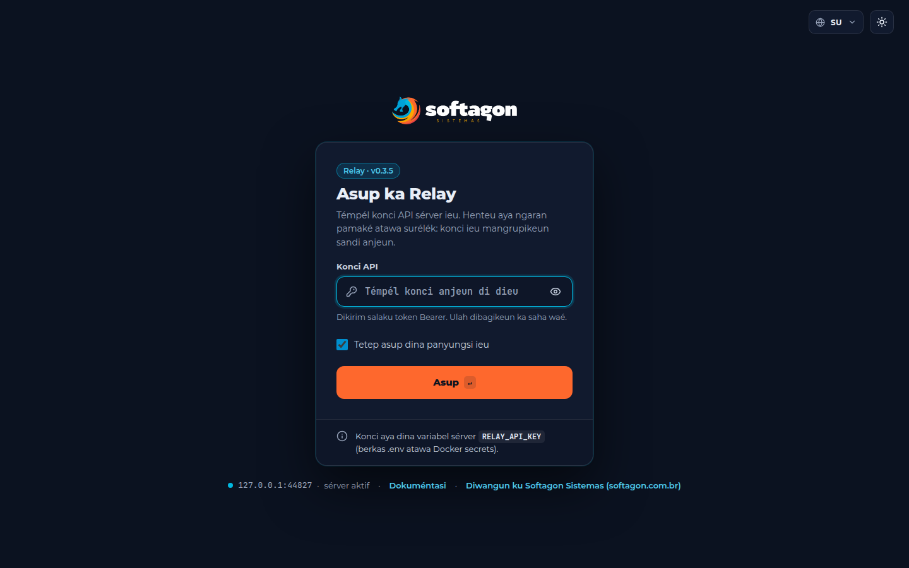
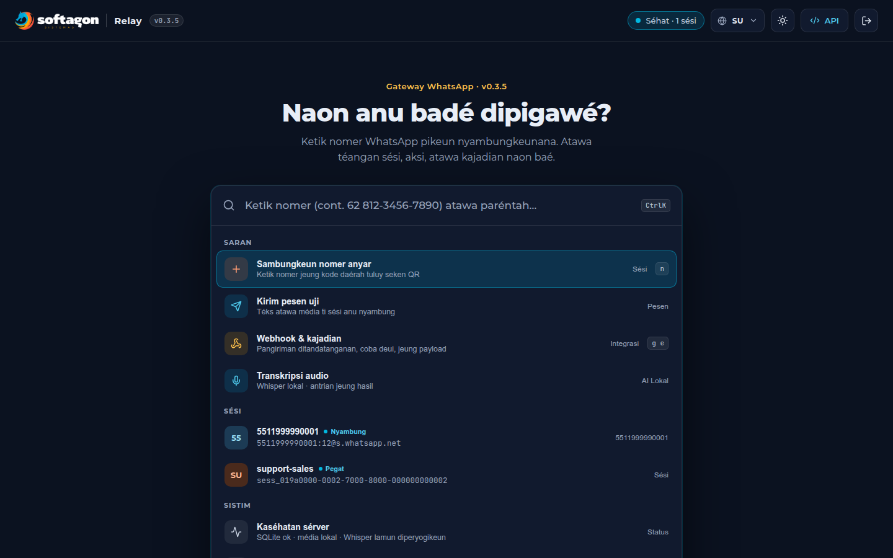
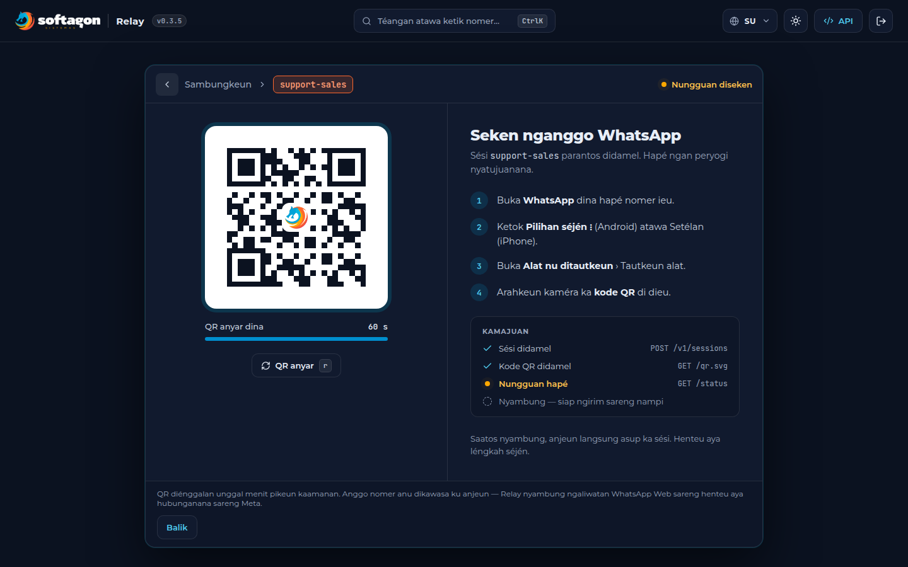
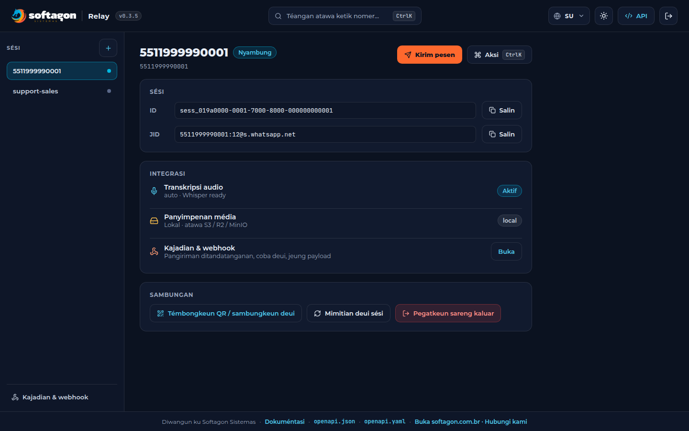
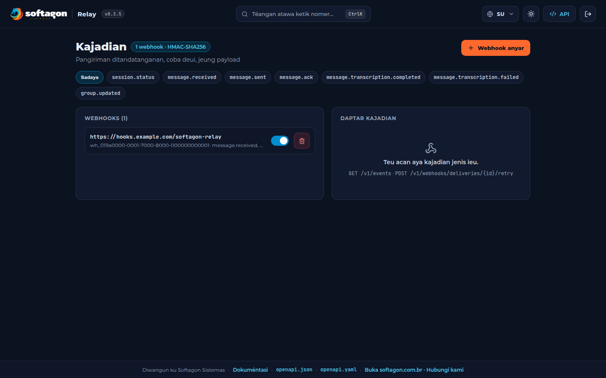
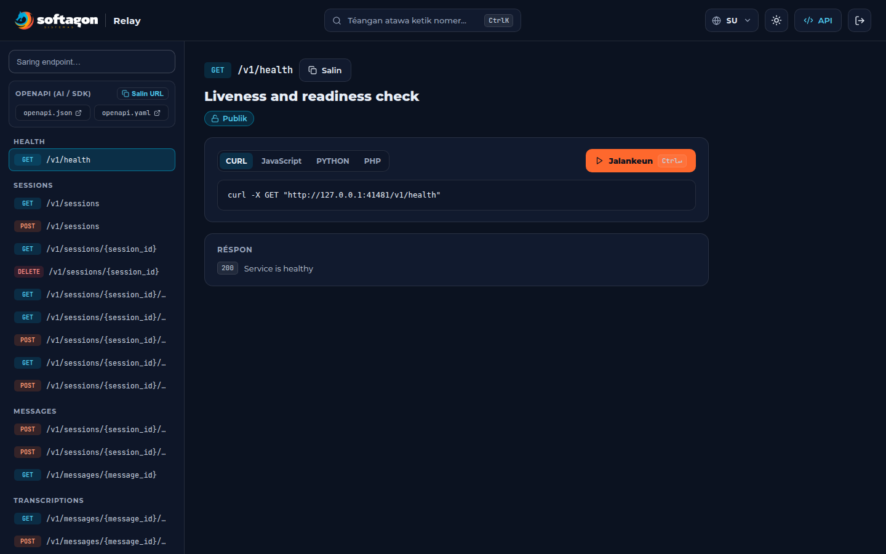

# Dokuméntasi Resmi — Softagon Relay (Basa Sunda)

> Basa: [Português (BR)](../pt-BR/README.md) · [English](../en/README.md) · [Español](../es/README.md) · [Français](../fr/README.md) · [Bahasa Indonesia](../id/README.md) · [Basa Betawi](../bew/README.md) · **Basa Sunda** · [Basa Jawa](../jv/README.md) · [Hata Batak Toba](../bbc/README.md) · [Bahasa Melayu](../ms/README.md)

**Naon ari Softagon Relay?**  
**Softagon Relay** nyaéta **gateway HTTP API WhatsApp Web** open-source sareng self-hosted anu diwangun nganggo **Rust** ku **[Softagon Sistemas](https://softagon.com.br)**. Jalan dina **hiji container Docker (~55 MB)** kalayan **SQLite (WAL)** di jerona, **Konsol Wéb gaya Raycast** di `/console`, panyimpenan média **Lokal atawa S3/R2/MinIO**, **webhook ditandatanganan HMAC-SHA256**, **OpenAPI 3.2.1**, sareng **transkripsi pesen sora multibasa offline** nganggo `whisper.cpp`.

- **Loka Resmi & Kontak:** <https://softagon.com.br>
- **Docker Hub:** <https://hub.docker.com/r/softagon/relay> (`softagon/relay:latest`)
- **Kode Sumber (GitHub):** <https://github.com/SoftagonSistemas/whatsapp-gateway-relay-softagon>
- **Changelog & Roadmap:** [CHANGELOG.md](../../CHANGELOG.md) *(kalebet rencana **aplikasi Desktop Tauri** pikeun Windows, Linux & macOS — [buka Issue](https://github.com/SoftagonSistemas/whatsapp-gateway-relay-softagon/issues/new) upami anjeun peryogi!)*
- **Lisénsi:** Apache-2.0

---

## 1. Mimitian Gancang (Docker)

```bash
KEY="$(openssl rand -hex 32)" && echo "RELAY_API_KEY=$KEY" && docker run -d \
  --name softagon-relay \
  --restart unless-stopped \
  -p 127.0.0.1:8080:8080 \
  -v relay-data:/data \
  -e RELAY_API_KEY="$KEY" \
  softagon/relay:latest
```

Buka **Konsol Wéb** di `http://localhost:8080/console` (atawa `/manager`, anu dialihkeun otomatis) tuluy lebetkeun `RELAY_API_KEY` anjeun.

### Docker Compose Aman
Anggo [compose.yaml](../../compose.yaml) tina répositori (`read_only: true`, `cap_drop: ALL`, `no-new-privileges:true`, UID non-root `10001`).

---

## 2. Pituduh Visual Konsol Wéb (`/console`)

Konsol Wéb dirancang dina tata letak keyboard-first **gaya Raycast**, ngarojong ganti basa langsung (**10 basa:** `PT / EN / ES / FR / ID / BEW / SU / JV / BTK / MS`) sareng téma **Caang / Poék**.

### 2.1 Asup (`/console/login`)
Lebetkeun ukur konci anu disetél dina `RELAY_API_KEY` (teu peryogi ngaran pamaké atawa surélék). Konci dikirim salaku token `Bearer` sareng tiasa disimpen dina panyungsi anjeun.



### 2.2 Tepas & Bar Paréntah (`/console`)
Pariksa kaséhatan sérver langsung (`Séhat · N sési`), buka daptar sési ku sakali klik, atawa ketik nomer WhatsApp tuluy pencét `↵` pikeun ngamimitian panautan.



### 2.3 Sambungkeun Nomer Anyar via Kode QR (`/console/connect`)
Saatos sési didamel, kode QR SVG langsung némbongan kalayan itungan mundur otomatis (pencét `r` pikeun ngadamel deui langsung). Dina hapé anjeun, buka **WhatsApp → Alat nu ditautkeun → Tautkeun alat** tuluy seken. Alat bakal muncul salaku **Softagon Relay**.



### 2.4 Manajemén Sési & Pesen Uji (`/console/sessions`)
Atur sadaya akun WhatsApp anu nyambung ti hiji tempat:
- Salin **ID** sareng **JID** sési ku sakali klik.
- Klik **Kirim pesen** pikeun ngirim pesen uji langsung kalayan validasi nomer internasional sareng résolusi otomatis digit sélulér pikeun Brasil, Méksiko, sareng Argéntina (BR/MX/AR).
- Buka **Aksi (`⌘K` / `Ctrl+K`)** pikeun ngamimitian deui, nyambungkeun deui, kaluar, atawa **ngahapus sési anu pegat** (sési anu nyambung ditangtayungan supados henteu kahapus teu kahaja).



### 2.5 Kajadian & Webhook (`/console/events`)
Daftarkeun URL webhook pikeun nampi kajadian sacara real-time (`message.received`, `message.sent`, `message.ack`, `session.status`, `message.transcription.completed`, `group.updated`). Relay otomatis ngadamel secret HMAC-SHA256 pikeun tanda tangan.



### 2.6 Référénsi API Interaktif (`/console/api`)
Dijieun langsung tina `/openapi.yaml` (ogé sayogi di **`/openapi.json`** pikeun agén AI, n8n, Postman, sareng SDK). Saring endpoint, salin conto **cURL, JavaScript, Python, sareng PHP**, tuluy jalankeun paménta langsung (`⌘↵` / `Ctrl+↵`).



### Pintasan Keyboard
| Pintasan | Aksi |
|---|---|
| `⌘K` / `Ctrl+K` | Buka bar paréntah atawa panel aksi sési |
| `/` | Fokus panéangan |
| `n` | Sambungkeun nomer anyar |
| `g` tuluy `s` / `e` / `a` | Buka Sési / Kajadian / API |
| `r` | Jieun deui Kode QR dina layar Sambungkeun |
| `?` | Témbongkeun daptar pintasan |

---

## 3. API HTTP (`/v1`) & Auténtikasi

Sadaya rute `/v1/*` (iwal `GET /v1/health` anu publik) peryogi:

```http
Authorization: Bearer <RELAY_API_KEY>
```

| Métode | Endpoint | Fungsi |
|---|---|---|
| `GET` | `/v1/health` | Pariksa kaséhatan sérver (publik) |
| `GET` / `POST` | `/v1/sessions` | Daptar atawa jieun sési |
| `GET` / `DELETE` | `/v1/sessions/{id}` | Rincian atawa hapus sési pegat (`409` lamun nyambung) |
| `GET` | `/v1/sessions/{id}/qr` · `/qr.svg` | Payload QR panautan (JSON atawa SVG) |
| `GET` | `/v1/sessions/{id}/status` | Status sambungan langsung |
| `POST` | `/v1/sessions/{id}/reconnect` | Mimitian deui sareng siklus QR anyar |
| `POST` | `/v1/sessions/{id}/logout` | Pegatkeun tautan alat WhatsApp |
| `POST` | `/v1/sessions/{id}/messages/text` | Kirim téks (ngarojong `Idempotency-Key`) |
| `POST` | `/v1/sessions/{id}/messages/media` | Kirim gambar, vidéo, audio, atawa dokumén |
| `GET` | `/v1/messages/{id}` | Candak status & métadata pesen |
| `GET` / `POST` | `/v1/messages/{id}/transcription` | Candak atawa coba deui transkripsi Whisper |
| `GET` / `POST` | `/v1/webhooks` | Daptar atawa jieun langganan webhook |
| `GET` / `PATCH` / `DELETE` | `/v1/webhooks/{id}` | Pariksa, robah, atawa hapus webhook |

---

## 4. Webhook Ditandatanganan (HMAC-SHA256)

Kajadian: `session.status`, `message.received`, `message.sent`, `message.ack`, `message.transcription.completed`, `message.transcription.failed`, `group.updated`.

Header dina unggal pangiriman (**at-least-once** kalayan exponential backoff + jitter):
- `X-Relay-Event-Id`: ID kajadian UUIDv7 stabil pikeun déduplikasi
- `X-Relay-Event-Type`: ngaran kajadian
- `X-Relay-Timestamp`: timestamp Unix dina detik
- `X-Relay-Signature`: `sha256=<hex(HMAC-SHA256(secret, "{timestamp}.{raw_body}"))>`

---

## 5. Transkripsi Lokal (Whisper) & Panyimpenan S3

- **Pesen Sora:** didékode murni dina Rust (Symphonia + `symphonia-opus` + Rubato 16 kHz mono, tanpa FFmpeg) sareng ditranskripsi lokal nganggo `whisper.cpp` (modél `base` multibasa).
- **S3 / R2 / MinIO:** setél `MEDIA_STORAGE=s3`, `S3_BUCKET`, `S3_ACCESS_KEY_ID`, `S3_SECRET_ACCESS_KEY`, sareng `S3_ENDPOINT_URL`.

---

## 6. Sérver MCP Lokal pikeun Agén AI (`v0.3.0`)

Softagon Relay dilengkepan ku **MCP Server (Model Context Protocol)** Rust native nganggo `rmcp`:

- **STDIO (mode lokal standar):** jalankeun `softagon-relay mcp --stdio`. Sadaya log dialihkeun ka `stderr` supados `stdout` tetep bersih pikeun JSON-RPC.
- **Streamable HTTP:** jalankeun `softagon-relay mcp --http` atawa aktifkeun `MCP_HTTP_ENABLED=true` (bind ka `127.0.0.1:8091/mcp`; dina Docker setél `MCP_HTTP_HOST=0.0.0.0` + `MCP_ALLOW_CONTAINER_BIND=true`).
- **Pakakas (Tools):** `list_sessions`, `get_session_status`, `list_chats`, `search_messages`, `get_chat_messages`, `get_message_transcription`, `send_text_message`, sareng `logout_session` / `delete_session` (**nonaktif sacara standar** iwal `MCP_ALLOW_DESTRUCTIVE=true` + `confirm: true`).
- **Catatan audit:** unggal pamanggilan tool MCP disimpen dina `mcp_audit_log` di SQLite.

```json
{
  "mcpServers": {
    "softagon-relay": {
      "command": "docker",
      "args": [
        "run", "-i", "--rm",
        "-v", "relay-data:/data",
        "-e", "RELAY_API_KEY",
        "softagon/relay:latest",
        "mcp", "--stdio"
      ],
      "env": {
        "RELAY_API_KEY": "<tempel-konci-anjeun>"
      }
    }
  }
}
```

### 6.2 Grok Bot, Pairing Tanpa Login & Fitur Agén (`v0.3.8`)

- **Kit Siap Anggo Grok Bot:** tingali [`docs/grok-bot.md`](../grok-bot.md) sareng [`integrations/grok-bot/TEMPLATE.md`](../../integrations/grok-bot/TEMPLATE.md) kanggo masang binér lokal di `/workspace/softagon-relay`.
- **Tautan Pairing Samentawis (`/pair/{token}`):** `POST /v1/sessions/{id}/pair-link` (atawa MCP `create_pairing_link`) muka **QR Code** tanpa login `RELAY_API_KEY`, nganyarankeun QR otomatis dugi ka 10 menit, kalayan `qr.png` sareng **kode 8 digit** (`POST /v1/sessions/{id}/pair-code`).
- **Webhook Bearer & Header Khusus:** lebetkeun `bearer_token` atawa `auth_header_name`/`auth_header_value` dina `POST`/`PATCH /v1/webhooks`. Réspon `401`/`403` langsung ngeureunkeun nyobaan deui.
- **Kontéks Obrolan Lengkep:** nyadiakeun `sender_name`, `sender_phone` (kaasup résolusi `@lid`), waleran tim tina HP (`from_me: true`, `source: "device_sync"`), waktos asli tanpa ngahirupkeun webhook dina `is_history_sync`, sarta `sticker`, `reaction`, `location`, sareng `contact`.
- **Alat MCP & Endpoint REST Anyar:** `get_contact` (`GET /v1/sessions/{id}/contacts/{jid}`), `mark_read` (`POST /v1/sessions/{id}/chats/read`), sareng `send_media_message` nganggo `media_url` atawa `data_base64` kalayan `idempotency_key`.

---

## 7. Pangrojong & Kontak

Peryogi pangrojong husus, integrasi kustom, atawa rékayasa AI & WhatsApp?  
Buka **[softagon.com.br](https://softagon.com.br)** sareng hubungi tim **Softagon Sistemas**.
